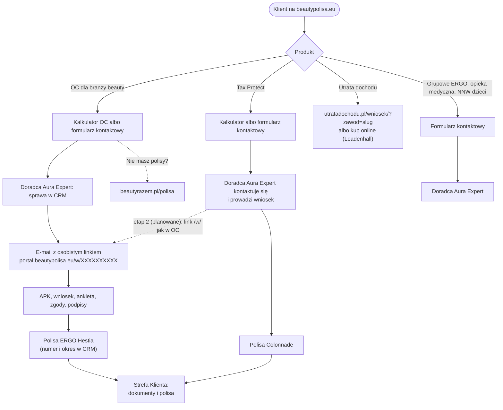

# 12 · Integracja z CRM Aura Expert: analiza potrzeb (APK), wniosek i polisa

| | |
|---|---|
| Wersja | 1.0 (ustalenia z 12.11.2026; do akceptacji zleceniodawcy) |
| Data | 12 listopada 2026 |
| Zakres | Droga klienta od kalkulatora lub formularza na beautypolisa.eu do polisy: lead → doradca → sprawa w CRM Aura Expert → jeden osobisty link `https://portal.beautypolisa.eu/w/<kod>` do APK i wniosku → podpisy → polisa → Strefa Klienta. **Etap 1: wyłącznie OC dla branży beauty.** Etap 2: Tax Protect. Inne produkty z tej ścieżki nie korzystają |
| Decyzja nadrzędna | Zleceniodawca, 12.11.2026: „ta ścieżka (kalkulator lub formularz → doradca → e-mail z osobistym linkiem do APK i wniosku w serwisie portal.beautypolisa.eu → podpis → polisa) dotyczy TYLKO OC na razie, później będzie TAX i nic więcej” |
| Powiązane | `00` (D28, D32–D34 w rejestrze), `02` (2.2 przepływ leada, 4.x bezpieczeństwo, 4.7 RODO, 4.12 tagi), `11` (Strefa Klienta, 7.4 M5, Q8), `snippets/lead-schema.ts` |
| Status | Koncepcja – nic z tego dokumentu nie jest wdrożone. Dokument **nie zmienia CRM**: wymagania wobec CRM i serwisu `portal.beautypolisa.eu` są opisane jako zależności (rozdz. 4.4–4.6) |

> Fakty pochodzą z repozytorium (`01`, `02`, `11`, makiety w `design/v3/`) i z ustaleń zleceniodawcy z 12.11.2026. Czego nie da się z nich wyprowadzić, oznaczono jako **[założenie]** albo **[do weryfikacji]**. Dokument nie zawiera identyfikatorów projektów, kluczy ani prawdziwych kodów – w przykładach kod to zawsze `XXXXXXXXXX`.

## TL;DR

1. **Jedna ścieżka zakupu z osobistym linkiem – tylko dla OC (etap 1), potem także Tax Protect (etap 2).** Klient liczy składkę w kalkulatorze albo zostawia kontakt w formularzu → doradca Aura Expert → e-mail z jednym osobistym linkiem `https://portal.beautypolisa.eu/w/XXXXXXXXXX` → APK, wniosek, ankieta, zgody i podpisy pod tym linkiem → polisa → dokumenty i polisa w Strefie Klienta. Dla OC dodatkowo: „Nie masz polisy? Zarejestruj się na beautyrazem.pl/polisa”.
2. **Pozostałe produkty – bez linku `/w/`.** Tax Protect dziś: kalkulator lub formularz → doradca kontaktuje się i prowadzi wniosek. Utrata dochodu: wniosek na utratadochodu.pl albo zakup online u Leadenhall. Grupowe ERGO, opieka medyczna, NNW dzieci: formularz → doradca. Strony publiczne nie opisują linku `/w/` przy żadnym produkcie poza OC.
3. **Link tworzy wyłącznie doradca w CRM** (sprawa w `crm_renewals`, baza „aurabroker”) i CRM wysyła go wyłącznie na adres z CRM. **Formularz portalu nigdy nie przekierowuje na `/w/<kod>`, nigdy nie pokazuje kodu i odpowiada tak samo dla nowej i istniejącej firmy.**
4. **Portal beautypolisa.eu nie dostaje dostępu do bazy CRM.** Leady trafiają do bazy portalu (02 §2.2), a do CRM – w v1 przez doradcę, później opcjonalnie przez wąski punkt przyjęcia leadów z osobnym sekretem (tylko zapis, bez odczytu). Sprawy i polisy wracają do Strefy Klienta jednokierunkowym, podpisanym przekazem – **bez kodów linków**.
5. **Bezpieczeństwo linku to wymagania wobec `portal.beautypolisa.eu` i CRM:** limity prób, Turnstile, `wazny_do` egzekwowane na serwerze (brak daty = link nieważny), blokada po złożeniu, minimum danych przed potwierdzeniem tożsamości (zalecany kod z e-maila), dłuższe kody (≥ 16 znaków) dla nowych linków, `Referrer-Policy: no-referrer`, `noindex`, brak kodów w analityce i logach. Słabości starszego formularza APK i linków ofert UD w CRM (przegląd 12.11.2026) to ryzyko zależności – osobne zadanie utwardzenia CRM.
6. **Strefa Klienta – „Sprawy w toku”** (tylko właściciel konta z sesją `aal2`): lista spraw OC z CRM i przycisk „Dokończ APK i wniosek”; link pobierany z CRM po stronie serwera w chwili kliknięcia, tylko dla spraw tego konta, nigdy nie zapisywany w bazie portalu.
7. **D28a:** Supabase Auth nie wydaje kodów zapasowych – zamiast nich zachęcamy do dodania drugiej, zapasowej aplikacji TOTP; po utracie wszystkich czynników reset robi doradca Aura Expert po weryfikacji tożsamości.

---

## 1. Cel i zakres

### 1.1 Cel

Ustalić jedną, prawdziwą i bezpieczną drogę od zainteresowania produktem na beautypolisa.eu do polisy – tak, żeby:

- strony publiczne opisywały ją zgodnie z tym, jak naprawdę działa (bez obietnic, których system nie spełnia);
- osobisty link do APK i wniosku nie mógł zostać przechwycony, zgadnięty ani wywołany przez osobę trzecią wpisującą cudze dane do formularza;
- klient z kontem w Strefie Klienta widział swoje sprawy w toku i polisy z CRM, bez kopiowania kodów i danych wniosków do bazy portalu.

### 1.2 Zakres

| W zakresie | Poza zakresem |
|---|---|
| Mapa ścieżek per produkt i treść, którą o nich mówią strony publiczne | Zmiany w CRM Aura Expert i w serwisie `portal.beautypolisa.eu` (tu tylko wymagania) |
| Przepływ lead → CRM → link `/w/<kod>` → polisa → Strefa Klienta | Treść APK, wniosku i ankiety (należą do CRM i ubezpieczyciela) |
| Wymagania bezpieczeństwa wobec linku, CRM i portalu | Naprawa starszego formularza APK z tokenem i linków ofert UD (osobne zadanie utwardzenia, 4.6) |
| Sprawy w toku i polisy z CRM w Strefie Klienta | Płatności online, sprzedaż bez doradcy |
| UTM i pomiar bez danych osobowych i kodów | Moduł `konsultacja.beautypolisa.eu` – **nie jest APK ani wnioskiem** i nie należy do ścieżki zakupu (1.4) |

### 1.3 Słownik

| Pojęcie | Znaczenie w tym dokumencie |
|---|---|
| **APK** | Analiza potrzeb klienta – ustalenie wymagań i potrzeb przed zawarciem umowy, które wypełnia klient pod osobistym linkiem |
| **Sprawa** | Jeden wiersz w CRM (`crm_renewals`): odnowienie albo nowa sprzedaż; do sprawy należy dokładnie jeden link |
| **Link `/w/<kod>`** | `https://portal.beautypolisa.eu/w/<kod>` – jedyny link do APK, wniosku, ankiety, zgód i podpisów danej sprawy; kod dziś ma 10 znaków (`kod_krotki`), ma datę ważności (`wazny_do`) |
| **CRM Aura Expert** | Aplikacja pracy doradców na bazie „aurabroker”; serwis `portal.beautypolisa.eu` to część tej aplikacji, która obsługuje stronę `/w/` po stronie serwera (w audycie: subdomena `portal.` wskazuje na projekt Cloudflare Pages `crmaura` – 01 §6) |
| **Portal** | Nowa aplikacja beautypolisa.eu (Next.js na Cloudflare Workers, własny projekt Supabase – 02) razem ze Strefą Klienta (11) |

### 1.4 Czego ta ścieżka nie obejmuje

- **`konsultacja.beautypolisa.eu` (`/k`, `/w`, baza „BEAUTY”, tabele `konsultacja_*`) to nie jest APK ani wniosek.** Strony portalu, e-maile portalu i makiety nie linkują do tego modułu jako do kroku zakupu. Ścieżka `/w/` na `konsultacja.` i ścieżka `/w/` na `portal.` to różne rzeczy – w dokumentach zawsze podajemy pełną domenę `portal.beautypolisa.eu`. Przegląd repozytorium z 12.11.2026: w dokumentach koncepcji i makietach nie ma odwołań do `konsultacja.` jako ścieżki zakupu (jest tylko na liście istniejących subdomen w 01 i 02 §7.3).
- **Starszy formularz APK z tokenem w CRM** (`apk_forms`, `apk_tokens`, funkcje `get_apk_by_token`, `submit_apk`, `apk_form_by_token`) i **oferty utraty dochodu z linkiem** (`ud_offers.share_token`, `ud_offer_by_token`) nie są częścią tej ścieżki. Opisujemy je wyłącznie jako ryzyko zależności (4.6).

---

## 2. Mapa ścieżek per produkt

### 2.1 Tabela

| Produkt | Wejście na beautypolisa.eu | Co dzieje się dalej | Link `/w/<kod>` | Co mówi strona publiczna |
|---|---|---|---|---|
| **OC dla branży beauty (ERGO Hestia)** | kalkulator `/kalkulator/oc` albo formularz kontaktowy | doradca Aura Expert zakłada sprawę w CRM i wysyła e-mail z osobistym linkiem → APK, wniosek, ankieta, zgody, podpisy → polisa (numer i okres zapisuje CRM) → dokumenty i polisa w Strefie Klienta | **tak – etap 1** | Pełny opis ścieżki (5 kroków, 2.3) oraz „Nie masz polisy? Zarejestruj się na beautyrazem.pl/polisa” (`https://beautyrazem.pl/polisa`) |
| **Tax Protect (Colonnade)** | kalkulator (taryfa – 02 §2.3) albo formularz kontaktowy | **dziś:** doradca Aura Expert kontaktuje się z klientem i prowadzi wniosek | **nie dziś; planowane w etapie 2** (opis tylko w dokumentacji) | „Policz składkę albo zostaw kontakt – doradca Aura Expert skontaktuje się z Tobą i poprowadzi wniosek.” **Bez wzmianki o linku `/w/`** |
| **Utrata dochodu** | strona `/ubezpieczenia/utrata-dochodu` (treść z utratadochodu.pl, bez kwot składek) | wniosek na `https://utratadochodu.pl/wniosek/?zawod=<slug>` albo zakup online okresowej niezdolności u Leadenhall: `https://utratadochodu.pl/kup-online?z=beautypolisa` | **nie** (ani teraz, ani w etapie 2) | Linki do utratadochodu.pl |
| **Grupowe ERGO dla beauty** | formularz kontaktowy | doradca Aura Expert | **nie** | „Zostaw kontakt – doradca się odezwie” |
| **Opieka medyczna (ENEL-MED / LUX MED)** | formularz kontaktowy | doradca Aura Expert | **nie** | jw. (abonament, nie ubezpieczenie – 02 F1) |
| **NNW dzieci** | formularz kontaktowy („zapytaj o ofertę”) | doradca Aura Expert | **nie** | jw. |

Zasada redakcyjna: opis „e-mail z osobistym linkiem do APK i wniosku w serwisie portal.beautypolisa.eu” pojawia się **wyłącznie** na stronach i w treściach OC (strona produktu, kalkulator, FAQ OC, e-mail potwierdzenia leada OC). Rozszerzenie na Tax Protect następuje dopiero decyzją o starcie etapu 2 (D32) – wcześniej żadna strona publiczna Tax Protect go nie wspomina.

### 2.2 Diagram



### 2.3 Treść ścieżki OC na stronach publicznych (wzorzec)

Pięć kroków, prostym językiem (do strony OC, kalkulatora i FAQ OC):

1. **Policz składkę albo zostaw kontakt.** Kalkulator pokazuje składkę roczną wg taryfy programu.
2. **Doradca Aura Expert sprawdza dane** i odzywa się do Ciebie.
3. **Dostajesz e-mail z osobistym linkiem** do analizy potrzeb i wniosku. Link zawsze prowadzi do `portal.beautypolisa.eu` – innej domenie nie ufaj. Link jest tylko dla Ciebie: nie przekazuj go innym. Ma datę ważności – po niej poproś doradcę o nowy.
4. **Wypełniasz i podpisujesz** analizę potrzeb i wniosek pod tym linkiem.
5. **Dostajesz polisę.** Dokumenty i polisa są też w Strefie Klienta.

„Nie masz polisy? Zarejestruj się na beautyrazem.pl/polisa.”

Na stronach publicznych **nigdy** nie ma przykładowego linku z kodem, przycisku „przejdź do wniosku” ani formularza „wpisz kod”. Wzór adresu pokazujemy najwyżej jako tekst `portal.beautypolisa.eu` (sama domena), żeby klient wiedział, gdzie ma trafić.

---

## 3. Przepływ techniczny

### 3.1 Sekwencja

```mermaid
sequenceDiagram
  autonumber
  actor K as Klient
  participant P as beautypolisa.eu (Worker)
  participant DB as Supabase portalu
  participant D as Doradca Aura Expert
  participant CRM as CRM Aura Expert (aurabroker)
  participant W as portal.beautypolisa.eu
  participant S as Strefa Klienta

  K->>P: kalkulator / formularz (Turnstile, Zod, honeypot, limity)
  P->>DB: app_create_lead() – transakcja, deduplikacja, przeliczenie składki
  P-->>K: zawsze ta sama odpowiedź: "Dziękujemy, numer zgłoszenia BP-…"
  DB-->>D: e-mail do zespołu (outbox) + lista w /panel
  D->>CRM: sprawa w crm_renewals (OC; odnowienie albo nowa sprzedaż), link i wazny_do
  D->>P: /panel: zdarzenie exported_to_crm (bez PII)
  CRM->>K: e-mail na adres z CRM: portal.beautypolisa.eu/w/XXXXXXXXXX
  CRM->>K: przypomnienia (przypomniano_at, mail_ostatni_dzien_at)
  K->>W: GET /w/XXXXXXXXXX – strona neutralna, bez danych sprawy
  K->>W: POST: kod z e-maila (zalecane, 4.4)
  K->>W: APK, wniosek, ankieta, zgody; podpis APK i wniosku
  W->>CRM: apk, wniosek, ankieta, zgody, podpis_apk_at, podpis_wniosku_at, zlozono_at
  D->>CRM: polisa wystawiona: nr_polisy, polisa_id, okres
  CRM->>S: podpisany przekaz (sprawy w toku, polisy) – bez kodów i bez treści wniosków
```

### 3.2 Krok po kroku

**1. Formularz lub kalkulator portalu (beautypolisa.eu).** Obsługa po stronie serwera na Workerze – w 02 §2.2 jako route handler `POST /api/leads`; Server Action jest dopuszczalna jako cienka nakładka na tę samą funkcję, z tymi samymi warstwami. Warstwy od najtańszej: honeypot na surowym JSON → idempotencja → rate limit (reguła Cloudflare + binding w Workerze) → walidacja Zod (`LeadInput`, `snippets/lead-schema.ts`) → Turnstile (`action: "lead"`, sprawdzane `hostname` i `action`) → zapis funkcją `app_create_lead(jsonb)`. Składkę OC i Tax Protect przelicza serwer z aktywnej wersji taryfy (02 §2.3).

**2. Odpowiedź formularza.** Zawsze `201 {status:"created", reference, …}` – ta sama dla nowego leada, duplikatu, trafienia honeypota (02 §2.2 pkt 9) **oraz dla firmy, która ma już sprawę lub polisę w CRM** (portal i tak tego nie wie – 3.3). Komunikat: „Dziękujemy. Doradca Aura Expert skontaktuje się z Tobą. Numer zgłoszenia: BP-…”. **Bez przekierowania, bez linku `/w/`, bez informacji o istniejących sprawach.**

**3. Potwierdzenie e-mailem (portal).** Szablon `lead_client` jest transakcyjny (02 §2.2 pkt 11): potwierdzenie, numer zgłoszenia, dane dystrybutora (IDD), klauzula informacyjna, kontakt. Dla OC – akapit „Co dalej” z krokami z 2.3 i zdaniem „Osobisty link do analizy potrzeb i wniosku wyślemy z adresu Aura Expert; zawsze prowadzi do portal.beautypolisa.eu”. **Szablon portalu nigdy nie zawiera linku `/w/`.** Najwyżej jedno potwierdzenie na adres na 24 h.

**4. Lead trafia do CRM.** Stan z 02: leady zapisuje wyłącznie baza portalu; zespół dostaje e-mail i pracuje w `/panel`; przekazanie do CRM to zdarzenie `exported_to_crm` w `lead_events` (`payload.recipient = "crm-aura"`, bez PII), a interfejs przekazu jest pytaniem otwartym (02, pytanie 5). Leady **nie** idą dziś przez bazę „BEAUTY” – tabela `crm_lead_intake` w „BEAUTY” (INSERT dla `anon` tylko z `rodo = true`, `processed = false`, `status = 'nowy'` – 01 §5.2) jest wzorcem uprawnień, nie elementem tej ścieżki. Warianty:

| Wariant | Opis | Uprawnienia | Ocena |
|---|---|---|---|
| **A. Ręcznie (v1)** | Doradca otwiera lead w `/panel`, zakłada sprawę w CRM, oznacza `exported_to_crm` | Portal nie ma żadnego dostępu do CRM; CRM nie ma dostępu do portalu | **v1** – zero nowych połączeń między systemami |
| **B. Punkt przyjęcia leadów w CRM (później)** | Worker `beautypolisa-jobs` wysyła lead z outboxu do **osobnego punktu przyjęcia** w CRM (funkcja HTTP albo funkcja bazy wywoływana przez wąską rolę) | Osobny sekret tylko do tego celu (podpis HMAC z `timestamp + nonce + body`, okno ±5 min, jak 11 §7.4 M5); punkt przyjęcia **tylko dopisuje** wiersz do kolejki leadów ze statusem „nowy” i zwraca `202` bez treści; **brak odczytu**, brak dopasowania do istniejących firm, brak tworzenia sprawy i linku | Po decyzji Q1 (rozdz. 8). Ten sam wynik `202` dla każdego poprawnego żądania |
| C. Klucz serwisowy „aurabroker” w Workerze portalu | Portal pisze bezpośrednio do tabel CRM | Pełny dostęp do bazy CRM (158 tabel) z publicznej aplikacji | **Odrzucone** – sprzeczne z 02 (decyzja 2 i 3) i z izolacją skutków incydentu |

**5. Doradca tworzy sprawę i link.** W CRM: `rodzaj` (odnowienie albo nowa sprzedaż), dane klienta, `program`, `tu_nazwa`, `suma`, `skladka`, okres, `wazny_do`, `kod_krotki`. Doradca **weryfikuje**, czy osoba z leada to ta sama osoba co w CRM (np. telefon zwrotny na numer z CRM), zanim połączy lead z istniejącą firmą – lead z formularza nie dowodzi tożsamości. **Etap 1: sprawy z linkiem tylko dla OC** (słownik wartości, które oznaczają OC, uzgadnia zespół CRM – [do weryfikacji]: czy produkt wynika z `program`, `tu_nazwa` czy `rodzaj`).

**6. E-mail z linkiem (CRM).** Wysyła CRM na adres zapisany w sprawie (`email`), nie na adres wpisany w formularzu portalu, dopóki doradca go nie potwierdził. Wymagania wobec treści i wysyłki – 4.5 (R-CRM-8 do R-CRM-10).

**7. APK, wniosek, podpisy (`portal.beautypolisa.eu`).** Klient wypełnia APK, wniosek, ankietę i zgody, podpisuje APK i wniosek; CRM zapisuje `apk`, `wniosek`, `ankieta` (jsonb), `zgody`, `zalaczniki`, `apk_odmowa`, `apk_at`, `podpis_apk_at`, `podpis_wniosku_at`, `zlozono_at`, `pdf_path`. Forma podpisu jest po stronie CRM – [do weryfikacji] (rozdz. 8, Q9).

**8. Polisa.** Po wystawieniu polisy CRM zapisuje `nr_polisy`, `polisa_id` i okres (`okres_od`, `okres_do`).

**9. Strefa Klienta.** Jednokierunkowy przekaz z CRM (rozdz. 5) aktualizuje „Sprawy w toku” i polisy na koncie klienta. Konto w Strefie zakłada personel (11 §4.1) – link `/w/` nie tworzy konta.

### 3.3 Dlaczego portal nie łączy leada z CRM automatycznie

Gdyby formularz portalu po wpisaniu NIP albo e-maila sam odszukał firmę w CRM i przekierował na `/w/<kod>` (albo wysłał link), każdy, kto zna NIP salonu – a NIP jest publiczny – mógłby otworzyć sprawę istniejącej firmy i zobaczyć jej dane, albo zasypać ją e-mailami. Dlatego:

- formularz **nigdy** nie przekierowuje na `/w/<kod>` i nigdy nie zwraca kodu, także po stronie serwera w nagłówku `Location`;
- odpowiedź formularza nie zależy od tego, czy firma jest w CRM (brak enumeracji klientów);
- kod trafia do klienta **wyłącznie e-mailem na adres z CRM**, wysłanym przez CRM po decyzji doradcy;
- portal nie odpytuje CRM po NIP ani po e-mailu (nie ma takiego połączenia).

---

## 4. Bezpieczeństwo

### 4.1 Model zagrożeń (STRIDE, w skrócie)

| Kategoria | Zagrożenie | Kontrola |
|---|---|---|
| **S** – podszycie | Fałszywe e-maile z linkiem do obcej domeny (phishing „BeautyPolisa”); osoba trzecia wpisuje cudzy NIP lub e-mail do formularza | Link zawsze w `portal.beautypolisa.eu` i strony publiczne to mówią (2.3); DKIM/SPF/DMARC dla domeny nadawcy (R-CRM-9); formularz bez przekierowań i bez dopasowania do CRM (3.3) |
| **T** – manipulacja | Zmiana danych wniosku po podpisie; podmiana `wazny_do` | Blokada po złożeniu (R-W5); `wazny_do` tylko po stronie serwera (R-W4) |
| **R** – wyparcie | Spór o to, kto podpisał APK i wniosek | Znaczniki `podpis_apk_at`, `podpis_wniosku_at`, kod z e-maila przed podpisem (R-W6), dziennik zdarzeń sprawy w CRM bez kodu (R-W12) |
| **I** – ujawnienie | Zgadnięcie kodu; wyciek kodu przez nagłówek `Referer`, analitykę, logi, historię przeglądarki, przekazany e-mail, skanery linków; odczyt danych po złożeniu | 4.2–4.4: długość i losowość kodu, limity, `no-referrer`, wykluczenia z analityki i logów, kod z e-maila przed pokazaniem danych, blokada po złożeniu |
| **D** – odmowa usługi | Masowe zgadywanie kodów; wysyłka kodów z e-maila w pętli | Limity na IP i kod, Turnstile przed wysłaniem kodu, globalny alert (R-W2, R-W3) |
| **E** – podniesienie uprawnień | Funkcje `SECURITY DEFINER` wywoływalne przez `anon` w „aurabroker”; dostęp portalu do CRM | Strona `/w/` obsługiwana na serwerze aplikacji, bez funkcji bazy dla `anon` (R-W10); portal bez kluczy CRM (3.2 pkt 4, rozdz. 5) |

### 4.2 Kod w linku – ile znaków wystarczy

Dziś kod ma 10 znaków. Siła kodu zależy od alfabetu, którego nie znamy [do weryfikacji w CRM]:

| Kod | Alfabet | Przestrzeń | Bity |
|---|---|---|---|
| 10 znaków (dziś) | 32 znaki (np. bez znaków mylących) | 32¹⁰ ≈ 1,1 × 10¹⁵ | 50 |
| 10 znaków (dziś) | 62 znaki (a–z, A–Z, 0–9) | 62¹⁰ ≈ 8,4 × 10¹⁷ | ≈ 59,5 |
| **16 znaków (zalecane dla nowych linków)** | 32 znaki | 32¹⁶ ≈ 1,2 × 10²⁴ | 80 |

Atakujący nie musi trafić konkretnego kodu – wystarczy dowolny aktywny. Przy N aktywnych linkach i G próbach prawdopodobieństwo trafienia ≈ N · G / przestrzeń. Przykład: 500 aktywnych linków i 10 milionów prób (rozproszony botnet przez miesiąc, gdyby limity zawiodły) przy 50 bitach daje ≈ 4 × 10⁻⁶; przy 80 bitach ≈ 4 × 10⁻¹⁵. Dziesięć znaków jest więc akceptowalne **pod warunkiem** działających limitów (R-W2); 16 znaków usuwa tę zależność. Zalecenie: **nowe linki ≥ 16 znaków** z kryptograficznego generatora liczb losowych, istniejące 10-znakowe – do wygaśnięcia (rozdz. 8, Q3).

### 4.3 Wymagania wobec strony `/w/<kod>` (serwis `portal.beautypolisa.eu`)

| ID | Wymaganie | Uzasadnienie |
|---|---|---|
| R-W1 | Kod generowany kryptograficznie losowo (np. `crypto.getRandomValues` lub `gen_random_bytes`), unikalny, nigdy nie wyprowadzany z identyfikatora sprawy, NIP, daty ani e-maila; nigdy nie używany ponownie | Brak przewidywalności |
| R-W2 | **Limity prób:** na adres IP (np. ≤ 20 nieudanych wejść na `/w/*` w 10 min → zarządzane wyzwanie Cloudflare, potem blokada czasowa) i na kod (≤ 5 błędnych kodów z e-maila → link zablokowany do decyzji doradcy) [wartości – założenie]; alert przy skoku liczby odpowiedzi „link nieaktywny” (oznaka zgadywania). Na planie Cloudflare Free jest jedna reguła rate limit (02 §1.3) – trzeba ją rozszerzyć o host `portal.` i ścieżkę `/w/*` albo liczyć limity w aplikacji [do weryfikacji, czy Pages Functions mają binding rate limit] | 4.2; ochrona przed zgadywaniem |
| R-W3 | **Turnstile** przed wysłaniem kodu z e-maila i przed sprawdzeniem kodu (weryfikacja `hostname` i `action` po stronie serwera, jak 02 §2.2 pkt 5) | Boty nie wysyłają e-maili w pętli i nie zgadują kodów |
| R-W4 | **`wazny_do` egzekwowany po stronie serwera przy każdym żądaniu** (wyświetlenie, zapis, podpis). `wazny_do` **puste = link nieważny** (nie „bez końca”); górna granica ważności nowego linku [założenie: 30 dni], przedłużenie tylko przez doradcę | Przegląd 12.11.2026 wykazał w starszym formularzu, że `NULL` oznaczał „bez końca” (4.6) |
| R-W5 | **Blokada po złożeniu:** po `zlozono_at` strona nie pokazuje danych APK, wniosku ani ankiety i nie przyjmuje zmian – tylko komunikat „Wniosek złożony. Dokumenty dostaniesz od doradcy i w Strefie Klienta”. Link wygasa po złożeniu (najpóźniej po dniach potrzebnych na poprawki ustalone z doradcą [założenie: 7 dni]) | Starszy formularz zwracał cały formularz także po wysłaniu (4.6) |
| R-W6 | **Minimum danych przed potwierdzeniem tożsamości.** `GET /w/<kod>` pokazuje tylko: nazwę produktu, termin ważności linku, dane Aura Expert (IDD) i przycisk „Wyślij mi kod”. **Zalecane: sześciocyfrowy kod z e-maila** (na adres z CRM, ważny 10 min, ≤ 5 prób, ≤ 3 kody na godzinę na sprawę) przed pokazaniem jakichkolwiek danych sprawy (imię, firma, NIP, suma, składka, wcześniejsze odpowiedzi) i obowiązkowo przed podpisem. Po kodzie – krótka sesja w ciasteczku `__Host-…; HttpOnly; Secure; SameSite=Lax` (bezczynność ≤ 30 min [założenie]) | Link w e-mailu może trafić do osoby trzeciej (przekazanie, wspólna skrzynka recepcji, historia przeglądarki, skaner poczty); kod z e-maila dowodzi dostępu do skrzynki w chwili użycia – ten sam wzorzec co zaproszenia w Strefie (11 §4.2) |
| R-W7 | **`GET` niczego nie zmienia.** Skanery linków w poczcie (np. ochrona linków w Microsoft 365) otwierają adres automatycznie. Dlatego `otwarto_at` zapisujemy dopiero po działaniu człowieka (kliknięcie „Wyślij mi kod” – `POST`), a nie przy samym wejściu | Inaczej stan „otwarto” jest zawyżony, a skaner mógłby wyzwolić skutki uboczne |
| R-W8 | **Jedna, neutralna odpowiedź** dla kodu nieistniejącego, wygasłego, zablokowanego i anulowanego: ten sam status HTTP (`404`), ta sama treść („Ten link jest nieaktywny. Jeśli dostałeś go od doradcy Aura Expert, poproś o nowy”), podobny czas odpowiedzi | Brak potwierdzania, że kod istniał |
| R-W9 | **Nagłówki** na wszystkich odpowiedziach `/w/*`: `Referrer-Policy: no-referrer`; `Cache-Control: no-store, private`; `X-Robots-Tag: noindex, nofollow, noarchive`; CSP bez `unsafe-inline` dla skryptów, `frame-ancestors 'none'`, `form-action 'self'`, `connect-src` tylko własny host i Turnstile; `X-Content-Type-Options: nosniff`; `Strict-Transport-Security` (HSTS w strefie – 02 §4.3); `Cross-Origin-Opener-Policy: same-origin`; `Permissions-Policy` jak `snippets/security-headers.http`. Strona `/w/` **nie ładuje zasobów z obcych domen** (fonty, CDN, piksele) – każde żądanie do obcej domeny to potencjalny wyciek adresu | Kod nie wycieka nagłówkiem `Referer`, z cache ani przez osadzenie |
| R-W10 | Obsługa `/w/` wyłącznie po stronie serwera aplikacji (zgodnie z ustaleniem: żadna funkcja bazy nie odwołuje się do `kod_krotki`); **nie dodawać** funkcji bazy wywoływalnej przez `anon` z kodem jako argumentem; zapytanie zwraca tylko kolumny potrzebne na danym kroku, filtrowane po `tenant_id` | Funkcje `SECURITY DEFINER` dla `anon` to główny problem „aurabroker” w audycie (01 §5.1) |
| R-W11 | **`noindex` zamiast blokady w `robots.txt`** dla `/w/`: przy `Disallow` wyszukiwarka nie przeczyta `noindex` i może pokazać sam adres (z kodem), jeśli gdzieś wycieknie; przy `X-Robots-Tag: noindex` robot widzi tylko neutralną stronę z R-W6 i jej nie indeksuje | Kody nie trafiają do wyników wyszukiwania |
| R-W12 | **Logi bez kodów:** ścieżka logowana jako `/w/[kod]` (normalizacja przed zapisem w logach aplikacji, Workers/Pages Logs, Sentry – `beforeSend` usuwa kod z adresu i nagłówka `Referer`); dziennik zdarzeń sprawy w CRM zapisuje identyfikator sprawy, nie kod. Dostęp do analityki HTTP Cloudflare (pokazuje ścieżki) – tylko osoby, które i tak mają dostęp do CRM | Kod to sekret na okaziciela |
| R-W13 | **Brak kodów w analityce:** `/w/*` na hoście `portal.beautypolisa.eu` wyłączone z Zaraz (GA4, piksele), z kolektora Aura i z każdego innego tagu – także po zgodzie. Zaraz działa na poziomie strefy `beautypolisa.eu`, więc wykluczenie hosta `portal.` i ścieżki `/w/*` musi być w regułach wyzwalania Zaraz [do weryfikacji w konfiguracji] | Adres strony w GA4 zawierałby kod |
| R-W14 | Formularze `/w/` chronione tokenem CSRF i sprawdzeniem `Origin`; limit rozmiaru ciała; załączniki (`zalaczniki`) – lista typów, limit rozmiaru, sprawdzenie sygnatury pliku, prywatny magazyn | Standard formularzy (02 §4.4) |

### 4.4 Wymagania wobec portalu beautypolisa.eu (nasza aplikacja)

| ID | Wymaganie |
|---|---|
| R-P1 | Formularz i kalkulator nigdy nie przekierowują na `/w/<kod>`, nie zwracają kodu ani adresu z kodem i nie wyświetlają pola „wpisz kod” |
| R-P2 | Odpowiedź formularza identyczna dla nowej i istniejącej firmy, duplikatu i honeypota (3.2 pkt 2) |
| R-P3 | Portal nie przechowuje kodów linków – ani w bazie, ani w logach, ani w cache; nie ma dostępu do bazy CRM |
| R-P4 | Strony publiczne opisują link `/w/` wyłącznie przy OC (2.1); nigdy nie publikują przykładowego linku z kodem innym niż `XXXXXXXXXX` w dokumentacji |
| R-P5 | E-maile portalu (potwierdzenie leada, przypomnienia o odnowieniu ze Strefy) nie zawierają linku `/w/`; przypomnienie o odnowieniu kieruje do Strefy Klienta albo do doradcy |
| R-P6 | Trasa „Dokończ APK i wniosek” w Strefie Klienta (5.3) wyłączona z kolektora analityki, Zaraz i przechwytywania adresów w Sentry; odpowiedź `303` z `Cache-Control: no-store` i `Referrer-Policy: no-referrer` |
| R-P7 | Linki wychodzące do `portal.beautypolisa.eu` z portalu (jeśli w ogóle – tylko z 5.3) z `rel="noreferrer"` |

### 4.5 Wymagania wobec CRM Aura Expert

| ID | Wymaganie |
|---|---|
| R-CRM-1 | Sprawa z linkiem `/w/` tylko dla OC (etap 1), a od decyzji o etapie 2 także dla Tax Protect; inne produkty – blokada w CRM (lista dozwolonych wartości, nie lista zakazanych) |
| R-CRM-2 | Nowe kody ≥ 16 znaków (4.2), generowane kryptograficznie; najlepiej przechowywane jako skrót (np. SHA-256) z wyszukiwaniem po skrócie [do decyzji: przypomnienia i „Dokończ” ze Strefy wymagają wtedy wydania nowego kodu zamiast ponownego wysłania starego – Q3] |
| R-CRM-3 | `wazny_do` obowiązkowe przy tworzeniu linku (`NOT NULL` + `CHECK` na górną granicę); przypomnienia nie przedłużają ważności |
| R-CRM-4 | Unieważnienie kodu: po złożeniu (R-W5), po wygaśnięciu, po anulowaniu sprawy przez doradcę, po przekroczeniu limitu błędnych kodów z e-maila; nowy link = nowy kod |
| R-CRM-5 | Dane sprawy dla klienta tylko po stronie serwera, filtrowane po `tenant_id` i kodzie; żadnej funkcji bazy z kodem dla `anon` (R-W10) |
| R-CRM-6 | Przekaz do Strefy Klienta (rozdz. 5): podpisany, jednokierunkowy, bez kodów i bez treści `apk`/`wniosek`/`ankieta` |
| R-CRM-7 | Punkt „Dokończ” dla Strefy (5.3): zwraca link tylko dla sprawy należącej do wskazanego klienta (`klient_id`), aktywnej i ważnej; uwierzytelniony osobnym sekretem portalu; zwraca wyłącznie adres w domenie `portal.beautypolisa.eu` |
| R-CRM-8 | E-mail z linkiem: wyłącznie na adres z CRM; temat i treść bez danych wrażliwych (imię, produkt, termin ważności – bez NIP, sumy, składki); zdania „Link prowadzi wyłącznie do portal.beautypolisa.eu”, „Nie przekazuj go innym”, „Aura Expert nigdy nie poprosi Cię o ten link ani o kod przez telefon”; dane Aura Expert (IDD) w stopce |
| R-CRM-9 | Nadawca z domeny z SPF, DKIM i DMARC (domena wysyłkowa `send.` w Resend ma DKIM – 01 §6); docelowo DMARC `p=quarantine`/`reject` [do weryfikacji: czym wysyła CRM] |
| R-CRM-10 | **Bez śledzenia kliknięć i przepisywania linków** w e-mailach z linkiem `/w/` (np. wyłączone śledzenie kliknięć w Resend dla tych wiadomości – inaczej adres z kodem przechodzi przez domenę śledzącą `links.` i trafia do logów dostawcy) i bez parametrów UTM w linku z kodem |
| R-CRM-11 | Dziennik zdarzeń sprawy (utworzenie, wysyłka, otwarcie, kod z e-maila, podpisy, złożenie, unieważnienie) z identyfikatorem sprawy, bez kodu; dostęp do spraw w CRM tylko dla doradców z MFA |
| R-CRM-12 | Retencja i usuwanie danych spraw zgodnie z 4.7 |

### 4.6 Ryzyka zależności (przegląd 12.11.2026) – wymagania wobec CRM, nie naprawa

W bazie „aurabroker” działają dwa starsze mechanizmy linków. **Nie są częścią ścieżki z tego dokumentu**, ale dzielą bazę, domenę i zaufanie klientów do linków od Aura Expert – incydent w nich uderzy też w ścieżkę `/w/`. Zgłoszone jako **osobne zadanie utwardzenia CRM**; tu opisujemy je jako ryzyko i warunki.

| Ryzyko | Stan (przegląd 12.11.2026) | Skutek | Wymaganie wobec CRM |
|---|---|---|---|
| Z1 | Starszy formularz APK z tokenem (`apk_forms`, `apk_tokens`; funkcje `get_apk_by_token`, `submit_apk`, `apk_form_by_token` – `SECURITY DEFINER`, wywoływalne przez `anon`). `apk_form_by_token` zwraca **cały formularz także po wysłaniu**; sprawdza tylko ważność, a **`NULL` = bez końca**; tokeny mają **12 znaków** | Kto ma lub zgadnie token, czyta dane APK bezterminowo; funkcje dostępne kluczem `anon` omijają limity aplikacji | Odebrać `EXECUTE` dla `anon`/`PUBLIC` albo przenieść obsługę na serwer; po wysłaniu – brak zwrotu treści; `NULL` = nieważny; nowe tokeny ≥ 16 znaków; wygaszenie mechanizmu, jeśli zastępuje go `/w/` |
| Z2 | Oferty utraty dochodu z linkiem (`ud_offers.share_token`, `ud_offer_by_token`) **bez daty ważności**; **51 linków** zwraca **cały rekord** | Stałe, publiczne linki do pełnych rekordów ofert | Data ważności i unieważnianie; funkcja zwraca tylko pola potrzebne do wyświetlenia; przegląd, czy 51 aktywnych linków jest nadal potrzebnych |
| Z3 | Baza współdzielona przez wiele modułów (158 tabel, 21 funkcji `SECURITY DEFINER` dla `anon`, 15 z mutowalnym `search_path` – 01 §5.1) | Błąd w innym module może ujawnić dane spraw `crm_renewals` | Przegląd uprawnień do `crm_renewals` (RLS, granty kolumnowe); Security Advisor po każdej migracji CRM; docelowo izolacja danych spraw |
| Z4 | `portal.beautypolisa.eu` utrzymywany poza repozytorium portalu (projekt Pages `crmaura` – 01 §6) | Wymagania 4.3 nie są sprawdzane przez nasze CI | Właściciel serwisu, lista kontrolna R-W1–R-W14 przed startem etapu 1, test nagłówków po każdym wdrożeniu (Q2) |

**Warunek startu etapu 1 (propozycja):** R-W2, R-W4, R-W5, R-W8, R-W9, R-W12, R-W13 i R-CRM-3, R-CRM-8, R-CRM-10 spełnione; Z1 i Z2 co najmniej z odebranym dostępem `anon` do pełnych rekordów albo z udokumentowaną akceptacją ryzyka przez zleceniodawcę.

### 4.7 RODO

| Dane | Gdzie | Podstawa prawna [do potwierdzenia z IOD] | Minimalizacja | Retencja [założenie] |
|---|---|---|---|---|
| Lead (kontakt, kontekst produktu) | baza portalu | art. 6 ust. 1 lit. b RODO – działania przed zawarciem umowy na żądanie osoby (02 §4.7) | zakres z `LeadInput`; bez danych z CRM | jak 02 §4.7 (90 dni od `exported_at` albo 12 mies. bez konwersji) |
| APK (wymagania i potrzeby) | CRM (`apk`, `apk_odmowa`) | art. 6 ust. 1 lit. c RODO w związku z obowiązkiem ustalenia wymagań i potrzeb klienta przez dystrybutora (ustawa o dystrybucji ubezpieczeń) | tylko pytania wymagane do analizy | okres wymagany do wykazania należytej dystrybucji i obrony roszczeń – do ustalenia z IOD |
| Wniosek, ankieta, zgody, załączniki | CRM | art. 6 ust. 1 lit. b (zawarcie umowy); zgody marketingowe – lit. a i art. 398 PKE, osobno per kanał | ankieta OC tylko z pytaniami ubezpieczyciela; **bez danych o zdrowiu** (art. 9) – jeśli ankieta ich wymaga, osobna ocena [do weryfikacji] | sprawy niezłożone: usunięcie treści `apk`/`wniosek`/`ankieta`/`zalaczniki` po 90 dniach od `wazny_do` [założenie]; złożone – jak APK |
| Projekcja sprawy w Strefie (`client_cases`, 5.2) | baza portalu | art. 6 ust. 1 lit. b i f (obsługa klienta w koncie) | bez kodu, bez treści wniosków, bez e-maila | 90 dni po zamknięciu sprawy [założenie] |
| Polisy z CRM w Strefie | baza portalu | art. 6 ust. 1 lit. b | jak 11 §7.1 | jak 11 |

- **Administrator:** Aura Expert sp. z o.o. (agent ubezpieczeniowy, RPU 11229690/A); IOD: iod@auraexpert.pl. **Odbiorcy:** ubezpieczyciel – ERGO Hestia (OC), w etapie 2 Colonnade (Tax Protect) – jako odrębni administratorzy; klauzula informacyjna na stronie `/w/` i w `/rodo` wymienia ich z nazwy.
- **Podmioty przetwarzające** ścieżki `/w/`: Cloudflare (Pages/Workers, logi), Supabase (baza „aurabroker”), dostawca e-mail CRM – w rejestrze czynności i w `/rodo` [do uzupełnienia przez IOD].
- **Prawa osób:** wniosek z art. 15/17 złożony w portalu (02 §4.7) obejmuje też dane w CRM – procedura przekazania do zespołu CRM.
- **Ocena skutków (DPIA):** IOD ocenia, czy APK i wnioski online w bazie współdzielonej (4.6 Z3) wymagają DPIA [do decyzji IOD].

---

## 5. Strefa Klienta: sprawy w toku i polisy z CRM

### 5.1 Co widzi kto

| Rola (11 §3) | Sprawy w toku | Polisy z CRM |
|---|---|---|
| **Właściciel konta salonu** (sesja `aal2`) | ✓ lista spraw OC swojego konta (w etapie 2 także Tax Protect) i przycisk „Dokończ APK i wniosek” | ✓ opublikowane polisy wszystkich produktów (D-A w 11) |
| Pracownik salonu | – | – (jak dziś w 11) |
| Pracodawca bez polisy, osoba szukająca pracy, organizator | – | – |
| Personel Aura w `/panel` | stan synchronizacji i kolejka konfliktów (bez treści APK i wniosków); sprawy prowadzi w CRM | ✓ jak 11 (publikacja, dokumenty) |

Sesja `aal1` (bez TOTP) widzi pustą listę – wymóg egzekwuje baza przez `client_account_ids('owner')` (11 §9), nie interfejs.

### 5.2 Synchronizacja CRM → portal

- **Kierunek jeden:** CRM → portal. Portal nie zapisuje niczego w CRM poza opcjonalnym przekazem leadów (3.2 pkt 4, wariant B).
- **Wzorzec jak 11 §7.4 M5**, z jedną zmianą: **źródłem jest CRM Aura Expert w „aurabroker” (`crm_renewals`), a nie CRM w „BEAUTY”**. Wyzwalacz w CRM (np. Database Webhook / `pg_net`) wysyła zdarzenie na `POST /api/internal/crm/cases` i `POST /api/internal/crm/policies` portalu; podpis HMAC z `timestamp + nonce + body`, okno ±5 min, nonce pamiętane 10 min, limit częstotliwości; sekret w Supabase Vault po stronie CRM. Portal nie przechowuje kluczy do „aurabroker”, CRM nie dostaje kluczy portalu.
- **Dopasowanie do konta wyłącznie po `crm_ref`** (`client_accounts.crm_ref` = `crm_renewals.klient_id`; polisa – `client_policies.crm_ref` = `polisa_id`) ustawionym przez personel przy zakładaniu konta (11 §4.1). **Nigdy po e-mailu ani NIP** – zdarzenie bez dopasowania trafia do kolejki konfliktów w `/panel`, nie tworzy konta.
- **Filtr produktów na obu końcach:** CRM wysyła sprawy tylko dla produktów z listy dozwolonej (etap 1: OC), portal odrzuca inne (`422`, wpis w dzienniku). Polisy – wszystkie produkty (D-A).
- **Polisy:** przekaz może tworzyć lub zmieniać tylko **nieopublikowane** polisy; publikuje personel w `/panel` (11 M5). Numer i okres pochodzą z CRM (`nr_polisy`, `polisa_id`, `okres_od`, `okres_do`).
- **Projekcja spraw w portalu** – nowa tabela `client_cases` (do dodania w `snippets/strefa-klienta.sql` razem z przekazem; FORCE RLS, odczyt tylko `client_account_ids('owner')`, zapis tylko funkcją `service_role`):

| Kolumna | Opis |
|---|---|
| `id`, `account_id` | klucz i konto (→ `client_accounts`) |
| `crm_case_ref` | identyfikator sprawy w CRM (unikalny, tylko personel i funkcje) |
| `product` | `oc-beauty` (etap 2: `tax-protect`) – `CHECK` z listą dozwoloną |
| `kind` | `odnowienie` / `nowa` |
| `stage` | `wyslano` / `otwarto` / `apk` / `zlozono` / `polisa` / `wygasla` / `anulowana` – wyliczany w CRM z `wyslano_at`, `otwarto_at`, `apk_at`, `zlozono_at`, `polisa_id` |
| `link_valid_until` | kopia `wazny_do` (tylko do wyświetlenia; ważność egzekwuje CRM) |
| `updated_at`, `crm_event_at` | kolejność zdarzeń (odrzucanie starszych) |

**Czego tabela nie ma:** kodu, adresu linku, e-maila, treści `apk`/`wniosek`/`ankieta`, `suma`, `skladka`.

### 5.3 „Sprawy w toku” i przycisk „Dokończ APK i wniosek”

Ekran (pulpit właściciela): karta na sprawę – produkt, „Odnowienie” albo „Nowa polisa”, stan („Wysłano link”, „Otwarto”, „Analiza potrzeb wypełniona”, „Wniosek złożony”), „Link ważny do …”. Przy stanach przed złożeniem – przycisk **„Dokończ APK i wniosek”**; przy wygasłym linku – „Poproś doradcę o nowy link” (tworzy lead „odnowienie” z kontekstem konta, jak P5 w 11 §6.2).

Przepływ przycisku:

1. Przycisk to formularz `POST` (Server Action z ochroną CSRF Next.js) z identyfikatorem karty – **nie** zwykły link z kodem w HTML.
2. Serwer sprawdza: sesja `aal2`, konto w `client_account_ids('owner')`, sprawa należy do konta, stan przed złożeniem, `link_valid_until` w przyszłości.
3. Worker wywołuje punkt „Dokończ” w CRM (R-CRM-7): żądanie podpisane osobnym sekretem portalu (HMAC, czas, nonce), w treści `crm_case_ref` i `crm_ref` konta. CRM sprawdza zgodność `klient_id`, `tenant_id`, ważność i stan, zwraca adres.
4. Portal sprawdza, że adres zaczyna się dokładnie od `https://portal.beautypolisa.eu/w/`, i odpowiada `303 See Other` z `Location` = ten adres, `Cache-Control: no-store`, `Referrer-Policy: no-referrer`. Kod nie jest zapisywany w bazie, logach ani dzienniku (w `client_audit_log` zdarzenie `case_link_opened` z `crm_case_ref`).
5. Kod widzi przeglądarka tylko w pasku adresu i historii – tego nie da się uniknąć przy linku w ścieżce. Strona `/w/` i tak wymaga kodu z e-maila przed pokazaniem danych (R-W6).

**Wariant lepszy (do etapu 2, Q4):** CRM zamiast kodu zwraca jednorazowy token przekazania ważny 2–5 minut, który `portal.beautypolisa.eu` wymienia na sesję sprawy; właściciel po `aal2` w Strefie nie musi wtedy wpisywać kodu z e-maila, a stały kod linku w ogóle nie trafia do przeglądarki.

### 5.4 Etapy

| Etap | Co | Zależność |
|---|---|---|
| Z1 (11) | Polisy wprowadzane ręcznie i importem (11 M1, M2) z `crm_ref` z CRM Aura Expert | ustalenie, który CRM jest źródłem polis (Q7) |
| Z3 (11) / etap 1 tej integracji | Przekaz polis i spraw OC z CRM (5.2), „Sprawy w toku” z przyciskiem (5.3) | punkty przekazu i „Dokończ” po stronie CRM (Q8 w 11, Q2 tutaj) |
| Etap 2 | Tax Protect w sprawach z linkiem `/w/` (CRM, Strefa, strony publiczne) | decyzja zleceniodawcy o starcie etapu 2 |

---

## 6. UTM i pomiar

Zasada: **żadnych danych osobowych, kodów, numerów spraw ani numerów polis w parametrach adresów, zdarzeniach analitycznych i raportach marketingowych.**

| Co | Jak |
|---|---|
| Linki wychodzące z portalu | Stałe parametry: `utm_source=beautypolisa&utm_medium=referral&utm_campaign=<produkt>` (konwencja z makiet `design/v3/`, np. `utm_campaign=utrata-dochodu`); dopuszczalny `zawod=<slug>` przy wniosku UD (slug zawodu, nie dana osobowa); Leadenhall: `https://utratadochodu.pl/kup-online?z=beautypolisa` z tymi samymi UTM |
| UTM wchodzące do leada | `LeadInput.utm` (`snippets/lead-schema.ts`). Zalecenie do schematu: tylko klucze `utm_source`, `utm_medium`, `utm_campaign`, `utm_content`, `utm_term` i odrzucanie wartości wyglądających na e-mail lub numer telefonu (ochrona przed kampaniami, które wklejają dane do adresu) |
| Lead → CRM | Doradca (wariant A) albo przekaz (wariant B) przenosi do sprawy tylko `reference` leada i źródło (`utm_campaign`, `landingPath`) – do raportu skuteczności kampanii po stronie CRM |
| Zdarzenia portalu | `lead_submitted {product, profession, individualQuote}` przez Service Binding do kolektora (02 §2.2 pkt 8), bez PII; GA4 – wyłącznie po zgodzie, przez Zaraz (02 §4.12), zdarzenie `generate_lead` z parametrem `product` |
| Lejek po leadzie | Etapy sprawy (`wyslano` → `otwarto` → `apk` → `zlozono` → polisa) raportuje **CRM w postaci zbiorczej** (liczby na produkt, miesiąc i `utm_campaign`), nie zdarzeniami per osoba w GA4. `otwarto` liczone po działaniu człowieka (R-W7) |
| Wykluczenia | `/w/*` na `portal.beautypolisa.eu` (R-W13); trasa „Dokończ” w Strefie (R-P6); `/strefa-klienta/*` jak w 02 §4.13 |
| E-maile z linkiem `/w/` | Bez UTM w linku z kodem i bez śledzenia kliknięć (R-CRM-10); skuteczność e-maili mierzymy stanem sprawy w CRM, nie kliknięciami |

---

## 7. Decyzje do rejestru (00, rozdz. 6)

> Numeracja zgodna z rejestrem w 00: **D31 jest tam zajęte przez promocję na otwarcie (P1)**, a 00 odwołuje się już do D32 (ścieżka zakupu) oraz D33 i D34 (utrata dochodu). Decyzję o stronach Tax Protect i Utrata dochodu – w zleceniu oznaczoną jako D31 – zapisujemy bez numeru („D-TP/UD”); numer nada rejestr w 00.

| ID | Decyzja | Odrzucone |
|---|---|---|
| **D-TP/UD** (numer do nadania w 00) | Strony produktów `/ubezpieczenia/tax-protect` i `/ubezpieczenia/utrata-dochodu`: **Tax Protect** – stała taryfa (D26), kalkulator lub formularz kontaktowy, „doradca Aura Expert skontaktuje się i poprowadzi wniosek”, **bez wzmianki o linku `/w/`** do startu etapu 2; **Utrata dochodu** – treść z utratadochodu.pl, bez kwot składek, wniosek na `utratadochodu.pl/wniosek/?zawod=<slug>` albo zakup online u Leadenhall (`utratadochodu.pl/kup-online?z=beautypolisa`) | opis ścieżki z linkiem `/w/` na stronie Tax Protect przed etapem 2; własny formularz wniosku UD w portalu; kwoty składek UD |
| **D32** | **Integracja APK + wniosek + polisa z CRM Aura Expert przez jeden osobisty link `https://portal.beautypolisa.eu/w/<kod>`**: sprawę i link tworzy doradca w CRM (`crm_renewals`, „aurabroker”), CRM wysyła link wyłącznie na adres z CRM, z datą ważności; formularz portalu nigdy nie przekierowuje na `/w/` i odpowiada tak samo dla każdej firmy; portal bez dostępu do bazy CRM; sprawy i polisy wracają do Strefy Klienta jednokierunkowym, podpisanym przekazem bez kodów. **Etap 1: tylko OC dla branży beauty. Etap 2: Tax Protect. Inne produkty (utrata dochodu, grupowe ERGO, opieka medyczna, NNW dzieci) nie korzystają z tej ścieżki** (decyzja zleceniodawcy 12.11.2026) | link dla wszystkich produktów; przekierowanie z formularza na `/w/` po NIP/e-mailu; automatyczne zakładanie sprawy i wysyłka linku z formularza; klucz serwisowy „aurabroker” w portalu; kopiowanie kodów do bazy portalu; `konsultacja.beautypolisa.eu` jako APK/wniosek |
| **D33** | **Źródłem treści o utracie dochodu jest serwis utratadochodu.pl** (Aura Expert); portal nie tworzy własnej taryfy ani kwot składek UD i kieruje do wniosku na utratadochodu.pl | własne opisy produktu niezgodne z utratadochodu.pl; kwoty „przykładowe” |
| **D28a** (poprawka D28) | **Supabase Auth nie wydaje kodów zapasowych.** Przy włączaniu drugiego składnika zachęcamy do zarejestrowania **drugiej, zapasowej aplikacji TOTP** (inne urządzenie lub menedżer haseł) – zgodnie z zaleceniem dokumentacji Supabase. Po utracie wszystkich czynników – reset przez doradcę Aura Expert po weryfikacji tożsamości (procedura do regulaminu Strefy Klienta). Obietnice „kodów zapasowych” usuwamy z makiet i dokumentów | kody zapasowe wydawane i sprawdzane przez własny serwer (dodatkowy sekret do przechowywania i kolejny mechanizm logowania), SMS jako zapas |

**Do naniesienia w innych dokumentach (po akceptacji):** 00 D28 i 02 §4.13, decyzja 19 i pytanie 20 (kody zapasowe → D28a); 11 TL;DR pkt 1 i 4, K4, §8, Q25, 00-D28 w §22 (kody zapasowe → D28a), P8 i M5 w 11 §6.2/§7.4 („CRM w BEAUTY” → CRM Aura Expert w „aurabroker” – po odpowiedzi na Q7); makiety `design/v3/strefa/logowanie.html` i `panel.html` („Kod zapasowy”, „Nowe kody zapasowe” → „Dodaj zapasową aplikację”); `design/v3/tax-protect.html` (treść HowTo o „osobistych linkach do analizy potrzeb i do wniosku” dla Tax Protect – sprzeczna z D32 przed etapem 2).

---

## 8. Pytania otwarte

| ID | Pytanie | Do kogo | Blokuje |
|---|---|---|---|
| Q1 | Czy formularz portalu może sam zakładać sprawę w CRM (wariant B z 3.2 – kolejka leadów „nowy” bez linku), czy zostajemy przy ręcznym przekazie doradcy? Jeśli B – jaki punkt przyjęcia po stronie CRM i kto go utrzyma? | zleceniodawca + zespół CRM | automatyzację, nie etap 1 |
| Q2 | Kto utrzymuje `portal.beautypolisa.eu` (projekt Pages `crmaura`) – i kto odpowiada za spełnienie R-W1–R-W14 przed startem etapu 1? Czy repozytorium tej aplikacji może dostać test nagłówków i limitów w CI? | zleceniodawca + zespół CRM | etap 1 |
| Q3 | Długość i alfabet kodu: jaki alfabet ma dziś `kod_krotki`? Czy nowe linki mogą mieć ≥ 16 znaków? Czy CRM może przechowywać tylko skrót kodu (wtedy przypomnienia i „Dokończ” wydają nowy kod)? | zespół CRM | R-W1, R-CRM-2 |
| Q4 | Czy strona `/w/` wprowadza kod z e-maila przed pokazaniem danych (R-W6)? Czy CRM może wydać jednorazowy token przekazania dla „Dokończ” ze Strefy (5.3, wariant lepszy)? | zleceniodawca + zespół CRM | R-W6; 5.3 |
| Q5 | Numer telefonu kontaktowego Aura Expert do stron produktów, e-maili i strony „link nieaktywny” (02 – kontakt awaryjny) | zleceniodawca | treści |
| Q6 | GA4: jedna usługa wspólna dla beautypolisa.eu i `portal.beautypolisa.eu` czy osobne? Czy na `portal.` działa dziś jakikolwiek tag (GA4, Zaraz, piksel)? Jak Zaraz w strefie jest ograniczony do hostów (R-W13)? | zleceniodawca | R-W13; 02 Q18 |
| Q7 | Który CRM jest źródłem polis dla Strefy Klienta: CRM Aura Expert w „aurabroker” (`crm_renewals.nr_polisy`/`polisa_id` – ustalenia 12.11.2026) czy CRM w „BEAUTY” (`crm_policies` – założenie 11 §7.4 M5)? Czy `crm_ref` kont ma wskazywać `klient_id` z „aurabroker”? | zleceniodawca + zespół CRM | 5.2; korekta 11 |
| Q8 | Rola `konsultacja.beautypolisa.eu` (`/k`, `/w`, baza „BEAUTY”, `konsultacja_*`): czy portal ma do niej w ogóle linkować (np. jako „porozmawiaj z asystentem”), skoro nie jest APK ani wnioskiem? Jeśli tak – gdzie i z jakim opisem, żeby nie mylić jej `/w` ze ścieżką zakupu | zleceniodawca | treści |
| Q9 | Forma podpisu APK i wniosku w `portal.beautypolisa.eu` (np. kod z e-maila/SMS, podpis kwalifikowany, akceptacja z identyfikacją) i jej akceptacja przez ERGO Hestię | zleceniodawca + prawnik | opis kroku 4 na stronie OC |
| Q10 | Słownik wartości w `crm_renewals` (`rodzaj`, `status`, `decyzja`, `program`, `tu_nazwa`): które oznaczają OC (etap 1) i Tax Protect (etap 2) – do listy dozwolonej po obu stronach przekazu | zespół CRM | 5.2, R-CRM-1 |
| Q11 | Tax Protect dziś: jak doradca prowadzi wniosek bez linku `/w/` (dokumenty Colonnade, podpis) – do opisu na stronie Tax Protect w jednym zdaniu, bez obietnic | zleceniodawca | D-TP/UD |
| Q12 | Okresy retencji APK, wniosków i spraw niezłożonych w CRM (4.7) oraz decyzja IOD o DPIA | IOD | 4.7 |
| Q13 | Termin i zakres zadania utwardzenia CRM (4.6 Z1–Z3) i czy akceptujemy start etapu 1 przed jego zakończeniem (warunek z 4.6) | zleceniodawca | start etapu 1 |
