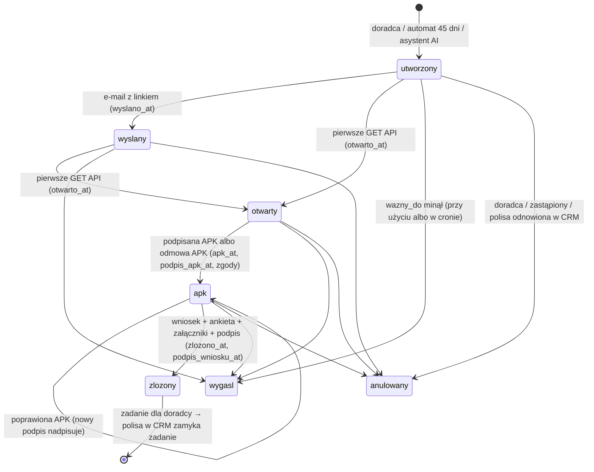
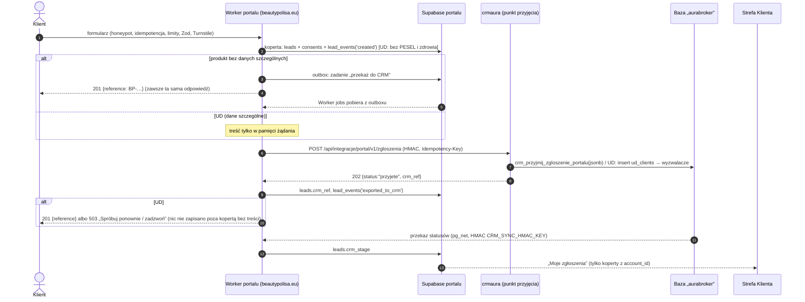

# 14 · Integracja wniosków z portalu z CRM Aura Expert („aurabroker”) – odpowiedź na W1

| | |
|---|---|
| Wersja | 1.1 (inżynieria wsteczna kodu z 13.11.2026; poprawki po weryfikacji: odstępstwa od `12` 3.2 pkt 4 B, drugi odbiorca arkusza, dosłowne zgody i tematy e-maili, odnośniki; do akceptacji zleceniodawcy i zespołu CRM); 1.2 [przegląd repo 13.11] – ustalenia z `hub`, `beauty-crm`, `udapp`, `APK` i synchronizacji BEAUTY → CRM (rozdz. 6, D-7, D-8, K13, K14, P1-10, C12–C15); 1.3 [przegląd repo 13.11] – poprawki po weryfikacji: warunek C13 przy powrocie wpisów z `lead-import` (D-6, K13, 6.1), hasło oferty UD (6.3, P2-2), polityki APK (6.4), skrót odwiedzającego (6.1 pkt 5) |
| Data | 13 listopada 2026 |
| Zakres | Jak dziś zgłoszenia i wnioski trafiają do CRM Aura Expert, model danych istotny dla portalu, ocena bezpieczeństwa wobec wymagań R-W, R-P i R-CRM z `12`, **odpowiedź na W1** z `13-przeniesienie-formularzy/00-braki-i-decyzje.md` („czy i jak wnioski z portalu mają trafiać do CRM”) z kontraktem integracji |
| Źródła (tylko odczyt) | `crmaura` @ `e01fbfb` (v1.96.0, 11.11.2026) – CRM; `branzowe`, gałąź `ezb-najnowsza` @ `8dc9a90` (24.09.2026) – EZB; `ud` @ `793a158` (12.10.2026) – utrata dochodu; `gohestia` @ `e186f2a` – ER. [przegląd repo 13.11]: `hub` @ `e2f6824` (26.10.2026) – Aura HUB; `beauty-crm` @ `40ebfaa` (18.06.2026); `udapp` @ `36ae901` (20.10.2026) – oferty UD; `APK` @ `1c519f4` (19.04.2026) |
| Powiązane | `13-przeniesienie-formularzy/00-braki-i-decyzje.md` (W1–W4, W7, W9; E1, E3, R7, U1, U2, U4, U10), `12` (D32, R-W1–R-W17, R-P1–R-P7, R-CRM-1–R-CRM-13, 3.2, 5.2–5.3), `02` (§2.2 przepływ leada, §4.7 RODO), `11` (§4.4a „Sprawy w toku”, §7.4 M5) |
| Status | Koncepcja. Dokument **nie zmienia** CRM, EZB, UD ani ER. Zmiany po stronie CRM są opisane jako wymagania (4.7) |

> **Konwencje.** Każde twierdzenie o zachowaniu kodu ma odnośnik `repo/ścieżka:linia` względem wersji z wiersza „Źródła”. Dokument nie zawiera identyfikatorów projektów Supabase, kont Cloudflare, identyfikatorów najemców (tenant), kluczy, adresów e-mail ani danych klientów. Sekrety opisujemy jako „sekret X (wartość w konfiguracji, nie w dokumencie)”, adresy skrzynek – opisem, np. „[adres biura odnowień]”. Przykładowy kod linku to zawsze `XXXXXXXXXX`. Czego nie da się ustalić z kodu, oznaczamy **[do weryfikacji]**.

## TL;DR

1. **CRM to jedna aplikacja** SvelteKit (`crmaura`) na Cloudflare Pages. W jednym wdrożeniu są panel pracowników, strony klienta (`/odnowienie/<klucz>`, `/w/<kod>`, starszy formularz APK `/form`, konta klientów `/portal`) i całe API. Aplikacja odpowiada pod `portal.beautypolisa.eu` i równolegle pod domeną `*.pages.dev` projektu. Serwer łączy się z bazą kluczem `service_role` (`crmaura/src/lib/server/auth.ts:6-12`). Bazę „aurabroker” współdzieli z aplikacją utraty dochodu (tabele `ud_*`, `crmaura/supabase/migrations/20261019000002_ud_leady_do_crm.sql:5`). EZB pisze do „wspólnego projektu Supabase z innymi aplikacjami” (`branzowe@ezb-najnowsza:supabase/migrations/20260713120000_init.sql:2`) – czy to ta sama baza, **[do weryfikacji]**.
2. **Co dziś trafia do CRM automatycznie:**
   - zgłoszenia z obecnego formularza BeautyPolisa, drogą: arkusz Google → Apps Script → `POST /api/leady/zgloszenia` z kluczem integracji;
   - wnioski UD: `form-submit` → `ud_clients` → wyzwalacze → w CRM klient, lead, zgłoszenie i zadanie. Dane medyczne nie są kopiowane, PESEL jest.

   **Co nie trafia:**
   - wnioski EZB – trafiają do `ezb_wnioski`, których CRM nie czyta; opiekun dostaje tylko e-mail;
   - zgłoszenia ER – tylko e-mail do agenta, bez żadnej bazy;
   - szkice i formularz kontaktowy UD.
3. **Ścieżka OC działa inaczej, niż opisują `12` i D32.** E-mail z CRM zawiera pełny link `/odnowienie/<uuid>.<podpis HMAC>`. `/w/<kod>` to tylko krótki alias do SMS-a: 10 znaków, ok. 58 bitów, przekierowanie `302` na pełny link. Strona klienta pokazuje dane i przyjmuje podpis bez drugiego czynnika, bez limitów prób i bez Turnstile. Do tego punkt `/api/integracje/asystent/link` wydaje pełny link workerowi `konsultacja-agent` (sprzeczność z D32 lit. f). Z wymagań R-W1–R-W17 spełnione są 3, częściowo 6, niespełnione 7, a R-W13 jest do weryfikacji (3.3).
4. **Odpowiedź na W1: wariant C (hybryda) w postaci jednego punktu przyjęcia w CRM.** Portal waliduje dane, sprawdza Turnstile i zapisuje u siebie **kopertę** zgłoszenia (numer, produkt, zgody z wersją i skrótem treści, czasy, identyfikator w CRM). Treść przekazuje z Workera do CRM jednym podpisanym punktem `POST /api/integracje/portal/v1/zgloszenia`. PESEL i dane o zdrowiu (UD) **przechodzą przez portal bez zapisu** i lądują tam, gdzie już dziś są – w `ud_clients`.

   Do CRM trafiają: OC (kalkulator i lead), Tax Protect, EZB, ER, UD, opieka medyczna, „Zapytaj doradcę” przy NNW oraz ogólny kontakt. **Ankieta oceny ryzyka grupy 4** (program WA50/003353/24/A) zostaje częścią linku do APK i wniosku w CRM – nie jest formularzem portalu. **Szkolenia, „Dam pracę”/„Szukam pracy” i newsletter – nie trafiają do CRM.**
5. **Kontrakt w skrócie** (4.4):
   - podpis HMAC sekretem `CRM_LEAD_INTAKE_KEY` (czas, nonce, skrót treści);
   - idempotencja po `zgloszenie_id` portalu;
   - odpowiedź `202 {status, crm_ref, otrzymano_at}` zawsze w tym samym kształcie, bez informacji, czy firma jest już klientem (R-P2);
   - dwa jawne odstępstwa od wariantu B z `12` 3.2 pkt 4: dopasowanie do istniejących klientów z zadaniem dla doradcy (O-1) i `crm_ref` w odpowiedzi (O-2) – uzasadnienie w 4.2;
   - CORS niepotrzebny, a żądania z nagłówkiem `Origin` CRM odrzuca;
   - statusy wracają do Strefy Klienta podpisanym przekazem CRM → portal (`CRM_SYNC_HMAC_KEY`, jak R-CRM-6).
6. **Warunek uruchomienia automatycznego przekazu:** P1 z 4.7. Wśród nich minimum bezpieczeństwa ścieżki OC (K1–K4, K6, K9 w rozdz. 3; K5 – stałe klucze integracji i link z asystenta – dopiero w P2-4). Lead z portalu prowadzi wprost do linku do APK i wniosku, więc słabości tej strony stają się słabościami portalu.
7. **[przegląd repo 13.11] „CRM Aura Expert” to w kodzie dwie bazy.** Projekt BEAUTY (`crm_companies` z kluczem `integer`, `crm_history`, `crm_lead_intake`, `mienie_*`; panel `beauty-crm` i Aura HUB) oraz projekt „aurabroker” (`crm_clients` z kluczem `uuid`, `crm_prospects`, `crm_zgloszenia`; `crmaura`). Łączy je jednokierunkowa synchronizacja BEAUTY → CRM raz na dobę (1.2 wiersz 17, D-7). Cel przekazu z W1 (`crmaura`) się nie zmienia; rolę BEAUTY trzeba potwierdzić z zespołem CRM (C12). Szczegóły i wpływ na P1-5, P1-9, C11 i U10 – rozdz. 6.

---

## 1. Jak dziś zgłoszenia i wnioski trafiają do CRM

### 1.1 Architektura w jednym akapicie

`crmaura` używa adaptera Cloudflare (`crmaura/svelte.config.js`) i nie ma podziału na aplikację publiczną i wewnętrzną. Strony klienta, panel i API mają ten sam kod, te same zmienne środowiskowe i ten sam klucz `service_role` (`crmaura/src/lib/server/auth.ts:6-12`).

Pracownik wywołuje API z nagłówkiem `Authorization: Bearer <JWT>`. Serwer sprawdza token przez `auth.getUser` i czyta `crm_profiles`, a potem działa kluczem serwisowym z ręcznym filtrem `tenant_id` (`auth.ts:20-30`).

Panel czyta wiele tabel wprost z przeglądarki sesją pracownika, przez RLS `tenant_id = get_my_tenant_id()`, np. `crmaura/src/lib/renewals/staffApi.ts:12-15`.

Linki dla klienta zawsze wskazują `portal.beautypolisa.eu`, także gdy żądanie przyszło pod `*.pages.dev` (`crmaura/src/lib/server/renewals.ts:115-118`). Pod `*.pages.dev` wołają CRM:
- zadanie dzienne z bazy (`crmaura/supabase/migrations/20261008000002_renewals_cron_url.sql:1-25`);
- skrypt arkusza zgłoszeń (`crmaura/docs/integracje/arkusz-zgloszen.gs:32`);
- worker asystenta AI (`crmaura/src/routes/api/integracje/asystent/wniosek/+server.ts:10`).

Powód podany w kodzie: ochrona przed botami na domenie portalu zatrzymuje żądania serwerowe.

### 1.2 Mapa wejść

| # | Źródło | Endpoint / funkcja | Tabele (zapis) | Kto widzi w CRM | Uwierzytelnianie | Dowód |
|---|---|---|---|---|---|---|
| 1 | Obecny formularz BeautyPolisa (strona) | arkusz Google (arkusz zgłoszeń) → Apps Script → `POST /api/leady/zgloszenia` → funkcja `crm_przyjmij_zgloszenia(p_hash, p_wiersze)` (`SECURITY DEFINER`, tylko `service_role`). **Drugi odbiorca:** ten sam skrypt (wyzwalacz co 15 min, `eksportujOba`) wysyła każdy nowy wiersz także do funkcji `lead-import` w bazie „BEAUTY” (Aura HUB, mailingi kampanii) – osobnym kluczem (sekret `LEAD_IMPORT_KEY`, wartość w konfiguracji, nie w dokumencie). Wysyła firmę, osobę, e-mail, telefon, NIP, rodzaj ubezpieczenia i przychód; arkusz nie ma kolumny zgody i skrypt jej nie sprawdza | `crm_clients` (nowa firma), `crm_prospects` (lead, zainteresowania), `crm_zgloszenia` (każde zgłoszenie, `ref` unikalny w firmie), `crm_tasks` („Klient po raz kolejny prosi o ofertę”), `crm_prospect_activities`, `crm_audit_log`, `crm_klucze_integracji.ostatnio_uzyty_at` | pracownicy firmy (RLS `SELECT`) | nagłówek `x-api-key` z prefiksem `crmzg_`; w bazie tylko SHA-256 klucza; paczka do 200 wierszy i 512 KiB | `crmaura/src/routes/api/leady/zgloszenia/+server.ts:10-36`; `crmaura/src/lib/server/zgloszenia.ts:7-13, 44-49, 74-81`; `crmaura/supabase/migrations/20261012000001_sprzedaz_leady_zgloszenia.sql:160-215, 418-419`; `crmaura/supabase/migrations/20261028000001_zgloszenia_beauty.sql:15-214`; `crmaura/docs/integracje/arkusz-zgloszen.gs:24, 125` (`ref` = arkusz!wiersz\|NIP\|e-mail); drugi odbiorca: `arkusz-zgloszen.gs:2-9, 15, 31, 35-38, 51-97` (pola `:72-76`, mapowanie kolumn bez zgody `:166-178`) |
| 2 | Wniosek UD (utratadochodu.pl) | funkcja brzegowa `form-submit` (Turnstile, `service_role`) → `insert ud_clients` → wyzwalacz `crm_ud_klient_do_crm` → `crm_ud_lead_do_crm()`; dosynchronizowanie co godzinę `crm_ud_synchronizuj()` | `ud_clients` (cały wniosek z ankietą zdrowotną w `form_data`); w CRM: `crm_clients` (osoba – **z PESEL**), `crm_prospects` (`utrata_dochodu`), `crm_zgloszenia` (`ref` „ud:<id>”), `crm_tasks`, `crm_ud_leady` (powiązanie i skrót wniosku) | pracownicy firmy z flagą `features.ud_leady` (RLS na `crm_ud_leady`) | publiczny: Turnstile (bez sprawdzenia `hostname`/`action`), CORS `*` | `ud/supabase/functions/form-submit/index.ts:5-8, 136-153, 163-178, 190-273, 362-368`; `crmaura/supabase/migrations/20261019000002_ud_leady_do_crm.sql:5-30, 38-60, 547-565` |
| 3 | Zmiany w aplikacji UD (etap leada, sprzedaż, oferty) | wyzwalacze na `ud_leady` i `ud_offers` | `crm_prospects.status`, notatki, zadanie „Wprowadź polisę …” | jw. | wewnątrz bazy | `crmaura/supabase/migrations/20261019000002_ud_leady_do_crm.sql:13-21, 552-556`; `…/20261019000004_ud_oferty_w_crm.sql:11, 432-456` |
| 4 | Szkic wniosku UD i formularz kontaktowy UD | `wniosek-szkic`, `contact-submit` | `ud_wnioski_szkice`, `udochodu_contacts` | **nie trafiają do CRM** (brak wyzwalaczy w migracjach `crmaura`) | Turnstile przy starcie szkicu; HMAC linku wycofania | `ud/supabase/functions/wniosek-szkic/index.ts:36, 134-149, 188`; `ud/supabase/functions/contact-submit/index.ts:99-106` |
| 5 | Wniosek EZB (`ergo.auraexpert.pl`) | `POST /api/wnioski` (Zod, przeliczenie składki, odrzucenie PESEL) | `ezb_wnioski`, `ezb_zdarzenia`; e-maile do klienta i opiekuna z załącznikami | **CRM nie czyta `ezb_*`** (brak odwołań w `crmaura/src`); wniosek widzi tylko adresat e-maila | publiczny, **bez Turnstile, honeypota i limitów** | `branzowe@ezb-najnowsza:src/routes/api/wnioski/+server.ts:19-79, 134-255`; `…/supabase/migrations/20260713120000_init.sql:1-53` |
| 6 | Kalkulator ER (`ergo.beautypolisa.eu`) | `POST /api/oferta` | **brak bazy** – dwa e-maile Resend (agent, klient) | tylko adresat e-maila | publiczny, bez Turnstile | `gohestia/app/api/oferta/route.ts:61-123` |
| 7 | Doradca: wniosek o odnowienie certyfikatu albo o pierwszą polisę OC | `POST /api/renewals` (`polisa_id` albo `klient_id`, tryb `email` / `link`); `DELETE` – anulowanie; `POST /api/renewals/link` – link i krótki link | `crm_renewals`, `crm_renewal_events`; e-mail z linkiem (Resend kluczem firmy), `crm_client_emails` (link zastąpiony „[link do wniosku]”) | pracownicy firmy | JWT pracownika | `crmaura/src/lib/renewals/staffApi.ts:1-31`; `crmaura/src/routes/api/renewals/link/+server.ts:8-29`; `crmaura/src/lib/server/renewals.ts:199-313, 328-413`; `crmaura/src/lib/server/renewalFlow.ts:137-176` |
| 8 | Zadanie dzienne odnowień (cron) | `pg_cron` → `crm_run_renewals()` → `POST <projekt>.pages.dev/api/cron/renewals` | `crm_renewals` (wygaszanie, zaproszenia 45 dni przed końcem, przypomnienie po 7 dniach, ostrzeżenia „ostatni dzień” i „wygasła”) | – | nagłówek `x-cron-token` z Vault, porównanie funkcją `edge_cron_token_matches` | `crmaura/supabase/migrations/20261007000003_renewals.sql:98-118`; `…/20261008000002_renewals_cron_url.sql:11-25`; `crmaura/src/routes/api/cron/renewals/+server.ts:19-54` |
| 9 | Klient: krótki link z SMS-a | `GET /w/[kod]` → `302` na `/odnowienie/<klucz>` | odczyt `crm_renewals.kod_krotki` | – | brak (posiadanie kodu) | `crmaura/src/routes/w/[kod]/+server.ts:6-28` |
| 10 | Klient: APK, zgody, załączniki, wniosek, ankieta grupy 4, podpisy | `GET`/`POST /api/odnowienie/[klucz]` (akcje `apk`, `apk_odmowa`, `zalacznik_url`, `zalacznik_usun`, `zloz`) | `crm_renewals`, `crm_renewal_events`, `crm_renewal_podpisy`, `crm_zgody`, `crm_clients.zgoda_*`, magazyn `renewal-files`; po złożeniu `crm_tasks` (z `renewal_id`), `crm_prospects`/`crm_prospect_activities`, `crm_client_emails` | pracownicy firmy | brak konta; jedynym uprawnieniem jest podpisany klucz w adresie | `crmaura/src/routes/api/odnowienie/[klucz]/+server.ts:49-330` |
| 11 | SMS z krótkim linkiem | `POST /api/sms` (SMSAPI tokenem firmy) | `crm_renewal_events` (`sms`, `blad_sms`); nadaje `kod_krotki` | pracownicy firmy | JWT pracownika; odstęp 60 s na wniosek | `crmaura/src/routes/api/sms/+server.ts:12-57`; `crmaura/src/lib/server/sms.ts:17-42` |
| 12 | Asystent AI (worker `konsultacja-agent`) | `POST /api/integracje/asystent/wniosek` (wysłanie e-maila z linkiem), `POST /api/integracje/asystent/link` (**zwraca pełny link** do przekierowania klienta) | `crm_renewals` (tworzenie/ponowna wysyłka), `crm_tasks` „do agenta” | pracownicy firmy | `x-api-key` z prefiksem `crmai_` (SHA-256 w `crm_klucze_integracji`, zakres `asystent_ai`); treść `{klient_id}` | `crmaura/src/routes/api/integracje/asystent/link/+server.ts:7-35`; `…/wniosek/+server.ts:14-35`; `crmaura/src/lib/server/wniosekAsystenta.ts:46-60, 318`; `crmaura/supabase/migrations/20261020000001_klucz_asystenta_ai.sql` |
| 13 | Import polis (PDF) | `/policies/import` – parser w przeglądarce (`pdfjs`), zapis sesją pracownika | `crm_policies` (`dane_importu`), `crm_policy_payments`, pojazdy, leasingi; wyzwalacz zamyka lead jako „wygrany” i zadania z wniosku | pracownicy firmy (RLS) | sesja pracownika | `crmaura/src/lib/policyImport/pdf.ts:4-15`; `crmaura/src/routes/(app)/policies/import/+page.svelte:281-307`; `…/20261012000001_sprzedaz_leady_zgloszenia.sql:76-109`; `…/20261019000003_zadania_po_odnowieniu.sql` |
| 14 | Starszy formularz APK z tokenem | `/form?token=…` → RPC `get_apk_by_token`, `submit_apk` (`anon`) | `apk_forms`, `apk_tokens` | pracownicy firmy | token w adresie | `crmaura/SECURITY_HANDOFF.md:3-7`; `crmaura/supabase/migrations/20261006000000_security_apk_storage_bp.sql:60-103`; `crmaura/supabase/pending/20261007000000_apk_private_files_legacy_rpc.sql:1-22` (**NIE ZASTOSOWANA**) |
| 15 | Konta klientów CRM | `/portal`, `/api/portal/access` (zakłada konto Auth ze znacznikiem `app_metadata.portal_klient_id`) | Supabase Auth, `crm_clients.auth_user_id` | klient – własne polisy przez RLS `*_client_select` | Supabase Auth | `crmaura/src/lib/server/portal.ts:8-59`; `crmaura/src/routes/api/portal/access/+server.ts:6-26` |
| 16 | Statusy dostarczenia e-maili | `POST /api/webhooks/resend/[tenant]` (podpis Svix) | statusy w `crm_client_emails` (m.in. `email.clicked` → „kliknięty”) | pracownicy | HMAC Svix (`svix-id`, `svix-timestamp`, `svix-signature`) | `crmaura/src/routes/api/webhooks/resend/[tenant]/+server.ts:11-24`; `crmaura/src/lib/server/resendWebhook.ts:5, 20` |
| 17 | **[przegląd repo 13.11]** Synchronizacja z bazy BEAUTY (Aura HUB, `beauty-crm`) | funkcja brzegowa `sync-beauty-companies` w projekcie „aurabroker”, wołana przez `pg_cron` (`sync-beauty-companies-daily`, codziennie 07:00 UTC według audytu); czyta `crm_companies` i `email_messages` z BEAUTY. Dopasowanie po `beauty_id`, potem po NIP, bez NIP – po e-mailu; rekord CRM jest nadrzędny (uzupełniane tylko puste pola) | `crm_clients` (nowy klient z `beauty_id` i `rodo_kanal = 'Import BEAUTY'`), `crm_client_contacts`, `crm_prospects` (funkcja `crm_beauty_leady` – zainteresowania, przychód, data zgłoszenia), `crm_kampanie_maile` (maile HUB ze statusem dostarczenia, otwarcia, kliknięcia), `crm_sync_log` | pracownicy firmy (RLS `SELECT`) | `x-cron-token` z Vault; do BEAUTY sekretem `BEAUTY_SERVICE_ROLE_KEY` – klucz serwisowy **drugiego projektu** (wartość w konfiguracji, nie w dokumencie) | `crmaura/supabase/functions/sync-beauty-companies/index.ts:3-21, 49, 58-67, 104-117, 146-156, 165-215, 236-282, 284-324`; `crmaura/docs/db/crm-audit.json:363, 965-970`; `crmaura/supabase/migrations/20261012000001_sprzedaz_leady_zgloszenia.sql:11, 421-440, 508-534` |

**Prospects (Sprzedaż).** Lead to jeden wiersz `crm_prospects` na klienta (`crm_prospects_klient_uq`). Etapy: `nowy` → `w_kontakcie` → `oferta_wyslana` → `wygrany` / `przegrany` (`crmaura/src/routes/(app)/prospects/+page.svelte:81`). Kody zainteresowań: `oc`, `tax`, `utrata_dochodu`, `zdrowie`, `grupowe`, `konsultacja`, `inne` (`crmaura/src/lib/sprzedaz.ts:4`). Dziś wynikają z **tekstu** pola „ubezpieczenie” w formularzu (`crm_kody_zainteresowan`, `…/20261012000001_sprzedaz_leady_zgloszenia.sql:17-37`). Polisa klienta zamyka jego lead jako „wygrany” (`…:76-109`).

**Zadania z wniosków.** Złożony wniosek online tworzy zadanie dla opiekuna z `renewal_id` (`crmaura/src/lib/server/renewalFlow.ts:346-395`; `…/20261015000002_zadania_z_wnioskow.sql`). Polisa, która załatwia wniosek, zamyka to zadanie (`…/20261019000003_zadania_po_odnowieniu.sql`, funkcja `crm_zamknij_zadania_po_polisie`).

**Statystyki i podsumowanie dzienne.** Tylko odczyt dla pracowników: e-mail podsumowania wysyła godzinowe zadanie z `x-cron-token` (`crmaura/src/routes/api/cron/podsumowanie/+server.ts:6-19`; `crmaura/src/lib/server/podsumowanie.ts:14`). Z punktu widzenia portalu nie są wejściem.

### 1.3 Przepływ OC: link → APK → wniosek → podpis → polisa



| Element | Jak działa | Dowód |
|---|---|---|
| Kto i dla czego tworzy sprawę | **Odnowienie:** tylko certyfikat z umowy generalnej `ug_podtyp = 'oc_beauty'`, niezakończony, bez następcy, klient aktywny. **Pierwsza polisa (`rodzaj = 'nowa'`):** klient z kartoteki, program OC na stałe (`PROGRAM_NAZWA`, `UBEZPIECZYCIEL`). Jedna aktywna sprawa na certyfikat i jedna na klienta przy pierwszej polisie (indeksy częściowe) | `crmaura/src/lib/server/renewals.ts:199-255, 365-413`; `crmaura/src/lib/renewals/program.ts:6-8`; `crmaura/supabase/migrations/20261007000003_renewals.sql:53-55`; `…/20261015000001_wnioski_nowe_polisy.sql` |
| Statusy | `utworzony`, `wyslany`, `otwarty`, `apk`, `zlozony`, `wygasl`, `anulowany`; decyzja `bez_zmian` / `zmiany` / `nie` / `nowa` | `…/20261007000003_renewals.sql:20-22`; `…/20261015000001_wnioski_nowe_polisy.sql` |
| Link w e-mailu | `/odnowienie/<uuid>.<podpis>`. Podpis to HMAC-SHA256 z `crm-odnowienie:v1:<id>`, obcięty do 16 bajtów (128 bitów), base64url (22 znaki). Porównanie w stałym czasie. **Sekret:** `RENEWAL_LINK_SECRET`, a gdy go brak – **klucz `service_role`** | `crmaura/src/lib/server/renewals.ts:79-113, 124-126`; `crmaura/src/lib/server/renewalFlow.ts:147` |
| Krótki link (SMS) | `/w/<kod>`: 10 znaków z alfabetu 56 znaków (ok. 58 bitów), `crypto.getRandomValues` z odrzucaniem bajtów ≥ 224. Nadawany przy pierwszej prośbie i **nigdy niezmieniany**. Zapisany jawnie w `crm_renewals.kod_krotki` (indeks unikalny). `GET /w/<kod>` odpytuje bazę i dla znanego kodu odpowiada `302` z pełnym kluczem w `Location`, dla nieznanego – stroną `404` „Ten link jest nieprawidłowy” | `crmaura/src/lib/renewals/sms.ts:4-20`; `crmaura/src/lib/server/renewals.ts:128-150`; `crmaura/supabase/migrations/20261107000001_wnioski_krotki_link.sql`; `crmaura/src/routes/w/[kod]/+server.ts:9-28` |
| Ważność | `wazny_do NOT NULL`. Odnowienie – do końca dnia końca ochrony; pierwsza polisa – 30 dni. Sprawdzane przy każdym wczytaniu (przejście na `wygasl`) i w cronie, a złożenie ma warunek `wazny_do > teraz`. Przypomnienia nie przedłużają ważności | `…/20261007000003_renewals.sql:47`; `crmaura/src/lib/server/renewals.ts:278-282, 401, 460-473`; `crmaura/src/lib/renewals/program.ts:289`; `crmaura/src/routes/api/odnowienie/[klucz]/+server.ts:309-317`; `crmaura/src/routes/api/cron/renewals/+server.ts:48-54`; `crmaura/src/lib/server/renewalFlow.ts:165-169` |
| Co widzi klient | Aktywna sprawa: nazwa firmy, numer polisy, ubezpieczyciel, program, suma i składka, okresy, ważność linku, zapisane odpowiedzi APK, lista załączników, NIP i REGON z kartoteki, stan zgód. Przy pierwszej polisie dodatkowo dane firmy (adres, e-mail, telefon) jako podpowiedź. Po złożeniu – tylko nazwa, numer polisy, decyzja i czas złożenia | `crmaura/src/lib/server/renewals.ts:556-602` |
| Otwarcie | Pierwsze `GET /api/odnowienie/[klucz]` (wywołuje je skrypt strony) zapisuje `otwarto_at`, IP i przeglądarkę oraz zmienia status na `otwarty` | `crmaura/src/routes/api/odnowienie/[klucz]/+server.ts:54-74` |
| APK i zgody | APK albo odmowa, zawsze z podpisem. Dwie zgody marketingowe, osobne i domyślnie odznaczone, wersja `WERSJA_ZGOD = '2026-10'` (brzmienie dosłownie pod tabelą). Do sprawy trafia migawka z dokładnym brzmieniem (`crm_renewals.zgody`); każda odpowiedź, także „nie”, idzie do rejestru `crm_zgody` z IP i przeglądarką, a stan bieżący do `crm_clients.zgoda_*` | `crmaura/src/routes/api/odnowienie/[klucz]/+server.ts:120-173`; `crmaura/src/lib/renewals/zgody.ts:13, 23-46, 76-84`; `crmaura/src/lib/server/zgody.ts:10-34` |
| Podpis | Podpis odręczny: PNG + przebieg ruchu, limity rozmiaru. W bazie `skrot_tresci` (SHA-256 kanonicznej treści APK albo wniosku) i `skrot_podpisu`. Podpis zapisywany **przed** zmianą sprawy, potem skrót sprawdzany ponownie z wiersza w bazie. Jeden podpis na zakres (`apk`, `wniosek`) | `crmaura/src/routes/api/odnowienie/[klucz]/+server.ts:78-95`; `crmaura/src/lib/server/podpis.ts:56-78`; `crmaura/supabase/migrations/20261014000001_podpisy_i_zgody.sql` |
| PDF APK | Po APK serwer tworzy `apk.pdf` w `renewal-files/<tenant>/<sprawa>/` i wysyła go klientowi e-mailem. Panel może go odtworzyć (`POST /api/renewals/pdf-apk`). Po złożeniu powstają `wniosek-odnowienia.pdf` i `ankieta.pdf`, idą e-maile do klienta i do [adres biura odnowień] | `crmaura/src/lib/server/renewalFlow.ts:26, 62-120, 207-240, 243-320`; `crmaura/src/routes/api/renewals/pdf-apk/+server.ts:7-23` |
| Ankieta grupy 4 | Zabiegi z listy `ZABIEGI_ANKIETA` (podstawa: Aneks nr 5) wymagają ankiety ERGO Hestii w kroku wniosku. Wycena jest wtedy „indywidualna” | `crmaura/src/lib/renewals/program.ts:92-112, 564, 585`; `crmaura/src/routes/api/odnowienie/[klucz]/+server.ts:281-292` |
| Załączniki | Jednorazowy adres wysyłki do prywatnego magazynu; MIME z listy, ≤ 10 MB na plik, ≤ 60 MB łącznie. Pliki spoza listy są usuwane po złożeniu | `crmaura/src/routes/api/odnowienie/[klucz]/+server.ts:175-219, 259-279`; `…/20261007000003_renewals.sql:86-96`; `crmaura/src/lib/server/renewals.ts:532-542` |
| Złożenie | Atomowe `UPDATE … WHERE status IN (aktywne) AND wazny_do > teraz` (drugie złożenie dostaje `409`). Potem w tle PDF-y, e-maile, zadanie dla opiekuna (termin 1–2 dni robocze, priorytet z sygnałów APK) i notatka w leadzie (`oferta_wyslana`) | `crmaura/src/routes/api/odnowienie/[klucz]/+server.ts:238-325`; `crmaura/src/lib/server/renewalFlow.ts:326-395` |
| Polisa | Pracownik wprowadza polisę (odnowienie: `renewal_of`). To zamyka zadanie z wniosku i lead jako „wygrany”. Sprawa, której certyfikat odnowiono inną drogą albo usunięto, jest anulowana automatycznie | `…/20261019000003_zadania_po_odnowieniu.sql`; `crmaura/src/lib/server/renewals.ts:475-494` |
| Tryb testowy | Flaga firmy `odnowienia_test`: e-maile tylko na adres testowy z dopiskiem `[TEST]`; SMS nie wychodzi | `crmaura/src/lib/server/renewals.ts:640-652`; `crmaura/src/routes/api/sms/+server.ts:33-35` |

**Zgody marketingowe CRM – brzmienie dosłowne** (`crmaura/src/lib/renewals/zgody.ts:13, 23-40`; wersja `2026-10`; nazwa administratora wstawiana ze stałej `ADMINISTRATOR.nazwa` = „Aura Expert sp. z o.o.”, adres e-mail ze stałej `ADMINISTRATOR.email` zastąpiony opisem):

| Kanał (`kanal`) | Tytuł (`tytul`) | Treść (`tresc`) |
|---|---|---|
| `email` | „Informacje o ubezpieczeniach e-mailem (w tym newsletter)” | „Wyrażam zgodę na otrzymywanie od Aura Expert sp. z o.o. informacji handlowych i marketingowych dotyczących ubezpieczeń i programu BeautyPolisa (w tym newslettera) na podany przeze mnie adres e-mail (art. 398 ustawy – Prawo komunikacji elektronicznej). Zgoda jest dobrowolna i mogę ją wycofać w każdej chwili, np. linkiem w stopce wiadomości albo pisząc na [e-mail Aura Expert do wycofania zgody].” |
| `sms` | „Kontakt telefoniczny i SMS” | „Wyrażam zgodę na kontakt telefoniczny i SMS ze strony Aura Expert sp. z o.o. w celu przedstawiania informacji handlowych i marketingowych dotyczących ubezpieczeń na podany przeze mnie numer telefonu (art. 398 ustawy – Prawo komunikacji elektronicznej). Zgoda jest dobrowolna i mogę ją wycofać w każdej chwili, pisząc na [e-mail Aura Expert do wycofania zgody].” |

Obok zgód strona pokazuje: „Wiadomości dotyczące Twojego ubezpieczenia (odnowienie, polisa, składki, szkody) wysyłamy niezależnie od tych zgód — są potrzebne do obsługi umowy.” (`zgody.ts:45-46`). Krótkie etykiety w panelu i PDF: „E-mail (informacje handlowe, newsletter)”, „Telefon i SMS” (`zgody.ts:42`).

**Tematy e-maili z linkiem – dosłownie** (`crmaura/src/lib/server/renewalDocs.ts`; w nawiasach kwadratowych wartości wstawiane z `crm_renewals`):

| Wiadomość | Temat | Dowód |
|---|---|---|
| Zaproszenie – odnowienie | „Odnowienie ubezpieczenia OC gabinetu — certyfikat [nr_polisy] kończy się [okres_do]” | `renewalDocs.ts:114` |
| Przypomnienie – odnowienie | „Przypomnienie: odnowienie ubezpieczenia OC — certyfikat [nr_polisy] kończy się [okres_do]” | `renewalDocs.ts:113` |
| Zaproszenie – pierwsza polisa | „Ubezpieczenie OC gabinetu — analiza potrzeb i wniosek online dla [klient_nazwa]” | `renewalDocs.ts:224` |
| Przypomnienie – pierwsza polisa | „Przypomnienie: wniosek o ubezpieczenie OC gabinetu — [klient_nazwa]” | `renewalDocs.ts:223` |
| Ostatni dzień | „PILNE: ochrona OC Twojego gabinetu kończy się DZIŚ ([okres_do]) — odnów ubezpieczenie” | `renewalDocs.ts:157` |
| APK (z linkiem do dokończenia wniosku) | „Analiza potrzeb (APK)” albo „Odmowa wypełnienia analizy potrzeb (APK)”, z dopiskiem „ — wersja poprawiona” przy poprawce, potem „ — certyfikat [nr_polisy]” (odnowienie) albo „ — [klient_nazwa]” (pierwsza polisa) | `renewalDocs.ts:321, 325` |
| Ochrona wygasła (bez linku do wniosku) | „OCHRONA UBEZPIECZENIOWA WYGASŁA — Twój gabinet jest bez ubezpieczenia OC ([certyfikat albo polisa] [nr_polisy])” | `renewalDocs.ts:191` |

### 1.4 Rozbieżności z dotychczasowymi dokumentami

| # | Dokument mówi | Kod pokazuje | Skutek dla koncepcji |
|---|---|---|---|
| D-1 | `12` i 00 D32: e-mail z CRM zawiera link `portal.beautypolisa.eu/w/<kod>` (kod 10 znaków) | E-mail (zaproszenie, przypomnienie, „ostatni dzień”) zawiera **pełny link** `/odnowienie/<uuid>.<HMAC>` (`crmaura/src/lib/server/renewalFlow.ts:147, 189, 221`). `/w/<kod>` służy tylko do SMS-a i do kopiowania z karty (`crmaura/src/routes/api/sms/+server.ts:48`; `crmaura/src/routes/api/renewals/link/+server.ts:21-27`) | Wymagania R-W trzeba odnieść do **obu** adresów. „Kod” w R-W1–R-W17 to w praktyce klucz `/odnowienie` (128 bitów podpisu) albo kod krótki (~58 bitów) |
| D-2 | 00 D32 lit. f i `12` 1.4: `konsultacja.beautypolisa.eu` (`/k`, `/w`) nie jest APK ani wnioskiem | Worker `konsultacja-agent` pobiera z CRM pełny link do wniosku (`/api/integracje/asystent/link`) i przekierowuje klienta po kliknięciu przycisku w e-mailu z HUB (`crmaura/src/routes/api/integracje/asystent/link/+server.ts:7-11`; `crmaura/src/lib/server/wniosekAsystenta.ts:318`) | `konsultacja.` jest bramą do APK i wniosku. Do decyzji zleceniodawcy: korekta D32 lit. f albo wyłączenie tej drogi (pytanie C7) |
| D-3 | `13/00` E1: „brak kodu serwera” EZB | Kod serwera jest na gałęzi `ezb-najnowsza`: walidacja Zod, odrzucanie PESEL, przeliczenie składki (`409` przy rozjeździe), numer `EZB-RRRR-NNNNNN`, statusy, cennik `branze-2607`, zdarzenia (`branzowe@ezb-najnowsza:src/routes/api/wnioski/+server.ts:13-255`; `…/20260713120000_init.sql:14-36`) | E1 w dużej części zamknięte. Wniosek **nie trafia do CRM** – to luka obecnego obiegu, nie tylko portalu |
| D-4 | `13/00` U1: „brak kodu funkcji” `form-submit` | Kod jest w repozytorium `ud` (`ud/supabase/functions/form-submit/index.ts`), a przekaz do CRM opisuje migracja `crmaura` (`20261019000002_ud_leady_do_crm.sql`) | U1 w dużej części zamknięte; mapowanie pól w 2.4 |
| D-5 | `13/00` R7: „wysyłka ER nieznana” | `POST /api/oferta` wysyła tylko dwa e-maile, bez zapisu w bazie i bez Turnstile (`gohestia/app/api/oferta/route.ts:61-123`) | R7 zamknięte: ER dziś nie zostawia śladu w CRM |
| D-6 | `12` 3.2 pkt 4: v1 – lead tylko w portalu, do CRM ręcznie (wariant A); wariant B (punkt przyjęcia) „później” | Punkt przyjęcia leadów **już istnieje** (`/api/leady/zgloszenia`) i obecny formularz BeautyPolisa z niego korzysta przez arkusz Google | Rekomendacja w rozdz. 4 zmienia v1 z `12` 3.2 pkt 4 na automatyczny przekaz – do zapisania w rejestrze 00 (propozycja w 4.9). [przegląd repo 13.11] To nie jedyne wejście: ten sam wiersz arkusza idzie też do `lead-import` w BEAUTY i wraca do CRM przy najbliższym przebiegu synchronizacji (07:00 UTC; 1.2 wiersz 17, D-7) [do weryfikacji, C13 – zakładając, że `lead-import` zapisuje `crm_companies`, jedyną tabelę firm czytaną przez synchronizację, `crmaura/supabase/functions/sync-beauty-companies/index.ts:104-109`]. Odcięcie arkusza (P1-9) zamyka obie drogi naraz |
| D-7 | **[przegląd repo 13.11]** `12`, `13/00` W1 i TL;DR 1 tego dokumentu: jeden CRM Aura Expert („aurabroker”) | Druga baza CRM w projekcie BEAUTY: `crm_companies` z kluczem `integer` (klucz obcy `email_messages.company_id integer`, `hub/supabase/migrations/20260708120000_aura_hub_email_module.sql:99-103`), `crm_history`, `crm_lead_intake`, `mienie_wnioski`. Obsługują ją panel `beauty-crm` (`beauty-crm/src/store/useCRMStore.ts:107-128`) i Aura HUB (`hub/README.md:17-21`). CRM „aurabroker” ma `crm_clients` z kluczem `uuid` i czyta BEAUTY raz na dobę (1.2 wiersz 17). Projekty rozróżniono po skrótach adresów w konfiguracji, bez wypisywania identyfikatorów | Cel przekazu z portalu zostaje `crmaura` – tam są linki OC, UD i obieg doradcy, a synchronizacja traktuje rekord CRM jako nadrzędny (`sync-beauty-companies/index.ts:7`). **Rozbieżność do wyjaśnienia z zespołem CRM (C12):** rola BEAUTY (baza mailingów HUB czy wciąż drugi CRM) i to, czy `beauty-crm` jest używany (ostatni commit 18.06.2026). Rozdz. 6 |
| D-8 | **[przegląd repo 13.11]** `13/00` część F: `udapp`, `APK`, `hub` „spoza analizy”, `beauty-crm` „nie czytane”; `hub` opisany jako miejsce funkcji `lead-import` | Przegląd z 13.11 objął te repozytoria; wyniki istotne dla integracji z CRM – rozdz. 6. Kodu funkcji `lead-import` **nie ma** w żadnym z przejrzanych repozytoriów (w tym w `hub`). Wołają ją arkusz (`crmaura/docs/integracje/arkusz-zgloszen.gs:15, 31, 69-77`) i `beauty-crm` (`src/components/LeadForm.tsx:41-46`); działa w projekcie BEAUTY | Część F w 00 do korekty (poza tym dokumentem). Co zapisuje `lead-import` – do potwierdzenia (C13) |

---

## 2. Model danych istotny dla portalu

Tylko nazwy i typy kolumn z migracji i introspekcji (`crmaura/docs/db/crm-schema.json`, stan 17.08.2026, uzupełniony migracjami). `!` = `NOT NULL`. Bez danych.

### 2.1 Sprawy OC (`crm_renewals` i tabele zależne)

| Tabela | Kolumny | Uprawnienia | Źródło |
|---|---|---|---|
| `crm_renewals` | `id uuid!`, `tenant_id uuid!`, `polisa_id uuid` (puste przy `nowa`), `klient_id uuid!`, `rodzaj text!` (`odnowienie`/`nowa`), `status text!` (7 wartości, 1.3), `decyzja text`, `email text`, `nr_polisy text`, `tu_nazwa text`, `program text`, `klient_nazwa text`, `suma numeric`, `skladka numeric`, `okres_od date`, `okres_do date`, `apk jsonb`, `apk_odmowa boolean!`, `wniosek jsonb`, `ankieta jsonb`, `zalaczniki jsonb!`, `skladka_nowa numeric`, `pdf_path text`, `wyslano_at`, `otwarto_at`, `apk_at`, `zlozono_at`, `przypomniano_at timestamptz`, `wazny_do timestamptz!`, `created_by uuid`, `created_at`, `updated_at timestamptz!`, `zgody jsonb`, `podpis_apk_at`, `podpis_wniosku_at`, `mail_ostatni_dzien_at`, `mail_wygasla_at timestamptz`, `kod_krotki text` (unikalny) | RLS: `SELECT` pracowników własnej firmy; `anon` – nic; zapis tylko serwer | `20261007000003_renewals.sql:15-84`; `20261014000001_podpisy_i_zgody.sql`; `20261015000001_wnioski_nowe_polisy.sql`; `20261103000001_odnowienia_alerty_konca.sql`; `20261107000001_wnioski_krotki_link.sql` |
| `crm_renewal_events` | `id bigint`, `renewal_id uuid!`, `tenant_id uuid!`, `zdarzenie text!`, `at timestamptz!`, `ip text`, `user_agent text`, `szczegoly jsonb` | jw. | `20261007000003_renewals.sql:59-84` |
| `crm_renewal_podpisy` | `id uuid`, `renewal_id uuid!`, `tenant_id uuid!`, `zakres text!` (`apk`/`wniosek`), `png text!` (≤ 400 000 znaków), `punkty jsonb!`, `proporcje numeric!`, `podpisano_at`, `ip`, `user_agent`, `skrot_tresci text!` (hex 64), `skrot_podpisu text!` (hex 64), `wersja text!`, `created_at`; unikalne (`renewal_id`, `zakres`) | jw. | `20261014000001_podpisy_i_zgody.sql` |
| `crm_zgody` | `id uuid`, `tenant_id uuid!`, `klient_id uuid!`, `kanal text!` (`email`/`sms`), `zgoda boolean!`, `tresc text!`, `wersja text!`, `zrodlo text!` (domyślnie `odnowienie`), `renewal_id uuid`, `podpisany boolean!`, `ip text`, `user_agent text`, `at timestamptz!` | jw. | `20261014000001_podpisy_i_zgody.sql` |
| magazyn `renewal-files` | prywatny, 10 MB, MIME: PDF, JPEG, PNG, WEBP, HEIC/HEIF; ścieżka `<tenant>/<sprawa>/<plik>` | odczyt pracowników własnej firmy | `20261007000003_renewals.sql:86-96` |

### 2.2 Leady, zgłoszenia, zadania, klucze

| Tabela | Kolumny (istotne) | Uprawnienia | Źródło |
|---|---|---|---|
| `crm_zgloszenia` | `id uuid`, `tenant_id uuid!`, `klient_id uuid`, `prospect_id uuid`, `zrodlo text!` (domyślnie `arkusz`), `ref text` (unikalny w firmie), `zgloszono_at timestamptz!`, `firma`, `kontakt`, `email`, `telefon`, `nip`, `produkt`, `przychod text`, `zainteresowania text[]!`, `ponowne boolean!`, `poprzednie_at timestamptz`, `poprzednie_typ text`, `historyczne boolean!`, `odczytane_at timestamptz`, `odczytal uuid`, `created_at` | `SELECT` i `UPDATE (odczytane_at, odczytal)` pracowników; zapis tylko funkcją | `20261012000001_sprzedaz_leady_zgloszenia.sql:160-199` |
| `crm_prospects` | `id`, `tenant_id`, `klient_id uuid` (unikalny), `nazwa`, `nip`, `adres`, `telefon`, `email`, `branza`, `broker_id uuid`, `status text` (`nowy`, `w_kontakcie`, `oferta_wyslana`, `wygrany`, `przegrany`), `zainteresowania text[]!`, `przychod`, `zrodlo`, `data_zgloszenia`, `ostatnie_zgloszenie_at`, `liczba_zgloszen integer!`, `status_zmieniony_at`, `ubez_*` (`maja`/`nie_maja`) i opisy, `notatki`, `created_at` | RLS firmy | `crm-schema.json`; `20261012000001_sprzedaz_leady_zgloszenia.sql:40-50` |
| `crm_tasks` | `id`, `tenant_id`, `created_by`, `assigned_to`, `extra_assignees uuid[]`, `klient_id`, `polisa_id`, `prospect_id`, `renewal_id uuid`, `tytul`, `opis`, `termin date`, `godzina time`, `typy text[]`, `priorytet` (`niski`…`pilny`), `status` (domyślnie `otwarte`), `postep_pct`, `zakonczone_at`, `created_at`, `updated_at` | RLS firmy | `crm-schema.json`; `20261015000002_zadania_z_wnioskow.sql`; `20261019000003_zadania_po_odnowieniu.sql` |
| `crm_clients` (istotne) | `id`, `tenant_id`, `opiekun_id`, `typ`, `nazwa`, `nip`, `regon`, `ulica`, `pesel`, `email`, `telefon`, `auth_user_id`, `beauty_id`, `segment_beauty`, `aktywny`, `zgoda_email`, `zgoda_email_at`, `zgoda_sms`, `zgoda_sms_at` | RLS firmy; `auth_user_id` tylko serwer | `crm-schema.json`; `20261014000001_podpisy_i_zgody.sql`; `20261006000001_crm_clients_auth_user_guard.sql` |
| `crm_klucze_integracji` | `id`, `tenant_id!`, `nazwa`, `hash text!` (SHA-256, unikalny), `prefiks`, `zakres text!` (`zgloszenia`/`asystent_ai`), `utworzyl`, `created_at`, `ostatnio_uzyty_at`, `wylaczony_at` | bez polityk – tylko serwer | `20261012000001_sprzedaz_leady_zgloszenia.sql:202-215`; `20261020000001_klucz_asystenta_ai.sql` |
| `crm_ud_leady` | `ud_klient_id uuid` (PK → `ud_clients`), `tenant_id!`, `klient_id`, `prospect_id`, `zgloszenie_id`, `ud_lead_id`, `etap`, `status_crm`, `sprzedano_at`, `zarchiwizowano_at`, `dane jsonb!`, `created_at`, `synced_at` | `SELECT` firmy | `20261019000002_ud_leady_do_crm.sql:38-60` |
| `crm_policies` (istotne) | `id`, `tenant_id`, `klient_id`, `nr_polisy`, `rodzaj`, `data_od`, `data_do`, `skladka_przypisana`, `suma_gwarancyjna`, `typ_umowy` (`jednostkowa`/`generalna`), `ug_podtyp` (m.in. `oc_beauty`, `beauty_tax`), `parent_id`, `renewal_of`, `zakonczona_od`, `deleted_at`, `dane_importu jsonb` | RLS firmy; klient – własne (`/portal`) | `crm-schema.json`; `20261007000003_renewals.sql:12` |

### 2.3 EZB (`ezb_*`, repozytorium `branzowe`)

| Tabela | Kolumny | Uprawnienia |
|---|---|---|
| `ezb_cenniki` | `id bigint`, `wersja text!` (unikalna), `obowiazuje_od date!`, `obowiazuje_do date!`, `dane jsonb!`, `utworzono` | RLS włączone, **brak polityk** – tylko `service_role` (`branzowe@ezb-najnowsza:supabase/migrations/20260713120000_init.sql:50-53`) |
| `ezb_wnioski` | `id uuid`, `nr_wniosku text!` (domyślnie `EZB-RRRR-NNNNNN`), `cennik_wersja text!` (FK), `branza text!`, `wariant smallint!` (1–3), `rozszerzenia jsonb!`, `zalozona_adopcja numeric(3,2)`, `liczba_osob smallint!` (2–100), `struktura jsonb` (agregat rocznik × płeć, bez PESEL), `firma jsonb!`, `kontakt jsonb!`, `zgody jsonb!`, `skladka jsonb!`, `status text!` (`nowy`, `przekazany`, `oferta`, `polisa`, `odrzucony`), `utworzono`, `zrodlo_wizyty jsonb` | jw. (`…/20260713120000_init.sql:16-36`; `…/20260904120000_zrodlo_wizyty.sql`) |
| `ezb_zdarzenia` | `id bigint`, `sesja uuid!`, `typ text!`, `dane jsonb`, `utworzono` | jw. |

### 2.4 UD (`ud_*`, repozytorium `ud`)

| Tabela | Kolumny | Uwagi |
|---|---|---|
| `ud_clients` | Brak migracji w repozytorium; kolumny według mapowania w `form-submit` (`ud/supabase/functions/form-submit/index.ts:190-273, 351-356`): kontakt (`full_name`, `email`, `phone`), **`pesel`**, `employment_type`, `profession`, `source`, `affiliate_code_used`, `weight`, `height`, `handedness`, `tax_form`, `employs_people`, `b2b_*` (8), `med_*` (7), `weight_change`, `takes_meds`, `pending_diagnosis`, `disability_congenital`, `smoker`, `event_*` (3), `risk_*` sport (15), `risk_death_invalidity`, `risk_temp_incapacity`, `risk_perm_incapacity`, `temp_incapacity_sum`, `perm_incapacity_sum`, `nw_*` (7), `exclusions_accepted`, `informed_accepted`, `form_data jsonb` (cały ładunek + `health_survey`) | Dane szczególnej kategorii (art. 9 RODO) w kolumnach i w `form_data`. Wyzwalacz kopiuje do CRM kontakt, PESEL, zawód, formy zatrudnienia i podatku, sumy i etap – bez danych medycznych (`crmaura/supabase/migrations/20261019000002_ud_leady_do_crm.sql:22-24`) |
| `ud_wnioski_szkice` | `id`, `created_at`, `updated_at`, `ostatni_krok` (`kontakt`…`zgody`), `ukonczony_at`, `client_id`, `zgoda_kontakt`, `zgoda_wersja`, `zgoda_tresc`, `zgoda_at`, `zgoda_wycofana_at`, `imie`, `email`, `phone`, `przypomnienie_wyslane_at`, `obsluzony_at`, `ip_hash`; kontakt tylko przy zgodzie (`CHECK`) | Wzorcowa rozliczalność zgody: treść dopisuje serwer z mapy wersji (`ud/supabase/migrations/20261001101112_wnioski_szkice.sql`) |
| `ud_leady` | `id`, `pipeline_id`, `etap_id`, `klient_id` albo `szkic_id`, `wersja`, `opiekun_id`, `nastepne_dzialanie_*`, `powod_utraty`, `etap_od`, `zarchiwizowano_at`, `created_at`, `updated_at` | Etap przenoszony do `crm_prospects.status` |

### 2.5 Strona portalu (propozycja – rozszerzenie modelu z `02`)

Kopertę zapisujemy w istniejącym modelu leada z `02` §2.2 (`leads`, `consents`, `lead_events`, `outbox_emails`), bez nowej równoległej tabeli:

| Gdzie | Dodać | Po co |
|---|---|---|
| `leads` | `kind text` (`lead`/`wniosek`), `product` rozszerzony o `ezb`, `ergo-razem`, `utrata-dochodu`; `crm_ref uuid` (identyfikator zgłoszenia w CRM), `crm_stage text`, `crm_stage_at timestamptz`, `payload_sha256 text` (skrót wysłanej treści `dane`), `sensitive_forwarded boolean` (UD: treść przekazana, niezapisana), `account_id uuid` (gdy złożone z sesji Strefy) | Rozliczalność, idempotencja i statusy bez trzymania danych szczególnych |
| `consents` | `content_sha256 text`, `doc_code text` (kod zgody z rejestru `packages/content/legal`) | Art. 7 ust. 1 RODO – dowód brzmienia (W3) |
| `lead_events` | typy `exported_to_crm` (`payload = {recipient:"crm-aura", crm_ref}`), `crm_stage_changed`, `crm_export_failed` | Ślad przekazu i odpowiedź na art. 15 o odbiorców (02 §4.7) |

---

## 3. Bezpieczeństwo

### 3.1 Ustalenia (ważność od najwyższej)

| ID | Waga | Ustalenie | Dowód | Skutek | Wymaganie |
|---|---|---|---|---|---|
| **K1** | wysoka | Strony klienta (`/odnowienie`, `/w`, `/form`, `/portal`) i panel działają w **jednym wdrożeniu z kluczem `service_role`** w zmiennych Pages. Aplikacja odpowiada też pod `*.pages.dev`, przez które wołają ją cron, arkusz zgłoszeń i asystent AI | `crmaura/src/lib/server/auth.ts:6-12`; `crmaura/src/lib/server/renewals.ts:115-118`; `…/20261008000002_renewals_cron_url.sql:5-8`; `crmaura/src/routes/api/integracje/asystent/wniosek/+server.ts:10`; `crmaura/docs/integracje/arkusz-zgloszen.gs:32` | Jedna podatność w publicznej części (zależność, SSRF, wyciek zmiennych) daje pełny dostęp do bazy współdzielonej z UD (PESEL, zdrowie). Pod `*.pages.dev` nie działają WAF, limity ani HSTS strefy | R-W15, R-W16, R-CRM-5 |
| **K2** | wysoka | Posiadanie linku = pełny odczyt i podpis: **bez drugiego czynnika** (kodu z e-maila), **bez limitów prób i bez Turnstile** na `/w/` i `/api/odnowienie`. Podpis to tylko rysunek palcem | `crmaura/src/routes/api/odnowienie/[klucz]/+server.ts:54-74, 107-113`; `crmaura/src/lib/server/renewals.ts:567-602`; `crmaura/src/lib/server/podpis.ts:56-78`; brak limitera w `crmaura/src` (jedyny `429` – odstęp SMS, `crmaura/src/routes/api/sms/+server.ts:45`) | Przekazany e-mail, wspólna skrzynka recepcji albo skaner poczty wystarczą, by zobaczyć NIP, REGON, dane firmy, odpowiedzi APK i złożyć podpis w imieniu klienta | R-W2, R-W3, R-W6 |
| **K3** | średnio-wysoka | `/w/<kod>` jest **wyrocznią** i ujawnia pełny klucz: znany kod → `302` z `Location: /odnowienie/<uuid>.<HMAC>`, nieznany → `404`. Kod ma 10 znaków (~58 bitów), jest jawny w bazie, stały (nie zmienia się przy ponownym wysłaniu) i nie znika po złożeniu | `crmaura/src/routes/w/[kod]/+server.ts:23-28`; `crmaura/src/lib/renewals/sms.ts:4-9`; `crmaura/src/lib/server/renewals.ts:128-150` | Bez limitów zgadywanie jest ograniczone tylko przestrzenią kodów; trafiony kod daje klucz bez daty wygaśnięcia w adresie. Kod z SMS-a zostaje w historii komunikatora | R-W8, R-W17, R-CRM-2 |
| **K4** | średnia | Sekret podpisu linków ma wartość zastępczą = **klucz `service_role`**, gdy `RENEWAL_LINK_SECRET` nie jest ustawiony | `crmaura/src/lib/server/renewals.ts:86-90` | Ten sam sekret do dwóch celów. Rotacja klucza serwisowego unieważnia wszystkie linki klientów (presja, żeby jej nie robić). Wyciek jednego = wyciek drugiego | R-W16 (osobne sekrety), runbook rotacji |
| **K5** | średnio-wysoka | Klucze integracji (`crmzg_`, `crmai_`) to **stałe sekrety w nagłówku** – bez czasu, nonce i podpisu treści. `/api/integracje/asystent/link` dla dowolnego `klient_id` firmy **zwraca pełny link** do wniosku (tworzy go, jeśli trzeba). `/api/leady/zgloszenia` zwraca per wiersz `status` (`nowe`/`ponowne`/`duplikat`) i `klient_id` | `crmaura/src/routes/api/integracje/asystent/link/+server.ts:14-35`; `crmaura/src/lib/server/wniosekAsystenta.ts:46-60, 318`; `crmaura/src/lib/server/zgloszenia.ts:30-37` (typ `WynikPrzyjecia`); `…/20261028000001_zgloszenia_beauty.sql:208` | Wyciek klucza asystenta = dostęp do APK i wniosku każdego klienta firmy, a wyciek klucza arkusza = wyrocznia „czy firma jest klientem”. Sprzeczne z R-CRM-7 (tylko kod, nie URL; HMAC z czasem i nonce) i z D32 lit. f | R-CRM-7, R-P2 |
| **K6** | wysoka (warunek z `12` 4.6 Z1) | Migracja zamykająca starszy mechanizm APK (`apk-pdfs` prywatny, odebranie `EXECUTE` dla `anon` na `apk_form_by_token`) ma w repozytorium status **„PRZYGOTOWANA, NIE ZASTOSOWANA”**. `get_apk_by_token` traktuje `expires_at IS NULL` jako ważny | `crmaura/supabase/pending/20261007000000_apk_private_files_legacy_rpc.sql:3, 12-17`; `crmaura/supabase/migrations/20261006000000_security_apk_storage_bp.sql:70-72` | Z1 z `12` 4.6 otwarte według repozytorium; stan produkcji **[do weryfikacji]** | `12` 4.6 pkt 3 |
| **K7** | średnia | UD `form-submit`: CORS `*`, Turnstile bez sprawdzenia `hostname` i `action`, PESEL sprawdzany tylko jako 11 cyfr (bez sumy kontrolnej i daty), brak idempotencji i limitu. Każdy wniosek synchronizowany do **GetResponse** (imię, nazwisko, e-mail) bez sprawdzenia zgody marketingowej. PESEL trafia też do `crm_clients` | `ud/supabase/functions/form-submit/index.ts:5-8, 10-33, 136-153, 181-187, 380-383`; `crmaura/supabase/migrations/20261019000002_ud_leady_do_crm.sql:22-24` | Spam w `ud_clients` i w CRM. Przekazanie danych do narzędzia marketingowego bez podstawy [do weryfikacji z IOD]. PESEL w dwóch miejscach | W2, W7; 4.7 P1-5 |
| **K8** | średnia | EZB `POST /api/wnioski`: **bez Turnstile, honeypota i limitów**; każdy poprawny ładunek wysyła e-mail z załącznikami na adres z formularza | `branzowe@ezb-najnowsza:src/routes/api/wnioski/+server.ts:134-241` (brak weryfikacji antybotowej w całym pliku) | Wysyłka e-maili na cudze adresy z domeny nadawcy (reputacja, nękanie), zaśmiecanie `ezb_wnioski` | W2 |
| **K9** | średnia | Brak `Content-Security-Policy`, `frame-ancestors`, `X-Content-Type-Options` i `Cross-Origin-Opener-Policy`; hook ustawia tylko `cache-control: no-store` dla HTML. Strona z polem podpisu może być osadzona w ramce. Wszystkie strony, także `/odnowienie`, ładują **Google Fonts** | `crmaura/src/hooks.server.ts:8-23`; `crmaura/src/routes/+layout.svelte:20-22`; brak `_headers` w `crmaura/static` | Clickjacking strony podpisu. Adres IP klienta trafia do Google (RODO). Zasób z obcej domeny na stronie z kluczem (referrer wyłączony przez `<meta name="referrer">`, `crmaura/src/routes/odnowienie/[klucz]/+page.svelte:84-88`) | R-W9 |
| **K10** | niska–średnia | E-mail z linkiem zawiera składkę. Numer certyfikatu jest w **temacie** zaproszenia i przypomnienia o odnowieniu, czyli w wiadomościach z kluczem dostępu (`renewalDocs.ts:112-114`), w temacie e-maila z APK, który też zawiera link z przyciskiem „Wróć do wniosku” (`:325, 335`), oraz ostrzeżenia „ochrona wygasła” (`:191`); tematy dosłownie – 1.3. Brak zdań „Nie przekazuj linku” i „Aura Expert nigdy nie poprosi o link”. Obsługa zdarzenia `email.clicked` wskazuje, że śledzenie kliknięć w Resend może być włączone | `crmaura/src/lib/server/renewalDocs.ts:108-142, 112-114, 191, 325`; `crmaura/src/lib/server/resendWebhook.ts:20` | Przepisywanie linku przez domenę śledzącą = klucz w logach dostawcy | R-CRM-8, R-CRM-10 |
| **K11** | niska | Pierwsze `GET /api/odnowienie/[klucz]` zapisuje `otwarto_at` i zmienia status; `GET /w/<kod>` odpytuje bazę | `crmaura/src/routes/api/odnowienie/[klucz]/+server.ts:59-70`; `crmaura/src/routes/w/[kod]/+server.ts:26` | Skaner poczty z przeglądarką zawyża „otwarto” | R-W7 |
| **K12** | niska | Brak retencji treści spraw, zgłoszeń i wniosków UD w CRM (jedyne sprzątanie to osierocone pliki) | `crmaura/src/lib/server/renewals.ts:532-542`; brak zadań retencji w migracjach `crmaura` | Dane APK, wniosków i (przez UD) zdrowia bez terminu usunięcia | R-CRM-12 |
| **K13** | wysoka [przegląd repo 13.11] | `beauty-crm`: publiczny `/formularz` (bez logowania, bez Turnstile i honeypota) zapisuje do `crm_lead_intake` kluczem `anon`, a potem z przeglądarki woła funkcję `lead-import` w BEAUTY ze **stałym sekretem w nagłówku `x-api-key` wpisanym w kod klienta** (wartość pominięta). Ta sama wartość jest w trzech plikach. Według komentarzy w kodzie funkcja zapisuje do CRM BEAUTY i do GetResponse; formularz wysyła `send_to_gr: true`, a zgoda na formularzu dotyczy tylko „przedstawienia oferty” | `beauty-crm/src/App.tsx:32, 48`; `beauty-crm/src/components/LeadForm.tsx:31-46, 133-145`; `beauty-crm/src/components/Dashboard.tsx:112-117`; `beauty-crm/src/store/useCRMStore.ts:273-280`; brak słów `turnstile`, `captcha`, `honeypot` w `src` i `public` | Każdy, kto otworzy stronę, może dopisywać firmy do BEAUTY i kontakty do GetResponse z pominięciem formularza; synchronizacja przenosi je do CRM przy najbliższym przebiegu (07:00 UTC; 1.2 wiersz 17) [do weryfikacji, C13 – zakładając, że `lead-import` zapisuje `crm_companies`; synchronizacja nie czyta `crm_lead_intake`, `sync-beauty-companies/index.ts:104-109`]. Jeśli funkcja ma jeden sekret (`LEAD_IMPORT_API_KEY`, `arkusz-zgloszen.gs:15`), ta sama wartość chroni drogę z arkusza [do weryfikacji – kodu funkcji brak w repozytoriach, C13] | Rotacja sekretu i wywołanie tylko z serwera – zgłosić zleceniodawcy (poza zakresem portalu); portal nigdy nie woła `lead-import` z przeglądarki (P1-9) **Stan 13.11: `beauty-crm` wyłączony; `anon` bez uprawnień w BEAUTY (6.2) – zostaje rotacja sekretu `lead-import`.** |
| **K14** | średnio-wysoka [przegląd repo 13.11] | `beauty-crm`: osobisty link do wniosku majątkowego `mienie-formularz.html?token=…`, gdzie `form_token = <UUID>-ID<id firmy>`. Token nie wygasa (zmienia go tylko ręczny reset). Strona statyczna czyta `crm_companies` (nazwa, NIP, REGON, e-mail, telefon, miasto) i `mienie_wnioski` **wprost z przeglądarki kluczem `anon`** (klucz jawny w pliku) z filtrem `form_token=eq.…`. Według komentarza w pliku RLS daje `anon` INSERT, SELECT, UPDATE i DELETE na `mienie_wnioski` | `beauty-crm/src/store/useCRMStore.ts:378-390`; `beauty-crm/public/mienie-formularz.html:2-10, 344-345, 771-787, 809-813` | Filtr w zapytaniu nie jest kontrolą dostępu. Jeśli polityka `SELECT` dla `anon` nie wiąże wierszy z tokenem, każdy z kluczem `anon` odczyta wszystkie wiersze; definicji RLS nie ma w repozytorium [do weryfikacji, C13]. Identyfikator firmy w tokenie ujawnia numerację kartoteki | To precedens linku osobistego (por. `/w/XXXXXXXXXX`) – do **niepowtarzania** w portalu i w `/w/` (6.2): R-W1, R-W4, R-W10 z `12` **Stan 13.11: `beauty-crm` wyłączony; `mienie_*` bez polityk dla `anon` (6.2) – ryzyko zamknięte.** |

**Co działa dobrze (zostawić):**
- tabele spraw bez dostępu dla `anon`, a pracownicy z samym `SELECT` (`20261007000003_renewals.sql:71-84`);
- funkcja przyjęcia zgłoszeń tylko dla `service_role`, a klucze integracji przechowywane jako skrót (`20261012000001_sprzedaz_leady_zgloszenia.sql:215, 418-419`);
- podpis linku porównywany w stałym czasie (`renewals.ts:105-113`);
- zapis z kontrolą wersji `updated_at` (`renewals.ts:604-619`);
- atomowe złożenie wniosku (`api/odnowienie/[klucz]/+server.ts:309-317`);
- skrót treści pod podpisem (`podpis.ts`);
- rejestr zgód z dokładnym brzmieniem (`server/zgody.ts`);
- link usuwany z historii e-maili (`renewalFlow.ts:172`);
- webhook Resend z podpisem Svix;
- token crona z Vault;
- EZB: przeliczenie składki na serwerze i odrzucanie PESEL;
- UD: Turnstile w trybie fail-closed i wzorcowa zgoda w szkicach.

### 3.2 CSRF, CORS, nagłówki, sekrety serwer–serwer (podsumowanie)

- **CSRF:** `svelte.config.js` nie wyłącza domyślnej kontroli `Origin` SvelteKit dla żądań formularzowych (`crmaura/svelte.config.js`). `POST /api/odnowienie` czyta JSON przez `request.json()` bez sprawdzenia `Content-Type` i bez limitu rozmiaru (`…/api/odnowienie/[klucz]/+server.ts:115`). Ochrona przed CSRF opiera się więc na domyślnej kontroli frameworka, bez jawnego tokenu (R-W14 – częściowo) [do weryfikacji w wersji SvelteKit].
- **CORS:** CRM nie ustawia `Access-Control-Allow-Origin`. Funkcje UD mają CORS `*` (`ud/supabase/functions/form-submit/index.ts:6`, `…/wniosek-szkic/index.ts:36`).
- **Sekrety serwer–serwer:** `x-cron-token` (Vault), `x-api-key` (`crmzg_`, `crmai_` – stałe), Svix HMAC (Resend), token SMSAPI i klucz Resend w `crm_tenants` (odczyt tylko serwer, `20261006000002_crm_tenants_secret_hardening.sql`). Żaden punkt przyjmujący dane z zewnątrz nie ma podpisu z czasem i nonce – poza webhookiem Resend.

### 3.3 Ocena wobec wymagań z `12`

**R-W (strona `/w/` i strona wniosku):** spełnione 3, częściowo 6, niespełnione 7, do weryfikacji 1.

| Wymaganie | Stan | Dowód / uwaga |
|---|---|---|
| R-W1 kod losowy | **spełnione** | klucz: UUID v4 i HMAC 128 b (`renewals.ts:92-102`); kod krótki z CSPRNG bez obciążenia (`sms.ts:11-20`) |
| R-W2 limity w aplikacji | **niespełnione** | brak limitera (K2) |
| R-W3 Turnstile | **niespełnione** | brak na `/w/` i `/odnowienie` |
| R-W4 `wazny_do` na serwerze | **spełnione** (bez górnej granicy 30 dni dla odnowień) | `20261007000003_renewals.sql:47`; `renewals.ts:278-282, 467-470`; `api/odnowienie:314` |
| R-W5 blokada po złożeniu | **częściowo** | zmiany po złożeniu odrzucane (`api/odnowienie:112`), widok bez APK i wniosku (`renewals.ts:570-572`), ale link działa dalej i pokazuje nazwę firmy, numer polisy i decyzję |
| R-W6 kod z e-maila | **niespełnione** | brak drugiego czynnika (K2) |
| R-W7 `GET` niczego nie zmienia | **częściowo** | zapis przy `GET` API wywoływanym przez skrypt strony (K11) |
| R-W8 brak wyroczni | **niespełnione** | `/w/`: `302` vs `404` (K3) |
| R-W9 nagłówki | **częściowo** | `/w/`: `no-store`, `no-referrer`, `X-Robots-Tag` (`w/[kod]:9`); `/odnowienie`: meta `referrer` i `robots`; brak CSP, `frame-ancestors`, `nosniff`, COOP; Google Fonts (K9) |
| R-W10 brak funkcji bazy dla `anon` z kodem | **częściowo** | obsługa na serwerze, bez RPC dla `anon` (`w/[kod]:26`), ale kluczem `service_role` i `select('*')` (`renewals.ts:463`) |
| R-W11 `noindex` zamiast `Disallow` | **spełnione** | `robots.txt` nic nie blokuje (`crmaura/static/robots.txt`), `noindex` w nagłówku i w meta |
| R-W12 logi bez kodów | **częściowo** | dziennik spraw i historia e-maili bez linku (`renewalFlow.ts:172`); logi żądań Cloudflare ze ścieżką [do weryfikacji] |
| R-W13 brak kodów w analityce | **do weryfikacji** | w kodzie brak tagów analitycznych; Zaraz na poziomie strefy nieznany |
| R-W14 CSRF, limity treści, załączniki | **częściowo** | 3.2; MIME i rozmiar plików sprawdzane, sygnatura pliku – nie |
| R-W15 tylko host produkcyjny | **niespełnione** | K1 |
| R-W16 rola o najmniejszych uprawnieniach | **niespełnione** | K1 |
| R-W17 kod znika z adresu | **niespełnione** | klucz w ścieżce `/odnowienie/<klucz>`; `/w/` przekierowuje na adres z kluczem |

**R-CRM (CRM Aura Expert):**

| Wymaganie | Stan | Dowód / uwaga |
|---|---|---|
| R-CRM-1 tylko OC (lista dozwolona) | **spełnione** | odnowienie tylko dla `ug_podtyp = 'oc_beauty'` (`renewals.ts:211-220`), pierwsza polisa – stały program OC (`renewals.ts:393-395`). Tax Protect (`beauty_tax`) wymaga zmiany kodu |
| R-CRM-2 kody ≥ 16 znaków, skrót | **niespełnione** | 10 znaków, jawnie (`sms.ts:4-9`; migracja `20261107000001`) |
| R-CRM-3 `wazny_do` obowiązkowe | **częściowo** | `NOT NULL` jest; brak `CHECK` górnej granicy; migracja z R-CRM-3 zbędna (pustych dat nie ma) |
| R-CRM-4 unieważnianie | **częściowo** | anulowanie i zastąpienie (`renewals.ts:270-276, 376-382`), nowa sprawa = nowy klucz; po złożeniu link żyje; kod krótki nie jest unieważniany osobno |
| R-CRM-5 odczyt rolą bazy, nie `service_role` | **niespełnione** | K1 |
| R-CRM-6 przekaz do Strefy Klienta | **brak** | nie ma przekazu do portalu |
| R-CRM-7 punkt „Dokończ” | **brak**; najbliższy odpowiednik łamie zasady | K5 |
| R-CRM-8 treść e-maila | **niespełnione** | K10 |
| R-CRM-9 SPF, DKIM, DMARC | **do weryfikacji** | nadawca w domenie `beautypolisa.eu` przez Resend (`renewals.ts:637`) |
| R-CRM-10 bez śledzenia kliknięć | **do weryfikacji – ryzyko** | K10 |
| R-CRM-11 dziennik bez kodu, MFA | **częściowo** | `crm_renewal_events` z IP i przeglądarką, bez kodu; MFA pracowników nie jest wymuszane w kodzie (w `crmaura/src` brak `aal2`, TOTP i innych odwołań do MFA). Osobno: audyt `crmaura/docs/db/crm-audit.json`, SEC-07 – wyłączona ochrona przed wyciekłymi hasłami (HaveIBeenPwned) w Supabase Auth całego projektu |
| R-CRM-12 retencja | **niespełnione** | K12 |
| R-CRM-13 komu idzie link | **proces** | kod pozwala wysłać SMS na dowolny numer wpisany przez pracownika (`api/sms:17`) i skopiować link (`api/renewals/link`); e-mail tylko na adres ze sprawy (`renewalFlow.ts:143-150`) |

**R-P (portal)** – wymagania wobec naszej aplikacji; kontrakt z rozdz. 4 je spełnia:
- **R-P1:** CRM nie zwraca portalowi linku ani kodu.
- **R-P2:** odpowiedź `202` w jednym kształcie, bez `klient_id` i `ponowne`. Gdyby portal użył dzisiejszego `/api/leady/zgloszenia`, musiałby te pola ignorować.
- **R-P3:** portal nie ma dostępu do bazy CRM – tylko zapis przez HTTP.
- **R-P5:** e-maile portalu bez `/w/`.
- **R-P4, R-P6, R-P7:** bez zmian względem `12`.

---

## 4. Odpowiedź na W1: czy wnioski z portalu mają trafiać do CRM „aurabroker”

### 4.1 Rekomendacja per formularz

| Formularz w portalu | Do CRM? | Gdzie w CRM | Co zostaje w portalu | Czego portal nie zapisuje | Uzasadnienie |
|---|---|---|---|---|---|
| **OC – kalkulator i „Poproś o ofertę” (lead)** | **TAK**, automatycznie | `crm_zgloszenia` + `crm_prospects` (`oc`) + zadanie przy ponownym zgłoszeniu; kalkulacja w `crm_wnioski_portalu`. Doradca zakłada „APK i wniosek o pierwszą polisę” (`crm_renewals`, `rodzaj = 'nowa'`) i link (D32) | koperta + lead jak `02` §2.2 (kontakt, kalkulacja, zgody) | – | Zastępuje drogę przez arkusz Google. Doradca pracuje tam, gdzie tworzy link. Portal **nie tworzy** sprawy ani linku (D32 lit. d, R-P1) |
| **OC – ankieta oceny ryzyka dla grupy 4** (program WA50/003353/24/A) | **NIE jako formularz portalu** | zostaje w linku do APK i wniosku (`ZABIEGI_ANKIETA`, `waliduj_ankiete`, `ankieta.pdf` – 1.3) | w leadzie OC tylko flaga `zabiegi_grupy_4` i lista nazw zabiegów z publicznej listy (bez odpowiedzi) | odpowiedzi ankiety | Ankieta wymaga podpisu i trafia do PDF dla ubezpieczyciela. Druga kopia w portalu dałaby dwa źródła prawdy. Ustalenie 13.11.2026 (00, D32 lit. c) |
| **Tax Protect** (kalkulator, lead) | **TAK** | jak OC, kod `tax`; kalkulacja w `crm_wnioski_portalu` | koperta + lead | – | Dziś doradca prowadzi wniosek. Etap 2 (link) wymaga zmiany CRM: `polisaProgramu` przyjmuje tylko `oc_beauty` (`renewals.ts:218`), a w słowniku jest `beauty_tax` |
| **EZB – wniosek dla salonu** | **TAK** (wniosek) | `crm_wnioski_portalu` (`produkt = 'ezb'`, pełna treść) + `crm_zgloszenia` (`grupowe`) + zadanie dla opiekuna (termin 1 dzień roboczy – obietnica z EZB) | koperta; treść (bez danych szczególnych) przez retencję leada | PESEL i daty urodzenia – nigdy (struktura tylko jako agregat, jak dziś) | Dziś wniosek EZB **w ogóle nie trafia do CRM** (D-3). Portal przelicza składkę z cennika z wersją (W6); numer dla klienta = `reference` portalu (`BP-…`), CRM go przechowuje. `ezb_wnioski` zostaje dla starej aplikacji do decyzji W9 |
| **ER – kalkulator ERGO Razem i prośba o kontakt** | **TAK** (lead) | `crm_wnioski_portalu` (`produkt = 'ergo-razem'`) + `crm_zgloszenia` (`grupowe`) + zadanie | koperta + lead (grupa wiekowa, wariant, dodatki, składka miesięczna) | odpowiedzi ankiety medycznej **i jej wynik** (wynik „wykluczenie” też jest informacją o zdrowiu) | Dziś tylko e-mail (D-5). Ankieta zostaje w przeglądarce (W7); kwalifikację potwierdza agent w rozmowie |
| **UD – wniosek o ubezpieczenie utraty dochodu** | **TAK** (wniosek), **synchronicznie** | `ud_clients` funkcją CRM (4.4) → istniejące wyzwalacze tworzą klienta, lead, zgłoszenie i zadanie w CRM bez danych medycznych | koperta: numer, zgody (w tym **zgoda art. 9** z wersją i skrótem treści), kontakt, `payload_sha256`, `sensitive_forwarded = true` | **PESEL, ankieta zdrowotna, waga i wzrost, ryzyka sportowe** – tylko w pamięci żądania, nie w bazie, logach ani kolejce | Dane szczególne zostają w jednym systemie, w którym już są (`ud_clients`). Wariant B wymagałby DPIA i szyfrowania w portalu (W1 „Przeciw”). Szkice z przypomnieniami (`wniosek-szkic`) – **nie w v1** (U2, U3) |
| **Opieka medyczna – zapytanie** | **TAK** (lead) | `crm_zgloszenia` + `crm_prospects` (`zdrowie`) | koperta + lead | – | Abonament, nie ubezpieczenie (02 F1); prowadzi doradca |
| **NNW dzieci – „Zapytaj doradcę”** | **TAK** (lead); zakup online – **poza** | `crm_zgloszenia` (`inne`, docelowo nowy kod `nnw`) | koperta + lead | – | Przekierowanie do Colonnade zostaje (decyzja zleceniodawcy); portal nie widzi zakupu |
| **Kontakt ogólny** | **TAK** (lead) | `crm_zgloszenia` (`konsultacja`) | koperta + lead | wolny tekst – tylko przez długość z `LeadInput` | Ten sam obieg co dziś przez arkusz |
| **Newsletter** | **NIE** | – (CRM dostaje zgodę e-mail tylko przy leadzie, `crm_zgody`) | lista z double opt-in w portalu (`02`) | – | Inny cel i inna podstawa; brak modelu w CRM |
| **Szkolenia (zapisy, płatności), „Dam pracę”, „Szukam pracy”** | **NIE** (raczej nie) | – | moduły Strefy Klienta (`11`) | – | Nie są sprzedażą ubezpieczeń i mają inne podstawy prawne; CRM nie ma modelu. Wyjątek: organizator albo pracodawca prosi o ofertę ubezpieczenia – wtedy zwykły lead |
| Zgłoszenie szkody (`/api/claims`, `02`) | poza W1 | `crm_claims` istnieje (`crm-schema.json`) – osobna decyzja | – | – | Do osobnego ustalenia (pytanie C10) |

### 4.2 Wybrany wariant: C (hybryda) jako „jeden punkt przyjęcia w CRM”

| Wariant z `13/00` W1 | Ocena na podstawie kodu |
|---|---|
| **A** – Worker woła istniejące funkcje (`/api/wnioski` EZB, `form-submit` UD, `/api/leady/zgloszenia`) | **Odrzucony.** `/api/wnioski` jest publiczny i nie trafia do CRM (D-3, K8). `form-submit` wymaga jednorazowego tokenu Turnstile z witryny UD – token wystawiony w portalu nie przejdzie, a przekazanie go łamałoby W2. `/api/leady/zgloszenia` ma stały klucz i zwraca `klient_id` oraz `ponowne` (K5). Trzy różne kontrakty i trzy sekrety |
| **B** – własna baza portalu i eksport | **Odrzucony** dla UD (PESEL i zdrowie w portalu = DPIA, szyfrowanie, zmiana zakresu v1). Dla pozostałych produktów dublowałby numerację, zadania i obieg doradcy |
| **C** – koperta w portalu + przekaz treści do CRM jednym punktem z podpisem | **Wybrany.** Jeden kontrakt i jeden sekret. Portal ma rozliczalność zgód, CRM ma treść i obieg doradcy. Dane szczególne trafiają tylko tam, gdzie już są. Turnstile weryfikuje Worker portalu, a CRM ufa Workerowi po podpisie HMAC (rozstrzyga W2: tokenu nie przekazujemy) |

Zmienia to `12` 3.2 pkt 4: zamiast „v1 – ręcznie, wariant B później” przyjmujemy **automatyczny przekaz od startu formularzy**. Z wymagań wariantu B z `12` 3.2 pkt 4 zostają bez zmian: osobny sekret `CRM_LEAD_INTAKE_KEY` z podpisem HMAC (czas, nonce, skrót treści), brak odczytu danych CRM przez portal, ten sam wynik dla każdego poprawnego żądania, brak tworzenia sprawy i linku.

**Odstępstwa od `12` 3.2 pkt 4 wariant B – zmiana wymagania, do rejestru (4.9):**

| # | `12` 3.2 pkt 4 B wymaga | Kontrakt z 4.4 robi | Uzasadnienie | Ograniczenie ryzyka |
|---|---|---|---|---|
| O-1 | punkt przyjęcia „**tylko dopisuje** wiersz do kolejki leadów ze statusem «nowy»”; „brak dopasowania do istniejących firm” | Dopasowuje klienta po NIP, a potem po e-mailu – jak `crm_przyjmij_zgloszenia` (`crmaura/supabase/migrations/20261028000001_zgloszenia_beauty.sql:80-105`). Dopisuje zgłoszenie do istniejącego leada (zainteresowania, licznik; lead „wygrany”/„przegrany” wraca na „nowy”, `…:143-153`), a przy ponownym zgłoszeniu zakłada zadanie „Klient po raz kolejny prosi o ofertę” (`…:182-187`) | Tak działa dziś droga, którą portal zastępuje (arkusz → `/api/leady/zgloszenia`, 1.2 wiersz 1). Bez dopasowania każdy lead z portalu tworzyłby nowego klienta w CRM. Doradca scalałby duplikaty ręcznie i nie wiedziałby, że rozmawia z obecnym klientem. Wynik dopasowania **nie wraca** do portalu | Dopasowanie nie nadpisuje e-maila ani telefonu istniejącego klienta (zmienia tylko `segment_beauty`, `…:121-134`), więc link do APK idzie wyłącznie na adres z CRM (R-CRM-13). Skutkiem jest zadanie dla doradcy, nie działanie automatu. Ryzyko cudzego NIP-u – 4.8 |
| O-2 | „zwraca `202` **bez treści**” | `202 {"status":"przyjete","crm_ref":"…","otrzymano_at":"…"}` | Przekaz zwrotny statusów (4.6) to dopiero P2-1, a portal potrzebuje identyfikatora w CRM od startu: w kopercie (`leads.crm_ref`), w zdarzeniu `exported_to_crm` (odpowiedź na art. 15 o odbiorców, `02` §4.7) i przy UD, gdzie przekaz jest synchroniczny. `crm_ref` to losowy UUID nowego wiersza `crm_zgloszenia` – nie zależy od tego, czy firma jest w CRM. Powtórka z tym samym `zgloszenie_id` dostaje ten sam `crm_ref`, bo to to samo zgłoszenie portalu | Kształt identyczny dla każdego poprawnego żądania. Bez `klient_id`, `prospect_id` i `ponowne` (R-P2). Odpowiedź dostaje tylko Worker uwierzytelniony podpisem HMAC |

Wariant zapasowy dla O-2, gdyby zleceniodawca albo zespół CRM chcieli zostać przy brzmieniu `12`: `202` bez treści, a `crm_ref` portal dostaje pierwszym zdarzeniem przekazu zwrotnego (4.6, etap `przyjete`, z `reference` do powiązania). Wymaga to przesunięcia P2-1 do P1. Dla O-1 nie ma rozsądnego wariantu zapasowego poza powrotem do ręcznego scalania w CRM.

### 4.3 Przepływ



### 4.4 Kontrakt: punkt przyjęcia w CRM

**Endpoint (nowy):** `POST /api/integracje/portal/v1/zgloszenia` w `crmaura`.

| Element | Ustalenie |
|---|---|
| Host | Produkcyjny host CRM za regułami strefy (np. ścieżka na `portal.beautypolisa.eu` z regułą WAF pomijającą wyzwanie antybotowe **tylko** dla tej ścieżki, albo token usługi Cloudflare Access) – **nie** `*.pages.dev` (K1, R-W15). Wybór należy do zespołu CRM [do weryfikacji] |
| Metoda i typ | `POST`, `Content-Type: application/json; charset=utf-8`, treść ≤ 64 KiB, jedno zgłoszenie na wywołanie |
| CORS | **Brak** nagłówków CORS. Żądanie z nagłówkiem `Origin` → `403` (wywołuje tylko Worker; przeglądarka nigdy nie zna adresu) |
| Uwierzytelnianie | Nagłówki: `X-BP-Key-Id` (np. `bp-prod-2026-1`), `X-BP-Timestamp` (sekundy Unix), `X-BP-Nonce` (128 bitów, base64url), `X-BP-Signature: v1=<hex>`. Podpisywany tekst: `v1\nPOST\n/api/integracje/portal/v1/zgloszenia\n<timestamp>\n<nonce>\n<sha256(hex) treści>`, algorytm HMAC-SHA256. Sekret `CRM_LEAD_INTAKE_KEY` (wartość w konfiguracji, nie w dokumencie): w portalu jako sekret Workera, w CRM jako zaszyfrowana zmienna Pages albo w Vault. **Nie jako skrót w `crm_klucze_integracji`** – HMAC wymaga samego klucza. Osobny dla każdego środowiska (staging nigdy nie woła produkcji); dwa aktywne klucze w okresie rotacji |
| Weryfikacja w CRM | Okno czasu ±300 s. Nonce zapamiętany ≥ 10 min (tabela z indeksem unikalnym albo KV) – powtórka → `401`. Porównanie podpisu w stałym czasie. Dopiero potem parsowanie JSON. Błąd podpisu → `401` bez szczegółów |
| Idempotencja | `Idempotency-Key` = `zgloszenie_id` z treści (UUID portalu). CRM zapisuje `crm_zgloszenia.ref = 'bp:<zgloszenie_id>'` (istniejący indeks unikalny `(tenant_id, ref)`) i skrót treści. Ten sam klucz i ta sama treść → ta sama odpowiedź `202`; ten sam klucz z inną treścią → `409 idempotency_conflict` |
| Firma (tenant) | Wynika z klucza (`X-BP-Key-Id` → tenant w konfiguracji CRM), **nigdy z treści** |
| Odpowiedź | `202 {"status":"przyjete","crm_ref":"<uuid zgłoszenia w CRM>","otrzymano_at":"<ISO>"}` – **ten sam kształt** dla nowego zgłoszenia, duplikatu i zgłoszenia firmy znanej CRM. Bez `klient_id`, `ponowne`, `prospect_id` (R-P2). Treść w odpowiedzi to odstępstwo O-2 od `12` 3.2 pkt 4 B (4.2) |
| Błędy | `400 invalid_json`, `401` (podpis, czas, nonce), `403` (nagłówek `Origin`), `409 idempotency_conflict`, `413`, `422 {"pola":["dane.wariant", …]}` (tylko ścieżki pól, bez wartości), `429` (limit ogólny, np. 120/min, z alertem), `503` (baza niedostępna; portal ponawia z tym samym kluczem) |
| Logi | Bez treści i nagłówków podpisu; tylko `zgloszenie_id`, produkt, wynik, czas |

**Treść (v1) – koperta wspólna:**

```json
{
  "wersja": "1",
  "zgloszenie_id": "00000000-0000-4000-8000-000000000000",
  "reference": "BP-2026-000000",
  "produkt": "oc-beauty | tax-protect | ezb | ergo-razem | utrata-dochodu | opieka-medyczna | nnw-dzieci | kontakt",
  "rodzaj": "lead | wniosek",
  "utworzono_at": "2026-11-13T10:00:00Z",
  "kontakt": { "imie_nazwisko": "…", "email": "…", "telefon": "…", "stanowisko": "…" },
  "firma": { "nip": "…", "nazwa": "…", "regon": "…", "adres": "…", "pkd_kod": "…", "zrodlo": "gus | recznie" },
  "zgody": [
    { "kod": "marketing_email", "kanal": "email", "wersja": "…", "skrot_tresci": "<sha256 hex>", "tresc": "…", "wyrazona": true, "at": "…" },
    { "kod": "ezb_z2", "wersja": "…", "skrot_tresci": "<sha256 hex>", "wyrazona": true, "at": "…" }
  ],
  "informacje": { "klauzula_wersja": "…", "idd_wersja": "…" },
  "zrodlo": { "utm_source": "…", "utm_medium": "…", "utm_campaign": "…", "landing": "/ubezpieczenia/…" },
  "konto": { "crm_tenant": "…", "crm_ref": "…" },
  "dane": { }
}
```

- `zgody[].kod` – kod z rejestru portalu (`packages/content/legal`). Dla formularzy przeniesionych z istniejących aplikacji: prefiks produktu + kod z rejestru źródłowego, np. EZB `z1`–`z7` (`branzowe@ezb-najnowsza:src/lib/domena/zgody.ts:16-73`) → `ezb_z1`…`ezb_z7`. Prefiks jest umowny, do potwierdzenia przy budowie rejestru (W3).
- `zgody[].tresc` – tylko dla zgód marketingowych z `kanal` (CRM zapisuje je w `crm_zgody`, gdzie `tresc` jest `NOT NULL`). Pozostałe zgody: kod, wersja, skrót. Pełny rejestr treści jest w portalu (W3).
- `konto` – tylko gdy zgłoszenie złożono z sesji Strefy `aal2` i konto ma parę (`crm_tenant`, `crm_ref`) z `12` 5.2. CRM **nie dopasowuje** po samym e-mailu ani NIP-ie w celu ujawnienia czegokolwiek portalowi.

**`dane` per produkt:**

| `produkt` | `dane` | Uwagi |
|---|---|---|
| `oc-beauty` | `suma`, `liczba_osob`, `grupa_ryzyka`, `ochrona_prawna`, `skladka_szacunkowa`, `cennik_wersja`, `zabiegi_grupy_4` (bool), `zabiegi[]` (nazwy z publicznej listy) | Składkę przelicza portal (02 §2.3); CRM traktuje ją jako orientacyjną |
| `tax-protect` | `prog_przychodu`, `suma`, `spory`, `skladka_szacunkowa`, `cennik_wersja`, `indywidualna` (bool) | `02` §2.3–2.4 (`TaxCalcInput`) |
| `ezb` | **Od klienta** (odpowiedniki pól schematu `branzowe@ezb-najnowsza:src/routes/api/wnioski/+server.ts:19-79`): `branza`, `wariant`, `rozszerzenia{medi[],gd,pakiety{<pakiet>: wariant}}`, `zalozona_adopcja`, `liczba_osob`, `struktura[]` (rocznik, płeć, liczba) albo `null`, `skladka_klienta{min,max,szacunek}`, `kontakt.start`; `firma.pkd_opis` i `firma.data_zawieszenia` (opcjonalne, `:49-50`) w `firma`; atrybucja z `zrodlo_wizyty` (`:63-78`: `utm_*`, `gclid`, `fbclid`, `msclkid`, `wejscie`, `skad`, `ts`) w kopercie `zrodlo`. **Wylicza serwer portalu** (jak dziś serwer EZB): `skladka{os,min,max,szacunek}` z cennika (`:159-180, 196`; `os` = składka bazowa na osobę, pole `baza` z `wyliczSkladke`, `src/lib/domena/skladka.ts:82-88`), `cennik_wersja` (stała `CENNIK_WERSJA`, `:14, 184`); przy rozjeździe ze `skladka_klienta` – `409` jak dziś (`:172-180`) | Portal zachowuje zasadę „żadnych PESEL-i” i odrzuca ładunek z ciągiem podobnym do PESEL (jak `zawieraPesel`, `…/+server.ts:148`). `wariant`: API EZB przyjmuje 0–2 i zapisuje 1–3 (`:21, 186`) – w kontrakcie portalu wartość 1–3 |
| `ergo-razem` | `grupa_wiekowa` (`A1`/`A2`/`B`), `wariant`, `dodatki[]`, `skladka_miesieczna`, `cennik_wersja` | Bez daty urodzenia, odpowiedzi i wyniku ankiety |
| `utrata-dochodu` | pola z `form-submit` (2.4): `pesel`, zawód, formy zatrudnienia i podatku, `employs_people` i `b2b_*`, ryzyka i sumy, `nw_*`, `hs_*`/`hsd_*`, `med_*`, `risk_*`, waga, wzrost, ręczność, `exclusions_accepted`, `informed_accepted`; flaga `"dane_szczegolne": true` | **Nigdy przez outbox** – tylko synchronicznie z żądania klienta. Wymaga zgody art. 9 w `zgody` (U5) |
| `opieka-medyczna`, `nnw-dzieci`, `kontakt` | `temat` (z listy), `liczba_osob` (opcjonalnie) | Bez wolnego tekstu poza polem z `LeadInput` |

### 4.5 Mapowanie pól na CRM

| Portal | CRM | Uwagi |
|---|---|---|
| `zgloszenie_id` | `crm_zgloszenia.ref = 'bp:<uuid>'` | idempotencja |
| `reference` | `crm_wnioski_portalu.reference`, `crm_zgloszenia.produkt` (dopisek) | numer, którym posługuje się klient |
| `produkt` | `crm_zgloszenia.zainteresowania` i `crm_prospects.zainteresowania`: `oc-beauty→oc`, `tax-protect→tax`, `utrata-dochodu→utrata_dochodu`, `opieka-medyczna→zdrowie`, `ezb`/`ergo-razem→grupowe`, `nnw-dzieci→inne` (P1: nowy kod `nnw`), `kontakt→konsultacja` | kod podany wprost, nie z tekstu (`crm_kody_zainteresowan` tylko dla arkusza) |
| `firma.nazwa`, `firma.nip` | `crm_zgloszenia.firma`, `.nip`; dopasowanie klienta po NIP, potem po e-mailu – jak w `crm_przyjmij_zgloszenia` (`…/20261028000001_zgloszenia_beauty.sql:80-105`) | Odstępstwo O-1 od `12` 3.2 pkt 4 B (4.2). Dopasowanie **nie nadpisuje** e-maila ani telefonu klienta (`…:121-134`), więc link nadal idzie na adres z CRM (R-CRM-13) |
| `kontakt.*` | `crm_zgloszenia.kontakt`, `.email`, `.telefon`; nowy klient: `crm_clients` (`typ = 'firma'`, przy UD `osoba`), `segment_beauty = true` | jak dziś przy formularzu BeautyPolisa |
| `zgody[kanal]` | `crm_zgody` (`kanal`, `zgoda`, `tresc`, `wersja`, `zrodlo = 'portal'`, `podpisany = false`) + `crm_clients.zgoda_*` | Kanały: portal `email` → `email`; portal `telefon` i `sms` → jeden kanał CRM `sms` (tytuł „Kontakt telefoniczny i SMS”, `zgody.ts:32-39`; brzmienie obu zgód CRM dosłownie w 1.3) – do ujednolicenia (P1-7) |
| pozostałe `zgody` | `crm_wnioski_portalu.zgody jsonb` (kod, wersja, skrót, czas) | dowód w portalu, kopia w CRM |
| `dane` (bez UD) | `crm_wnioski_portalu.dane jsonb` | treść widoczna na karcie zgłoszenia w panelu |
| `dane` (UD) | `ud_clients` (te same kolumny co `form-submit`), `source = 'beautypolisa'` | dalej istniejące wyzwalacze (1.2 wiersz 2) |
| `zrodlo` | `crm_wnioski_portalu.zrodlo jsonb`; `crm_prospects.zrodlo = 'portal'` | raport kampanii po stronie CRM (`12` 6) |
| — | `crm_tasks` dla opiekuna (`typy = ['wniosek']` przy `rodzaj = 'wniosek'`) | jak zadania z wniosków online |

### 4.6 Statusy zwrotne do Strefy Klienta (D32 „sprawy w CRM”)

Przekaz CRM → portal według wzorca `12` 5.2 i R-CRM-6:
- wyzwalacz na `crm_prospects.status`, `crm_wnioski_portalu.status` i (dla OC) `crm_renewals.status`;
- wysyłka przez `pg_net` na `POST /api/internal/crm/zgloszenia` portalu;
- podpis HMAC z czasem i nonce, klucz `CRM_SYNC_HMAC_KEY` z Vault.

Treść przekazu: `{crm_ref, reference, etap, at, seq}` – bez danych osobowych i bez treści.

| Etap w portalu (`leads.crm_stage`) | Tekst w Strefie | Źródło w CRM |
|---|---|---|
| `przyjete` | „Zgłoszenie przyjęte” | odpowiedź `202` |
| `w_kontakcie` | „Doradca jest w kontakcie” | `crm_prospects.status = 'w_kontakcie'`; UD – etap z `ud_leady` (już przenoszony) |
| `oferta` | „Oferta przygotowana” | `oferta_wyslana`; EZB/ER – `crm_wnioski_portalu.status = 'oferta'` |
| `wniosek_w_toku` (tylko OC, etap 2 – Tax) | „Wysłaliśmy osobisty link do APK i wniosku” → sekcja „Sprawy w toku” (`client_cases`, `12` 5.2) | `crm_renewals` (`rodzaj = 'nowa'`, `status` ≠ `wygasl`/`anulowany`) |
| `polisa` | „Polisa wystawiona” | `wygrany` (wyzwalacz polisy, `…/20261012000001:76-109`) |
| `zamkniete` | „Zgłoszenie zamknięte” | `przegrany`, `odrzucony` |

Strefa pokazuje etapy **tylko** dla kopert z `account_id` (zgłoszenie złożone po zalogowaniu) albo dopasowanych parą (`crm_tenant`, `crm_ref`) z kontrolą HMAC NIP-u (`12` 5.2) – nigdy po samym e-mailu. Kolejność według `seq`/`at`, starsze zdarzenia są odrzucane.

### 4.7 Zmiany wymagane w CRM przed uruchomieniem

**P1 – przed startem formularzy portalu z automatycznym przekazem:**

| # | Zmiana | Powód |
|---|---|---|
| P1-1 | Punkt `POST /api/integracje/portal/v1/zgloszenia` (4.4) i funkcja `crm_przyjmij_zgloszenie_portalu(jsonb)`: `SECURITY DEFINER`, `search_path` stały, `EXECUTE` tylko `service_role`. Logikę dopasowania i zadań bierze z `crm_przyjmij_zgloszenia` (odstępstwo O-1 od `12` 3.2 pkt 4 B), ale zwraca tylko `crm_ref` (odstępstwo O-2) – oba do zapisania w rejestrze (4.9) | kontrakt, R-P2 |
| P1-2 | Sekret `CRM_LEAD_INTAKE_KEY` (dwa aktywne, per środowisko), magazyn nonce i idempotencji, limit ogólny z alertem | K5 – nie powtarzać stałego klucza |
| P1-3 | Dostęp z Workera bez `*.pages.dev` (reguła WAF dla jednej ścieżki albo Cloudflare Access) | K1, R-W15 |
| P1-4 | Tabela `crm_wnioski_portalu` (`id`, `tenant_id`, `zgloszenie_id` – unikalny, `reference`, `produkt`, `rodzaj`, `status`, `dane jsonb`, `zgody jsonb`, `zrodlo jsonb`, `skrot_tresci`, `klient_id`, `prospect_id`, `created_at`, `updated_at`). RLS: `SELECT` firmy; zapis tylko serwer. Do tego karta w panelu i zadanie dla opiekuna | EZB, ER, OC i Tax z treścią w CRM (dziś EZB i ER tam nie trafiają) |
| P1-5 | UD: funkcja wstawiająca do `ud_clients` z walidacją jak `form-submit` (bramka ryzyka podstawowego, granice sum, ankieta > 1 mln zł) **plus** suma kontrolna i data w PESEL, **zgoda art. 9** (nowe kolumny: wersja, skrót, czas). Bez synchronizacji z GetResponse, jeśli nie ma zgody marketingowej. [przegląd repo 13.11] Do tego (6.3): walidacja ankiety jak w panelu `udapp` (odpowiedź na każde pytanie, szczegóły przy „tak”), a nie jak w `form-submit` (wystarczy jedna odpowiedź); `crm_ref` zapisany w tej samej transakcji co `ud_clients`, bo wyzwalacz do CRM połyka błędy; etykieta źródła `beautypolisa` w `crm_ud_etykieta` | U1, U5, K7 |
| P1-6 | Słownik produktów: kod `nnw`, rozróżnienie `ezb` i `ergo-razem` w `crm_wnioski_portalu.produkt`, kody portalu przyjmowane wprost. [przegląd repo 13.11] Ten sam słownik ma jeszcze dwie implementacje w Aura HUB (`email_normalize_interest` w SQL, `normalizeInterest` w TS), też bez tych kodów – uzgodnić, jeśli leady trafią do HUB (C11, 6.1) | 4.5 |
| P1-7 | Kanały zgód: `zrodlo = 'portal'` w `crm_zgody`; ujednolicenie kanałów (telefon i SMS) i brzmienia z rejestrem zgód portalu. Punkt wyjścia: dwie zgody CRM w wersji `2026-10` (dosłownie w 1.3). Portal przyjmuje je bez zmian albo zatwierdzone brzmienie portalu staje się w CRM nową `WERSJA_ZGOD` (`zgody.ts:8, 13`) – tak, żeby ta sama osoba nie wyrażała tej samej zgody w dwóch różnych brzmieniach | W3 |
| P1-8 | **Minimum dla ścieżki OC**, do której lead z portalu prowadzi wprost: ustawiony osobny `RENEWAL_LINK_SECRET` bez wartości zastępczej (K4); limity prób i Turnstile na `/w/` i `/api/odnowienie` (K2, K3); `/w/`, `/odnowienie` i `/api/odnowienie` niedostępne pod `*.pages.dev` (K1); `frame-ancestors 'none'` i fonty z własnego hosta na stronach klienta (K9); zastosowana migracja z `supabase/pending` albo potwierdzenie, że jest na produkcji (K6, `12` 4.6 Z1); warunki startu z `12` 4.6 | K1–K4, K6, K9 |
| P1-9 | Formularze portalu nie zasilają już arkusza Google (inaczej zgłoszenie trafi dwa razy, z różnymi `ref`). Arkusz ma jednak **drugiego odbiorcę** – `lead-import` w bazie „BEAUTY” (Aura HUB, mailingi kampanii; 1.2 wiersz 1). Rekomendacja: portal przekazuje do HUB **tylko** leady z wyrażoną zgodą marketingową e-mail (kod zgody z wersją), osobnym zadaniem outboxu z osobnym sekretem (wartość w konfiguracji, nie w dokumencie) i z minimalnym zakresem (firma, osoba, e-mail, NIP, produkt). Bez zgody lead do HUB nie trafia; wycofanie zgody w portalu wysyła do HUB wypis. Alternatywa: HUB czyta zgody z CRM (`crm_clients.zgoda_email`). Decyzja zleceniodawcy (C11). [przegląd repo 13.11] Alternatywa nie ma dziś drogi w kodzie: HUB łączy się tylko z własnym projektem BEAUTY (`hub/src/lib/server/supabase.ts:17`; `hub/src/hooks.server.ts:18-19`), a jedyne połączenie baz biegnie odwrotnie (BEAUTY → CRM, 1.2 wiersz 17). Przy przekazie do HUB zgoda musi być w nim jawnie, bo automat HUB traktuje puste pole `rodo` jako zgodę (6.1). Atrybucja UTM do HUB – 6.1 pkt 4 | W9, W3 |
| P1-10 | **[przegląd repo 13.11] (Aura HUB, nie CRM)** Przed wdrożeniem portalu na `beautypolisa.eu` uzgodnić trasy Workera analityki HUB `beautypolisa.eu/*` i `www.beautypolisa.eu/*`: zdjąć je albo świadomie przepuścić przez nie portal. Worker dopisuje do każdej strony HTML skrypt `/__vitals.js` i zapisuje ścieżki, `utm_*` oraz dobowy skrót odwiedzającego | 6.1 pkt 5, C14 |

**P2 – po starcie, w kolejności:**

| # | Zmiana | Powód |
|---|---|---|
| P2-1 | Przekaz statusów CRM → portal (4.6) i projekcja spraw OC (`12` 5.2) | D32 e, Strefa Klienta |
| P2-2 | Kod z e-maila przed pokazaniem danych i przed podpisem (R-W6), usuwanie klucza z adresu (R-W17), jedna odpowiedź `/w/` dla każdego kodu (R-W8), kody ≥ 16 znaków albo wycofanie kodu krótkiego (R-CRM-2). [przegląd repo 13.11] Podobny wzorzec jest u Aura Expert: oferta UD w `udapp` (link w e-mailu, 4-cyfrowe hasło SMS-em, limit prób) – z zastrzeżeniami: SMS niesie link i hasło razem, a wygaśnięcie i limit prób odnawiają się (6.3 pkt 4) | K2, K3 |
| P2-3 | Strony klienta jako osobne wdrożenie z rolą Postgres o najmniejszych uprawnieniach zamiast `service_role` | R-W16, R-CRM-5 |
| P2-4 | Klucze arkusza i asystenta AI zastąpione podpisem HMAC z czasem i nonce; `/api/integracje/asystent/link` zwraca jednorazowy token przekazania zamiast pełnego linku, a decyzja zleceniodawcy dotyczy `konsultacja.` (D-2). [przegląd repo 13.11] Ta sama klasa poza CRM: `x-api-key` funkcji `lead-import` (K13) i `x-utm-secret` Aura HUB (6.1) – do zgłoszenia zleceniodawcy | K5 |
| P2-5 | Retencja: `crm_zgloszenia`, `crm_wnioski_portalu`, `crm_renewals` (treść niezłożonych spraw), `ud_clients` | R-CRM-12, K12 |
| P2-6 | EZB: widok `ezb_wnioski` w panelu albo migracja do `crm_wnioski_portalu`; do wygaszenia starej aplikacji (W9) – Turnstile i limity na `/api/wnioski` | D-3, K8 |
| P2-7 | Tax Protect w ścieżce linku (`beauty_tax` w `polisaProgramu` i w słowniku R-CRM-1) | etap 2 D32 |
| P2-8 | Treść e-maila z linkiem zgodna z R-CRM-8 i wyłączone śledzenie kliknięć dla tych wiadomości | K10 |
| P2-9 | MFA wymuszone dla pracowników z dostępem do spraw | R-CRM-11 |

### 4.8 Ryzyka

| Ryzyko | Skutek | Ograniczenie |
|---|---|---|
| Baza „aurabroker” z kluczem `service_role` w publicznej aplikacji (K1) przyjmuje więcej danych z portalu | Większa szkoda przy incydencie | P1-8 jako warunek; P2-3; UD i tak już tam jest – portal nie dokłada nowych kategorii danych |
| UD synchronicznie: CRM niedostępny = wniosek nieprzyjęty | Utrata wniosku, frustracja klienta | Komunikat z telefonem i zachętą do ponowienia (ten sam `zgloszenie_id`); bez kolejkowania danych szczególnych (świadomy kompromis, W7) |
| Dwie drogi zgłoszeń w okresie przejściowym (arkusz, stare aplikacje EZB/UD/ER i portal) | Podwójne zgłoszenia, sprzeczne statusy | P1-9; W9 (301 z `ergo.*`, `utratadochodu.pl/wniosek/`); funkcja i tak oznacza „ponowne” |
| Odcięcie arkusza (P1-9) odcina też zasilanie mailingów kampanii w Aura HUB (`lead-import` w bazie „BEAUTY”) | Leady z portalu nie trafiają do kampanii e-mail albo trafiają bez zgody, jeśli ktoś odtworzy dzisiejszy przekaz 1:1 (skrypt arkusza nie sprawdza zgody, `arkusz-zgloszen.gs:63-76, 166-178`) | Przekaz do HUB tylko ze zgodą marketingową e-mail i z wypisem przy wycofaniu (P1-9); decyzja C11; do czasu decyzji leady z portalu nie trafiają do HUB |
| Cudzy NIP w formularzu podpina zgłoszenie pod istniejącego klienta, tworzy zadanie „ponownie prosi o ofertę”, dopisuje zainteresowania i przywraca lead „wygrany”/„przegrany” na „nowy” – skutek odstępstwa O-1 od `12` 3.2 pkt 4 B (4.2) | Doradca kontaktuje się z prawdziwym klientem; zaśmiecony lead; brak wycieku do zgłaszającego | Odpowiedź `202` w jednym kształcie (R-P2, O-2); R-CRM-13 – link tylko na adres z CRM; dane kontaktowe klienta nie są nadpisywane; wymaganie do P1-4: karta zgłoszenia pokazuje dane zgłaszającego obok danych z kartoteki, a doradca potwierdza je przed wysłaniem linku |
| Zmiany kontraktu po obu stronach | Odrzucane zgłoszenia | Wersja w ścieżce (`/v1/`) i w treści; testy kontraktowe na stagingu; staging nigdy nie woła produkcji |
| Brak zatwierdzonych tekstów prawnych (W3, W5, U5, E5, R6) | Zgody bez wartości dowodowej; ryzyko IDD (W5) | Formularze startują dopiero z zatwierdzonymi wersjami; `422` w portalu dla nieaktualnych wersji (02 §2.2) |
| Obciążenie zespołu CRM (P1: 9 pozycji) | Opóźnienie startu formularzy | Kolejność: P1-1–P1-4 i P1-8 najpierw (OC, Tax, EZB, ER); UD (P1-5) może dołączyć później – do tego czasu UD zostaje na utratadochodu.pl (D33). [przegląd repo 13.11] P1-10 dotyczy Aura HUB, nie zespołu CRM |
| **[przegląd repo 13.11]** Dwie bazy CRM z synchronizacją raz na dobę (D-7) i trzy reguły odczytu zgody: HUB uznaje puste `rodo` za zgodę, a „nie”, „brak”, „sprzeciw” za sprzeciw (`hub/README.md:479-484`, `hub/src/lib/categories.ts:77-80`); synchronizacja uznaje za zgodę każdą niepustą wartość poza „brak”, także „nie” (`crmaura/supabase/functions/sync-beauty-companies/index.ts:44, 154, 199`); portal – tylko zgodę z wersją i skrótem treści (W3) | Ten sam salon w dwóch kartotekach; `crm_clients.rodo_zgoda = true` z „Import BEAUTY” mimo sprzeciwu w BEAUTY; lead z portalu przekazany do HUB może dostać automatyczny mail kampanii | Dowodem zgody z portalu jest tylko `crm_zgody` (P1-7), nie `rodo_zgoda` z importu; do HUB tylko ze zgodą podaną jawnie (P1-9); C12, C13 |
| **[przegląd repo 13.11]** Worker analityki Aura HUB na trasach `beautypolisa.eu/*` i `www.beautypolisa.eu/*` (6.1 pkt 5) | Kolizja tras z Workerem portalu; skrypt `/__vitals.js` dopisywany do stron portalu poza jego kodem (przejdzie przez CSP `script-src 'self'`, bo jest serwowany z tego samego hosta); pomiar bez decyzji portalu o zgodach | P1-10, C14; stan tras na produkcji [do weryfikacji] |

### 4.9 Propozycja zapisu do rejestru decyzji (00 – nie naniesiono)

> **W1 (propozycja):** Wnioski i leady z portalu (OC, Tax Protect, EZB, ER, UD, opieka medyczna, „Zapytaj doradcę” przy NNW, kontakt) trafiają do CRM Aura Expert automatycznie. Droga: jeden punkt przyjęcia w CRM, podpis HMAC (`CRM_LEAD_INTAKE_KEY`), wywołanie z Workera, odpowiedź bez informacji o istnieniu klienta. Portal przechowuje kopertę (numer, produkt, zgody z wersją i skrótem treści, identyfikator w CRM, etap). PESEL i dane o zdrowiu (UD) portal przekazuje bez zapisu. Ankieta oceny ryzyka grupy 4 zostaje w linku do APK i wniosku w CRM. Szkolenia, „Dam pracę”/„Szukam pracy” i newsletter nie trafiają do CRM. Start przekazu – po P1 z `14` 4.7. **Zmiana wymagania `12` 3.2 pkt 4 wariant B:** punkt przyjęcia dopasowuje zgłoszenie do istniejącego klienta po NIP i e-mailu i zakłada zadanie dla doradcy (O-1), a w odpowiedzi `202` zwraca `crm_ref` w kształcie niezależnym od stanu CRM (O-2); pozostałe wymagania wariantu B obowiązują. **Odrzucone:** wołanie istniejących funkcji EZB, UD i arkusza (wariant A); własna baza wniosków w portalu z PESEL i zdrowiem (wariant B); klucz serwisowy „aurabroker” w portalu.

---

## 5. Pytania do zespołu CRM

| # | Pytanie | Blokuje |
|---|---|---|
| C1 | Czy `ezb_*` są w tej samej bazie co CRM („aurabroker”)? Kto utrzymuje `branzowe` i czy `ezb_wnioski` ma zostać źródłem numeracji EZB? | P1-4, P2-6 |
| C2 | Kto i kiedy zbuduje punkt przyjęcia (P1-1–P1-4)? Akceptujecie kontrakt z 4.4, w tym brak `klient_id`/`ponowne` w odpowiedzi? | start formularzy |
| C3 | Którą drogą Worker portalu ma omijać ochronę przed botami na domenie CRM (reguła WAF dla ścieżki czy Cloudflare Access)? Czy cron, arkusz i asystent AI mogą przestać używać `*.pages.dev`? | P1-3, K1 |
| C4 | Czy `RENEWAL_LINK_SECRET` jest ustawiony na produkcji? Czy migracja z `supabase/pending/20261007000000…` została zastosowana? | P1-8, K4, K6 |
| C5 | Termin na limity i Turnstile na `/w/` i `/api/odnowienie` oraz na kod z e-maila (R-W6)? | P1-8, P2-2 |
| C6 | UD: czy funkcja wstawiająca do `ud_clients` może powstać w CRM, czy wolicie ją w repozytorium `ud`? Gdzie zapisać zgodę art. 9? Na jakiej podstawie `form-submit` wysyła dane do GetResponse? | P1-5, K7 |
| C7 | Czy worker `konsultacja-agent` przekierowuje klientów na `/odnowienie` (`/api/integracje/asystent/link`)? Utrzymać to (korekta D32 lit. f) czy wyłączyć? | K5, D-2 |
| C8 | Czy w Resend dla domeny nadawcy jest włączone śledzenie kliknięć? | R-CRM-10 |
| C9 | Słownik: kody `nnw`, `ezb`, `ergo-razem`; czy Tax Protect = `ug_podtyp = 'beauty_tax'` (`12` Q10)? | P1-6, P2-7 |
| C10 | Retencja `crm_zgloszenia`, `crm_renewals`, `ud_clients` i rejestru zgód – czy jest decyzja IOD? Czy zgłoszenia szkód z portalu mają trafiać do `crm_claims`? | P2-5 |
| C11 | Aura HUB: czy leady z portalu mają zasilać mailingi kampanii (`lead-import` w bazie „BEAUTY”)? Jeśli tak – przekaz z portalu (tylko ze zgodą marketingową e-mail) czy odczyt zgód z CRM? Na jakiej podstawie HUB dostaje dziś z arkusza wszystkie zgłoszenia bez zgody? [przegląd repo 13.11] Czy automat HUB (`auto_send`) wysyła maile do nowych wpisów z arkusza, skoro puste `rodo` liczy jako zgodę (6.1 pkt 3)? | P1-9 |
| C12 | **[przegląd repo 13.11]** Dwie bazy CRM (D-7): czy kartoteką Aura Expert jest `crmaura` („aurabroker”), a BEAUTY (`crm_companies`) tylko bazą mailingów Aura HUB? Czy panel `beauty-crm`, jego `/formularz` i `mienie-formularz.html` są jeszcze używane? Czy synchronizacja `sync-beauty-companies-daily` działa i ma zostać po starcie portalu? | W1 (potwierdzenie celu), P1-9 **Odpowiedź 13.11: panel `beauty-crm` niepotrzebny – wyłączony (projekt Pages i DNS usunięte); `/formularz` i `mienie-formularz.html` nie działają.** |
| C13 | **[przegląd repo 13.11]** `lead-import` (BEAUTY): gdzie jest kod i co zapisuje (`crm_companies`? pole `rodo`?); czy sekret z kodu `beauty-crm` to ten sam co `LEAD_IMPORT_API_KEY` z arkusza i kiedy rotacja (K13)? Jakie polityki RLS dla `anon` mają `crm_companies`, `crm_lead_intake`, `mienie_wnioski` (K14)? Czy reguła zgody w synchronizacji („nie” = zgoda) jest zamierzona? | K13, K14, P1-9 |
| C14 | **[przegląd repo 13.11]** Aura HUB: czy Worker analityki ma na produkcji trasy `beautypolisa.eu/*` i `www.beautypolisa.eu/*`; zdjąć je przed startem portalu czy przepuścić przez nie portal (skrypt `/__vitals.js`, dobowy skrót odwiedzającego z IP i user-agenta – 6.1 pkt 5, ocena zgody z IOD)? Czy leady z portalu mają trafiać do `utm_attributions` – a jeśli tak, czym je wiązać, skoro portal nie zna `company_id` ani `lead_intake_id` z BEAUTY, a wiązanie po e-mailu to kolejny odbiorca danych? | P1-10, U10, C11 |
| C15 | **[przegląd repo 13.11]** UD: który panel ofert jest produkcyjny – `udapp` czy `ud/apps/panel`? Czy do P1-5 wchodzą: walidacja ankiety z panelu, `crm_ref` w tej samej transakcji co `ud_clients` i etykieta źródła `beautypolisa` (6.3)? | P1-5 |

---

## 6. Ustalenia z przeglądu pozostałych repozytoriów [przegląd repo 13.11]

Przegląd z 13.11 objął 12 repozytoriów zleceniodawcy (tylko odczyt, bez uruchamiania kodu). Tu są wyniki istotne dla integracji z CRM, każdy sprawdzony w klonie: `hub`, `beauty-crm`, `udapp`, `APK` (wersje w wierszu „Źródła”) oraz funkcja synchronizacji w `crmaura`. Projekty Supabase rozróżniono po skrótach adresów w konfiguracji, bez wypisywania identyfikatorów:
- **BEAUTY:** `beauty-crm`, drugi odbiorca arkusza i źródło synchronizacji w `crmaura`; HUB według `hub/README.md:17`;
- **„aurabroker”:** `crmaura`, `ud`, `udapp`, `APK`.

### 6.1 Aura HUB (`hub`) i baza BEAUTY

| # | Ustalenie | Dowód | Skutek dla portalu i W1 |
|---|---|---|---|
| 1 | HUB to panel mailingów do kontaktów z `crm_companies` w projekcie BEAUTY. Czyta tę tabelę, po wysyłce dopisuje wpis w `crm_history` (`type = 'email'`), a akcja „oznacz” w `/duplicates` dopisuje tag `duplikat`. `email_messages.company_id` ma typ `integer` i klucz obcy do `crm_companies` | `hub/README.md:1-5, 17-21, 120-123`; `hub/src/lib/server/sender.ts:586-593`; `hub/supabase/migrations/20260708120000_aura_hub_email_module.sql:99-103` | `crm_companies` (BEAUTY, `integer`) to nie `crm_clients` („aurabroker”, `uuid`) – D-7, C12. Portal nie pisze do BEAUTY wprost |
| 2 | Słownik zainteresowań: `email_normalize_interest` (SQL) i bliźniak `normalizeInterest` (TS). Początek tekstu `ubezpieczenie` → `oc`, `konsultacja`, `tax`, `utrata_dochodu`, `zdrowie`, `grupowe`, `brak`, `inne` – jedna wartość na wpis. CRM (`crm_kody_zainteresowan`) ma te same kody poza `brak` (pusty tekst = brak kodu), ale wyrażeniami regularnymi i z kilkoma wartościami. Reguły też się różnią: CRM szuka wzorca w całym tekście (np. „nie wiem” i „konsult” → `konsultacja`), HUB tylko na początku, więc tekst zaczynający się od „konsultacja” HUB zapisze jako `inne` | `hub/supabase/migrations/20260708120000_aura_hub_email_module.sql:9-31`; `hub/src/lib/categories.ts:51-63`; `crmaura/supabase/migrations/20261012000001_sprzedaz_leady_zgloszenia.sql:13, 17-37` (reguły `:25-33`) | Trzy implementacje jednego słownika, żadna bez `nnw`, `ezb`, `ergo-razem` (P1-6). Jeśli leady idą do HUB (C11), portal musi podać tekst rodzaju ubezpieczenia, który trafi we właściwą sekcję – inaczej `inne` |
| 3 | Automat HUB: dla sekcji z `auto_send` kolejkuje mail do każdego **nowego** wpisu `crm_companies` (okno 14 dni, limit dobowy). Bramka RODO działa tylko przy kolejkowaniu. **Puste `rodo` = zgoda**, wykluczony jest tylko wyraźny sprzeciw | `hub/README.md:61, 139-141, 162, 479-492`; `hub/src/lib/server/sender.ts:1148-1211`; `hub/src/lib/categories.ts:77-80` | Wpis w BEAUTY bez pola zgody może dostać mail kampanii. Wzmacnia rekomendację P1-9: do HUB tylko lead ze zgodą e-mail, z wartością zgody podaną jawnie (nazwa pola w `lead-import` – C13). Przekaz z arkusza (bez zgody, `arkusz-zgloszen.gs:73-76`) – pytanie C11 |
| 4 | `POST /api/webhooks/utm-attribution`: celowo bez CORS (woła go backend landingu), nagłówek `x-utm-secret` (sekret `UTM_INGEST_SECRET`, wartość w konfiguracji, nie w dokumencie), porównanie w stałym czasie, **bez czasu i nonce**. Pola: `email`, `company_id`, `lead_intake_id` (`uuid`, bez klucza obcego), `slug`, `utm_*`, `gclid`, `fbclid`, `landing_url`, `referrer`, `first_seen_at`. Bez `company_id` dopina lead po e-mailu do najnowszego wpisu `crm_companies`. Zasila raport kampanii HUB | `hub/src/routes/api/webhooks/utm-attribution/+server.ts:8-18, 20-35, 42-47, 67-98`; `hub/src/lib/server/secrets.ts:2-9`; `hub/supabase/migrations/20260903091944_utm_module.sql:144-165`; `hub/README.md:322-367` | Droga dla atrybucji leadów z portalu (U10) jest gotowa, ale: (a) stały sekret – ta sama klasa co K5; (b) portal nie zna `company_id` ani `lead_intake_id` z BEAUTY, więc wiązałby tylko po e-mailu, a to kolejny odbiorca danych osobowych (`02` §4.7, art. 15). **Rekomendacja v1:** atrybucja tylko w kopercie i w przekazie do CRM (`zrodlo`, 4.4–4.5). Do HUB – wyłącznie razem z leadem przekazanym za zgodą (P1-9), z Workera, nigdy z przeglądarki; decyzja C11, C14 |
| 5 | Worker analityki HUB (`analytics-collector`) ma trasy `beautypolisa.eu/*` i `www.beautypolisa.eu/*`. Przepuszcza żądanie do originu, zapisuje w Analytics Engine host, ścieżkę (identyfikatory jako `:id`), kraj, host referrera, klasę urządzenia i `utm_*`, bez ciasteczek. [przegląd repo 13.11] Zapisuje też rodzinę przeglądarki (`blob7`) i dobowy skrót odwiedzającego (`blob8`): SHA-256 z IP (`cf-connecting-ip`), user-agenta, hosta, daty i soli rotowanej co dobę (`index.ts:244-249`). Do każdej odpowiedzi HTML 200 dopisuje `<script src="/__vitals.js" defer>` | `hub/workers/analytics-collector/wrangler.jsonc:18-34`; `hub/workers/analytics-collector/index.ts:1-11, 36-52, 244-253, 313-328, 525-551` (opis `blob7` i `blob8`: `:44-45`); `hub/src/lib/analytics.ts:21-29` | Worker portalu na tym samym hoście koliduje z trasą HUB; stan tras na produkcji [do weryfikacji] (plik dopuszcza dodanie ich ręcznie w panelu, `wrangler.jsonc:22-25`). Skrypt dopisany poza kodem portalu przejdzie przez CSP `script-src 'self'`. Ocena zgody na pomiar [do weryfikacji z IOD] – obejmuje skrót odwiedzającego: to identyfikator pseudonimowy, którego „bez ciasteczek” nie wyklucza. P1-10, C14 |
| 6 | Kierunek połączenia baz: HUB łączy się z jednym projektem Supabase (`PUBLIC_SUPABASE_URL`) dwoma klientami – serwisowym `adminClient` i sesyjnym SSR `createServerClient` – i nie czyta niczego z „aurabroker”. `crmaura` czyta z BEAUTY `crm_companies` i `email_messages` kluczem serwisowym BEAUTY (1.2 wiersz 17) | `hub/src/lib/server/supabase.ts:17`; `hub/src/hooks.server.ts:18-19`; `crmaura/supabase/functions/sync-beauty-companies/index.ts:49, 104-109, 284-293` | Alternatywa z P1-9 („HUB czyta zgody z CRM”) wymaga nowej integracji. [przegląd repo 13.11] Klucz serwisowy BEAUTY jest wyłącznie sekretem funkcji brzegowej w projekcie „aurabroker” (`Deno.env`, `index.ts:49`; poza tą funkcją `crmaura` go nie używa). Dostęp do sekretów funkcji tego projektu daje pełny dostęp do BEAUTY [do weryfikacji] |

**Wpływ na D-6, P1-9 i C11.** D-6: punkt przyjęcia `/api/leady/zgloszenia` nie jest jedynym wejściem zgłoszeń BeautyPolisa. Drugie to `lead-import` → BEAUTY → synchronizacja przy najbliższym przebiegu (07:00 UTC) [do weryfikacji, C13 – zakładając, że `lead-import` zapisuje `crm_companies`; kodu funkcji nie ma w repozytoriach, D-8]. Rekomendacja „automatyczny przekaz z portalu do `crmaura`” zostaje; odcięcie arkusza zamyka obie drogi. P1-9 i C11: rekomendacja bez zmian (do HUB tylko ze zgodą), z dwiema korektami. Po pierwsze, alternatywa „HUB czyta zgody z CRM” nie ma dziś drogi w kodzie (pkt 6). Po drugie, sama zgoda w portalu nie wystarczy – trzeba ją jawnie przekazać do HUB, bo puste pole HUB odczyta jako zgodę (pkt 3).

### 6.2 `beauty-crm`

> **Stan 13.11.2026 (wieczór):** zleceniodawca uznał `beauty-crm` za niepotrzebny – projekt Cloudflare Pages usunięto razem z wdrożeniami i wpisem DNS `crm.beautypolisa.eu`. W bazie BEAUTY rola `anon` nie ma uprawnień do tabel `crm_*`, a `mienie_wnioski`/`mienie_lokalizacje` nie mają polityk dla `anon` (sprawdzone na schemacie, bez danych), więc K14 i część K13 dotycząca zapisu przez `anon` nie są ryzykiem produkcyjnym. Zostaje: sekret `lead-import` z publicznego repozytorium (rotacja razem z arkuszem), archiwizacja repozytorium i sprawdzenie, czy funkcja `mienie-form` jest jeszcze używana. Opis poniżej – stan kodu sprzed wyłączenia.

| # | Ustalenie | Dowód | Skutek |
|---|---|---|---|
| 1 | Panel CRM (React, Vite) z logowaniem Supabase Auth. Cały odczyt i zapis `crm_companies`, `crm_history`, `crm_reminders`, `crm_users`, `crm_settings`, `crm_policies`, `mienie_*` idzie z przeglądarki kluczem `anon` i sesją użytkownika | `beauty-crm/src/App.tsx:38-48`; `beauty-crm/src/store/useCRMStore.ts:107-128, 288-293` | Bezpieczeństwo zależy wyłącznie od RLS, którego nie ma w repozytorium [do weryfikacji, C13]. Czy panel jest używany – C12 |
| 2 | Publiczny `/formularz` → `crm_lead_intake` + `lead-import` (K13). Zgoda – jedno pole, zapisane jako `rodo: true` bez wersji i treści: „Wyrażam zgodę na przetwarzanie moich danych osobowych przez Aura Expert sp. z o.o. w celu przedstawienia oferty ubezpieczeniowej, zgodnie z Polityką Prywatności.” Przekaz do `lead-import` nie niesie pola zgody, a ustawia `send_to_gr: true` | `beauty-crm/src/components/LeadForm.tsx:31-46, 133-145` | Antywzorzec wobec W3 (zgoda bez wersji i skrótu, cel „oferta” użyty do marketingu – ta sama wada co K7 w UD). Portal tego nie przejmuje |
| 3 | Link osobisty `form_token` (K14): `<UUID>-ID<id firmy>`, bez daty ważności, wymiana tylko ręcznym resetem. Odczyt danych firmy i wniosku z przeglądarki kluczem `anon` | `beauty-crm/src/store/useCRMStore.ts:378-390`; `beauty-crm/public/mienie-formularz.html:771-813` | **Precedens dla `/w/XXXXXXXXXX` – do niepowtarzania.** W portalu i w CRM: token losowy, **bez identyfikatora firmy** (R-W1); `wazny_do` sprawdzane na serwerze (R-W4); dostęp wyłącznie przez serwer (Worker albo funkcja z rolą o najmniejszych uprawnieniach), **nigdy przez RLS dla `anon`** z tokenem w filtrze (R-W10); jedna odpowiedź dla złego i wygasłego tokenu (R-W8) |

### 6.3 `udapp` (oferty UD) – wpływ na P1-5

| # | Ustalenie | Dowód | Skutek dla wariantu C |
|---|---|---|---|
| 1 | Panel agenta ofert UD: SvelteKit, logowanie agentów Supabase Auth, zapis na serwerze kluczem serwisowym. Tabele `ud_clients`, `ud_offers`, `ud_offer_files`, `ud_offer_documents`, `ud_offer_pins`, `ud_offer_questions`, `ud_owu_library`, `ud_settings`, `ud_send_log`, `ud_user_profiles` w projekcie „aurabroker” | `udapp/app/README.md:1-11`; wywołania `from('ud_…')` w `udapp/app/src`; `udapp/app/src/routes/panel/klienci/nowy/+page.server.js:30-34, 78-79` | Drugi pisarz do `ud_clients` obok `form-submit`. Portal (P1-5) byłby trzecim – ta sama tabela i te same wyzwalacze CRM |
| 2 | Ręczne dodanie klienta: `source = 'manual'`, `referred_by` = agent. Ankieta zdrowotna z pól `hs_<klucz>`/`hsd_<klucz>` trafia do `form_data.health_survey` i do 13 kolumn płaskich (to samo mapowanie co w `form-submit`). Walidacja w panelu jest **surowsza**: odpowiedź na każde pytanie i szczegóły przy „tak”, próg > 1 mln zł bez warunku na zaznaczone ryzyko. `form-submit` wymaga ankiety tylko przy zaznaczonym ryzyku trwałej niezdolności i przyjmuje ją już przy jednej odpowiedzi | `udapp/app/src/routes/panel/klienci/nowy/+page.server.js:45, 61-76`; `udapp/app/src/lib/healthSurvey.js:1-8, 65-68`; `ud/supabase/functions/form-submit/index.ts:56-70, 314-356` | `hs_`/`hsd_` to nazwy pól ładunku, nie kolumny `ud_clients` – `dane` UD w 4.4 są z tym zgodne. P1-5: walidacja jak w panelu (C15) |
| 3 | Wyzwalacz `crm_ud_klient_do_crm` działa dla każdego `source` i pokazuje go na karcie (`zrodlo_ud`). Etykiety zna tylko dla `form`, `direct`, `polisa`. Funkcja wyzwalacza połyka błędy (ostrzeżenie zamiast przerwania), a brak nadrabia cron godzinowy | `crmaura/supabase/migrations/20261019000002_ud_leady_do_crm.sql:157-160, 513-527, 547-550`; `…/20261019000004_ud_oferty_w_crm.sql:23` | P1-5: etykieta `beautypolisa` w `crm_ud_etykieta`. `crm_ref` dla portalu musi powstać w tej samej transakcji co wiersz `ud_clients`, a nie w wyzwalaczu – inaczej `202` może wrócić bez zgłoszenia w CRM |
| 4 | Po wniosku agent przygotowuje ofertę i wysyła ją klientowi. E-mail zawiera link `/offer/<share_token>` („Dzień dobry,”, wersja HTML i tekstowa, stopka spółki). SMS zawiera 4-cyfrowe hasło i link razem (`offers.js:567`). Hasło ważne `PIN_TTL_HOURS` (domyślnie 48 h), a sam PIN zostaje w `ud_offers.access_code` (`offers.js:528-534`). [przegląd repo 13.11] Gdy brak aktywnego hasła **albo hasło wygasło**, a `access_code` ma 4 cyfry, próba odblokowania usuwa stary wiersz razem z licznikiem prób i tworzy w locie nowe hasło na 30 dni bez podanego licznika (`unlock/+server.js:31-41`; definicji `ud_offer_pins` w repozytorium brak). Wygaśnięcie po 48 h w praktyce więc nie działa, a limit prób odnawia się. Limit prób (`max_attempts`, potem `429`), po poprawnym haśle ciasteczko | `udapp/app/src/lib/server/offers.js:522-570`; `udapp/app/src/lib/server/templates.js:15-58`; `udapp/app/src/routes/offer/[token]/unlock/+server.js:6-66`; `udapp/app/DEPLOY.md:43` | **Wariantu C nie zmienia:** oferta, link i hasło zostają w aplikacji UD, portal ich nie dostaje (jak R-P1). Etap `oferta` w Strefie dla UD zasila się już z `ud_offers` (`sent`/`viewed`/`chosen` → `oferta_wyslana`, `bought` → `wygrany`; `crmaura/supabase/migrations/20261019000004_ud_oferty_w_crm.sql:5-11, 88-97`) – 4.6 bez zmian. Sam e-mail nie wystarcza do otwarcia oferty (scenariusz K2), ale sam telefon tak – SMS niesie link i hasło. Dla P2-2 to wzorzec z zastrzeżeniami, nie gotowy drugi czynnik |
| 5 | `/dystrybutor`: jeden PDF „Informacja o dystrybutorze” z `ud_settings.distributor_pdf_path` (bucket `ud-public`), serwowany przez domenę aplikacji | `udapp/app/src/routes/dystrybutor/+server.js:5-24` | Poza W1 (dokumenty – 00) |
| 6 | Instrukcja wdrożenia `ud` opisuje nowy panel z repozytorium `ud` (`apps/panel`) i stary `udapp`, który „zostaje nietknięty, dopóki nowy nie zostanie zweryfikowany” | `ud/apps/panel/DEPLOY.md:11-14` | Który panel jest produkcyjny – C15. Dla kontraktu bez znaczenia: oba w projekcie „aurabroker” |

### 6.4 `APK`

| # | Ustalenie | Dowód | Skutek |
|---|---|---|---|
| 1 | Formularz APK Aura Consulting (broker) w przeglądarce. Zapisuje do `apk_forms` (`form_data` JSONB, status `draft`/`submitted`/`archived`), `apk_tokens` (TTL 30 dni) i `apk_audit` w projekcie „aurabroker” kluczem `anon` (klucz w kodzie, wartość pominięta). Integracja z `crm_clients` jest tylko w planach. Token linku powstaje z `Math.random` i nie jest nigdzie odczytywany | `APK/README.md:62-70, 118, 123`; `APK/lib/supabase.js:1-10`; `APK/lib/formState.js:16-22`; `APK/components/steps/Step1Dane.jsx:86-94`; `APK/src/app.jx:63-67` | – |
| 2 | Migracja `crmaura` zdjęła INSERT/UPDATE dla `anon` (i `authenticated`) na `apk_forms` – na nich opiera się zapis tej aplikacji (bez `tenant_id` – brak tego pola w kodzie `APK`) – oraz INSERT dla `authenticated` i UPDATE dla `anon` na `apk_tokens` (`:18-26`; wycofanie `:178-184`). [przegląd repo 13.11] Wstawianie `apk_tokens` kluczem `anon` (`APK/components/steps/Step1Dane.jsx:14-19`) nie ma w repozytorium polityki: introspekcja zna tylko `apk_tokens_insert` dla roli `public` z warunkiem `tenant_id = get_my_tenant_id()`, którego `anon` bez `tenant_id` nie spełni (`crmaura/docs/db/crm-schema.json:4537-4542, 6084`) [do weryfikacji]. `SECURITY_HANDOFF.md` podaje, że migracja jest zastosowana na produkcji, a aplikacja i repozytorium APK „nie istnieją” – repozytorium jednak jest (ostatni commit 19.04.2026) | `crmaura/supabase/migrations/20261006000000_security_apk_storage_bp.sql:8-10, 18-26, 178-184`; `crmaura/SECURITY_HANDOFF.md:3-7`; `APK/components/steps/Step1Dane.jsx:14-19`; `crmaura/docs/db/crm-schema.json:4527-4570` | `APK` nie jest dziś kanałem do CRM. W obiegu są tylko APK w sprawie `crm_renewals` (1.3) i starszy `/form` (1.2 wiersz 14, K6) |
| 3 | Kontrakt 4.4 nie ma koperty APK i jej nie potrzebuje: APK dla OC robi CRM po linku (podpis, `skrot_tresci`, PDF – 1.3) | 4.4; 1.3 | Wzorce z `APK` (numer referencyjny, wersja formularza, log zdarzeń) dotyczą W5 (analiza potrzeb w portalu, 00), **nie** kontraktu z CRM |

### 6.5 Uwaga do rekomendacji W1

Kod z czterech repozytoriów **nie podważa** wariantu C ani celu przekazu (`crmaura`). Kartoteką nadrzędną jest CRM „aurabroker” („Rekord w CRM jest nadrzędny”, `crmaura/supabase/functions/sync-beauty-companies/index.ts:7`); tam są linki OC, UD i obieg doradcy. Zmieniają się trzy rzeczy wokół rekomendacji:
- warunek potwierdzenia roli BEAUTY (C12);
- dwa punkty P1 doprecyzowane (P1-5, P1-9) i jeden nowy poza CRM (P1-10);
- atrybucja UTM: v1 tylko w przekazie do CRM, HUB – po decyzji C11 i C14.

---

## Weryfikacja

- Odczytane w całości lub w częściach istotnych:
  - `crmaura`: trasy `w/[kod]`, `api/odnowienie/[klucz]`, `api/renewals/*`, `api/sms`, `api/leady/zgloszenia`, `api/integracje/asystent/*`, `api/cron/renewals`, `api/webhooks/resend/[tenant]`;
  - `crmaura`: moduły `lib/server/(renewals|renewalFlow|wniosekAsystenta|zgloszenia|zgody|podpis|auth|mail|sms)`, `lib/renewals/(sms|zgody|staffApi|program)`;
  - `crmaura`: `lib/server/renewalDocs.ts` (tematy e-maili), `docs/integracje/arkusz-zgloszen.gs` (obaj odbiorcy arkusza);
  - `crmaura`: migracje odnowień, podpisów i zgód, zgłoszeń, UD → CRM, kluczy, krótkiego linku, crona, `security_apk_storage_bp`, katalog `pending`, a także `docs/db/crm-schema.json`, `crm-audit.json`, `SECURITY_HANDOFF.md`;
  - `branzowe@ezb-najnowsza`: `api/wnioski`, `lib/domena/zgody.ts`, `lib/domena/skladka.ts`, `serwer/supabase.ts`, migracje;
  - `ud`: `form-submit`, `wniosek-szkic`, `contact-submit`, migracje szkiców i leadów, `CLAUDE.md` (bramki funkcji);
  - `gohestia`: `app/api/oferta/route.ts`.
- Porównanie baz wykonano po nazwach tabel w migracjach i po skrótach adresów projektów w konfiguracji, bez wypisywania identyfikatorów. `crmaura` i `ud` wskazują te same projekty. W konfiguracji `branzowe` adres projektu jest sekretem Workera, więc baza EZB pozostaje do potwierdzenia (C1).
- [przegląd repo 13.11] Odczytane dodatkowo (rozdz. 6):
  - `hub`: README (baza klientów, migracje, wysyłka, UTM, RODO), `hooks.server.ts`, `lib/server/(sender|supabase|secrets)`, `lib/categories.ts`, `lib/analytics.ts`, `routes/api/webhooks/utm-attribution`, migracje modułu e-mail i UTM, `workers/analytics-collector`;
  - `beauty-crm`: `App.tsx`, `components/(LeadForm|Dashboard).tsx`, `store/useCRMStore.ts`, `lib/supabase.ts`, `public/mienie-formularz.html`;
  - `udapp`: `app/README.md`, `app/DEPLOY.md`, `lib/healthSurvey.js`, `lib/server/(offers|templates|supabase).js`, trasy `offer/[token]/unlock`, `dystrybutor`, `panel/klienci/nowy`;
  - `APK`: README, `lib/(supabase|formState).js`, `components/steps/Step1Dane.jsx`, `src/app.jx`;
  - `crmaura`: `supabase/functions/sync-beauty-companies`, `docs/db/crm-audit.json` (harmonogram synchronizacji), migracje `ud_oferty_w_crm` i `security_apk_storage_bp`, `SECURITY_HANDOFF.md`; `ud`: `apps/panel/DEPLOY.md`.
  - Skróty adresów projektów: `beauty-crm`, drugi odbiorca w arkuszu i źródło w `sync-beauty-companies` – jeden projekt (BEAUTY); `crmaura`, `ud`, `udapp`, `APK` – drugi („aurabroker”). W `hub` adres projektu jest zmienną środowiskową; przypisanie do BEAUTY według `hub/README.md:17`. Kodu funkcji `lead-import` nie ma w żadnym z przejrzanych repozytoriów (C13).
- Kodu nie uruchamiano. Stan produkcji (zastosowane migracje, zmienne środowiskowe, reguły strefy) może różnić się od repozytorium – miejsca zależne od tego oznaczono **[do weryfikacji]**.
